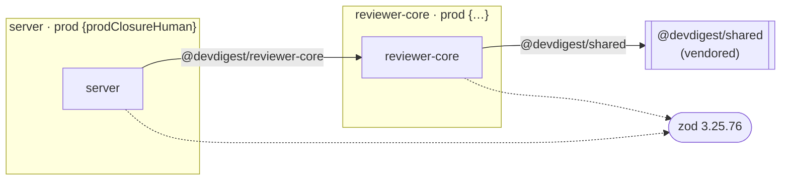

# Report template

Fill this skeleton **exactly**: same section numbers, headings, and column
order. Placeholders are `{…}`. Drop a section's table only when the JSON has
nothing for it, and write `_None found._` in its place. Never delete a heading.

Formatting rules:
- Sizes use the `*Human` strings from the JSON; never re-compute them.
- Sort tables by size, largest first, unless the section says otherwise.
- Package names, dep names, commands, and paths go in `code`.
- Keep prose to one or two sentences per section. The tables carry the content.

---

````markdown
# Dependency report — {YYYY-MM-DD}

| Mode | Packages | Installed | Declared deps | Total `node_modules` |
|------|----------|-----------|---------------|----------------------|
| {offline/online} | {summary.packages} | {summary.installed} | {summary.declaredDeps} | {summary.totalNodeModulesHuman} |

## 1. TL;DR

- {3–5 bullets: the biggest risk, the heaviest package, the main quick win, anything not measurable}

**Findings:** 🔴 P0 × {n} · 🟠 P1 × {n} · 🟡 P2 × {n} · ⚪ P3 × {n}

## 2. Dependency map



Legend: solid arrow = internal edge (tsconfig path alias) · dashed arrow = external
prod dep · 🟥 red = drift or out-of-sync copy · 🟨 amber = dominates its package's prod closure.

## 3. Package overview

| Package | Manager | Prod / Dev | Prod closure | Dev-only | `node_modules` | Flags |
|---------|---------|-----------:|-------------:|---------:|---------------:|-------|
| `{id}` | {manager} | {counts.prod} / {counts.dev} | {prodClosureHuman} | {devOnlyHuman} | {nodeModulesHuman} | {flags or —} |

## 4. Per-package detail

### 4.{n} `{package id}` — {one-line role, e.g. "Fastify API"}

| Dependency | Type | Category | Version | Own | Closure | Transitive | Used via | Notes |
|------------|------|----------|---------|----:|--------:|-----------:|----------|-------|
| `{name}` | {type} | {category} | {installed} | {ownSizeHuman} | {closureSizeHuman} | {transitiveCount} | {usedVia, import count} | {notes or —} |

{Repeat 4.n for each package. A package flagged `not-installed` gets a one-line note instead of size columns.}

## 5. Cross-package

### 5.1 Internal edges

| From | To | Via | Kind |
|------|----|-----|------|
| `{from}` | `{to}` | `{via}` | {cross-package / vendored-self / pins-external} |

### 5.2 Vendored copies

| Alias | Copies | In sync | Differing files |
|-------|--------|---------|-----------------|
| `{alias}` | `{dir}`, `{dir}` | ✅/❌ | `{file}`, … |

### 5.3 Version drift

| Dependency | Versions per package | Major mismatch | Shared-contract risk |
|------------|---------------------|----------------|----------------------|

### 5.4 Duplicate installs

| Dependency | Version | Packages | Apparent extra | Real disk cost |
|------------|---------|----------|---------------:|----------------|
| `{name}` | {version} | {packages} | {wastedHuman} | {"≈0 (pnpm hardlinks)" or wastedHuman} |

### 5.5 Vulnerabilities (online mode only; otherwise write `_Not checked (offline run)._`)

Group by `module` + fix version. Prod exposure first, then severity.

| Package | Module | Severity | Exposure | Introduced by | Advisory | Fixed in |
|---------|--------|----------|----------|---------------|----------|----------|
| `{pkg}` | `{module}` | {critical/high/…} | {prod/dev} | `{introducedBy}` | {title (n advisories)} | {patched} |

Summary line per package: `{summary}` counts, plus `prodHighCritical`.

### 5.6 Outdated (online mode only)

List only `majorBehind` rows. Count the minor/patch rows instead of listing them.

| Package | Dependency | Current | Latest | Type |
|---------|------------|---------|--------|------|

## 6. Size breakdown

### 6.1 Heaviest dependencies (repo-wide, by closure)

| # | Dependency | Package | Type | Closure | Transitive |
|--:|------------|---------|------|--------:|-----------:|

### 6.2 By category

| Category | Deps | Own size (sum) |
|----------|-----:|---------------:|

## 7. Prioritized recommendations

| ID | Pri | Package | Finding | Evidence | Action | Effort | Risk |
|----|-----|---------|---------|----------|--------|--------|------|
| DEP-01 | 🔴 P0 | `{pkg}` | {finding} | {numbers} | `{command or edit}` | S/M/L | {risk} |

### Quick wins

{Bullet list of the S-effort P1–P2 IDs with a one-line why. These are what a developer can do today.}

## 8. Appendix

- **Method:** `collect-deps.mjs` ({durationMs} ms) reads `package.json`,
  lockfiles, `node_modules` (resolving pnpm symlinks), and tsconfig `paths`,
  then regex-scans source for imports. Offline unless marked online.
- **Limits:** sizes are apparent on-disk bytes, not bundle bytes · usage scan
  is regex-based, so dynamic `require(variable)` is invisible · pnpm
  duplicates share physical disk through hardlinks.
- **Raw data:** `{path to deps.json}`
````
