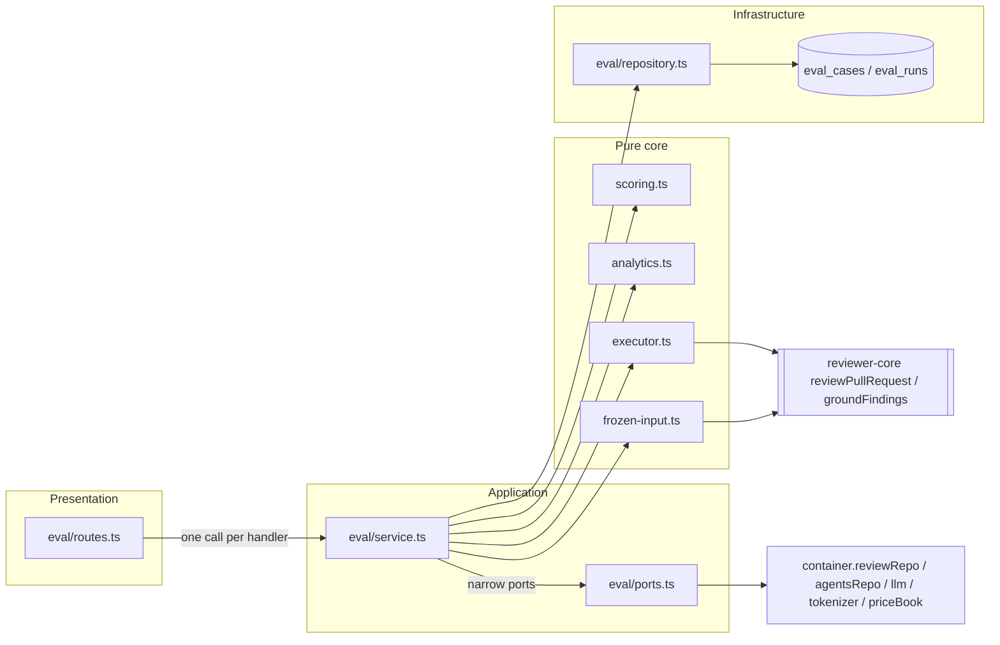
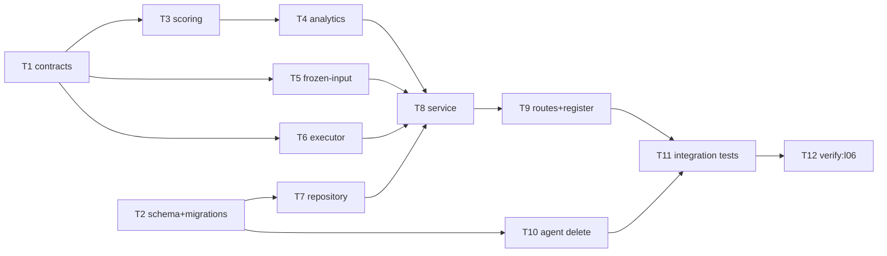
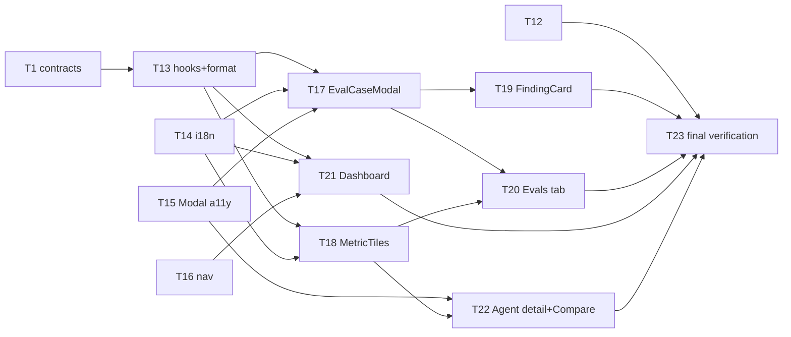

# Implementation Plan: Eval Pipeline (L06)

## Overview

A regression harness for DevDigest's own review agents. A reviewer turns an accepted/dismissed
finding into an eval case through a two-step modal (draft → warm-up dry run → Save/Cancel). An
agent is then run against its whole case set as one suite run (`POST /agents/:id/eval-runs`),
and the run is scored entirely in code: recall, precision, and citation accuracy. Two runs can
be compared side by side, including a diff of their system prompts. The Agent editor gets an
Evals tab, and the sidebar gets a workspace-level Eval Dashboard.

Source: `specs/cross-module/SPEC-03-eval-pipeline.md` (SPEC-03; AC-1 … AC-59 plus AC-33a/b/c;
AC-37 deferred by N12). The spec is the source of truth. This plan does not edit it.

> **Disambiguation (normative, from the spec):** the repo-root `evals/` directory and the
> `.github/workflows/eval-*.yml` workflows are a different system (the Claude Code harness
> evals). No task in this plan reads, writes, or imports anything under `evals/` (N13).

## Execution mode

**multi-agent (parallel). Confirmed by the user.** Multi-agent fits because the feature splits along clean seams:

- one contract task and one schema task,
- four pure server units (scoring, analytics, frozen input, executor) that can run fully in
  parallel,
- the server module wiring,
- four client foundations (hooks, i18n, Modal a11y, nav) followed by five client surfaces.

Every file is owned by exactly one task. The contended files (`vendor/shared/index.ts` ×2,
`server/src/modules/index.ts`, `client/src/lib/hooks/index.ts`, `client/messages/en/eval.json`,
`client/src/vendor/ui/kit/Modal.tsx`, `server/package.json`) each belong to a single task.

If you'd rather run it **single-agent**, work the tasks in numeric order (T1 → T23) without
changes. The `Owned paths` constraint just stops mattering.

## Requirements (verified)

Restated from SPEC-03. The EARS ACs are authoritative, and every AC appears in the traceability
table at the end. Settled user decisions (not reopened): agents only (N3); no Promote action (N12 /
AC-37); **no seeded eval cases**, so the ≥ 8 cases come from real triaged findings via the modal
and tests use their own fixtures; two-step case creation; code-only scoring; `reviewer-core`
unchanged; `POST /agents/:id/eval-runs` exists; `verify:l06` lives in `server/package.json`; both
`vendor/shared` copies are edited identically.

- **R1 — Case creation from a finding (AC-1 … AC-12, D12, D13).**
  - "Turn into eval case" on FindingCard is enabled only for accepted or dismissed findings.
  - It opens EvalCaseModal pre-filled from a **read-only** draft endpoint: kebab name, Diff /
    Files / PR meta tabs holding the frozen input, and the expectation (`must_find` if accepted,
    `must_not_flag` if dismissed). The expectation carries the finding's file, lines, severity,
    category, and title.
  - The expectation editor validates live (Save and Run case are disabled while it's invalid) and
    has a skeleton helper.
  - Run case is a dry run that persists nothing.
  - Save creates exactly one case with `source_finding_id` set. The optional Run-on-save records
    the case's latest single-case result. Cancel discards the draft.
  - An expectation whose lines hit no hunk of the frozen diff is refused, and the check reuses
    `groundFindings`.
  - There is one case per (finding, agent): re-opening the same finding opens the existing case
    in edit mode.
  - The case is independent of later re-triage.
- **R2 — Case management (AC-13, AC-14, D18).** Name, notes, frozen input, and expectation are
  editable in the same modal. Delete requires confirmation. An invalid edit is rejected with the
  field named and the stored case left unchanged. Edits and deletes never rewrite past runs.
- **R3 — Suite run (AC-15 … AC-21, D2, D4, D5, D9, D10, D15).**
  - `POST /agents/:id/eval-runs` creates a `running` row recording the agent version and covered
    case ids, returns immediately, and executes every case in the background through
    `reviewPullRequest` and the grounding gate. The client polls.
  - The eval prompt contains only: system prompt, model, strategy, enabled linked skill bodies,
    and the case's frozen diff and PR meta. It has no repo map, callers, project context, live PR,
    or intent.
  - With unchanged config, model input is byte-identical across runs.
  - A failing case is marked `errored` with a reason and excluded from the metrics, and the run
    still completes.
  - Only one run per agent can be in flight, after reconciling stale runs (all `running` rows on boot; >15 min on run start).
  - Requests fail with a 4xx for no cases, no provider key, or a run already in flight.
  - Run triggers are rate-limited.
- **R4 — Scoring, zero LLM calls (AC-22 … AC-29, D6, D7).** A match is file equality plus an
  inclusive line-range intersection, over **grounded** findings only.
  - Pass rules: a `must_find` case passes on ≥ 1 match; a `must_not_flag` case passes on 0
    matches.
  - `recall` = passed `must_find` / scored `must_find`.
  - `precision` = 1 − FP / total grounded findings, where FP counts grounded findings in
    `must_not_flag` cases that match.
  - `citation_accuracy` = kept / (kept + dropped).
  - A zero denominator gives `null`. The run stores the full per-case record listed in AC-29.
- **R5 — Cost (AC-30 … AC-32, D11).** A no-LLM estimate endpoint backs the pre-run statement.
  "Run all agents" requires a confirmation stating agents × cases and reports per agent. Cost and
  duration are shown after a run. Looking never costs anything.
- **R6 — Demonstration (AC-33a/b/c).** One suite run scores ≥ 8 real cases (at least one of each
  type). A prompt change gets a distinct version, and the comparison shows a visible delta. A
  sabotaged prompt lowers precision.
- **R7 — Compare (AC-34 … AC-36).**
  - Compare is enabled only when exactly 2 runs are selected.
  - It shows old, new, and Δ with ▲/▼ plus text for recall, precision, citation, and cost.
  - Case-set drift is stated (added and removed cases named) and deltas are computed over the
    common scored cases.
  - A line diff of the two versions' system prompts is shown, or the text "unchanged".
- **R8 — AgentEditor Evals tab (AC-38 … AC-41).**
  - Tab placed after Config / Skills / Context.
  - Metric tiles with deltas, plus a Traces-passed tile.
  - "View full dashboard →" link.
  - Cases header showing "N / M passing", Run all evals, and New eval case.
  - Case rows with state icon + text, "expected X, got Y", a tag, and Run / Edit / Delete.
  - Run history.
- **R9 — Eval Dashboard (AC-42 … AC-47).**
  - Sidebar entry under SKILLS LAB pointing to `/eval`.
  - Agents table: model, last run, passed/total, sparkline, latest metrics.
  - Recent runs across all agents.
  - A non-ranking statement and Run all agents.
  - `/eval/agents/:id` detail page: selector, Run eval, tiles with deltas, a three-line trend
    chart plus a table equivalent, a runs table with checkboxes, and Compare.
  - A derived banner that never asserts a cause.
- **R10 — Empty / degraded states (AC-48 … AC-51).** No cases → how-to text and no metrics. No
  completed run → "never run". Exactly one run → no deltas, compare disabled, and a "second run
  needed" note. An errored run → reason shown, and the run is never used as "latest".
- **R11 — Contracts, security, a11y (AC-52 … AC-58).**
  - The two vendored copies are identical for the eval contracts.
  - Frozen input reaches the model only under the existing `wrapUntrusted` / `INJECTION_GUARD`.
  - Every user- and model-authored string renders as text.
  - The expectation is boundary-validated data with size limits.
  - Cross-workspace access returns 404 and does nothing.
  - No colour-only signals; the trend has a table equivalent.
  - Keyboard-operable flows, a focus-trapped modal that closes on Escape, and an `aria-live`
    status.
- **R12 — Verification (AC-59, D21).** `cd server && pnpm verify:l06` exists and is green. It
  covers migrations, contract parity, the route surface (draft and dry run write nothing), and the
  scoring suite. DB-backed checks self-skip without Docker.
- **NFRs.**
  - Logs contain ids, counts, metrics, model, tokens, and cost, never diff, expectation, or
    finding prose.
  - Scoring never refetches.
  - The suite run doesn't block its HTTP request.
  - No existing route or behaviour changes (N7).
  - Onion layering with static module registration and `.js` relative imports.

### Verified against the repo

| Spec / brief claim | Verified |
|---|---|
| Reserved tables, unused | `server/src/db/schema/eval.ts:7-35`. Only consumers are the `db/schema.ts` barrel (`:37`, `:74-75`). `eval_runs.case_id` is `NOT NULL` FK (`:24-26`). |
| Reserved contracts, unused | `knowledge.ts` Eval block (`EvalPerTrace`, `EvalRun`, `EvalOwnerKind`, `EvalCase`) and `eval-ci.ts` Eval section (`EvalCaseInput`, `EvalRunRecord`, `EvalRunResult`, `EvalTrendPoint`, `EvalDashboard`). The **only** consumer in any package is `server/test/contracts.test.ts:14,157-167` (an `EvalRun` fixture with `per_trace`). |
| Vendored copies already drift | `diff -rq` shows `adapters.ts`, `contracts/eval-ci.ts`, `contracts/knowledge.ts`, `contracts/platform.ts`, `contracts/productionize.ts`, `contracts/trace.ts` differ. In `eval-ci.ts` and `knowledge.ts` the drift is outside the Eval blocks (`AgentManifest`, `openrouter`, `AgentVersion*`, comments). `index.ts` is identical. |
| Triage routes and timestamps | `server/src/modules/reviews/routes.ts:150-156`. `findings.accepted_at` / `dismissed_at` at `server/src/db/schema/reviews.ts:44-45`. Accept and dismiss are mutually exclusive (`review.repo.ts:119-144` nulls the other). |
| Finding → agent | `reviews.agent_id` (nullable) at `server/src/db/schema/reviews.ts:17`. `findings` has no `workspace_id`, so scope via `container.reviewRepo.findingContext(id)` → `{finding, review, pull}` (`review.repo.ts:103-117`) and check `pull.workspaceId`. |
| `pr_files.patch` hunks only | `server/src/db/schema/pulls.ts:44`. Header synthesis precedent: `server/src/modules/reviews/diff-loader.ts:33-44` (`diff --git` / `---` / `+++` + patch → `parseUnifiedDiff`, `adapters/git/diff-parser.ts:14`). |
| Engine entry point and outcome | `reviewPullRequest` at `reviewer-core/src/review/run.ts:128`. `ReviewOutcome.review.findings` = kept, `.dropped` = dropped with reason, plus `tokensIn` / `tokensOut` / `costUsd` / `assembly`. `groundFindings` is exported from `reviewer-core/src/index.ts:23`. |
| Live enrichment to exclude | `server/src/modules/reviews/run-executor.ts:200-330`: callers digest, repo map, rank note, project-context `specs`, live `pull.body`, `intentBlock`, `taskLine(pull)`. |
| Prompt section headings (for AC-16 assertions) | `reviewer-core/src/prompt.ts:114-130`: `## PR description`, `## Skills / rules`, `## Repo skeleton`, `## Project context`, `## Callers of changed symbols`, `## Intent`, `## Diff to review`. |
| Agent version snapshots | `agent_versions` at `server/src/db/schema/agents.ts:39-49`. `configJson.system_prompt` written by `AgentsRepository.snapshotVersion` (`agents/repository.ts:148-168`). `getVersion(agentId, version)` at `:181`. `linkedSkills` at `:192`. |
| Agent delete | `AgentsRepository.deleteById` at `agents/repository.ts:76-83`. Versions and skill links cascade by FK. Nothing references `eval_cases` (polymorphic `owner_id`, no FK). |
| Rate limit | Global `@fastify/rate-limit` registered only when `nodeEnv !== 'test'` (`server/src/app.ts:95-97`). Per-route precedent: `config: { rateLimit: { max: 10, timeWindow: '1 minute' } }` (`intent/routes.ts:36`). |
| Error classes | `AppError(code, message, status, details)`, `NotFoundError` 404, `ValidationError` 422, `ConfigError` **500** (`server/src/platform/errors.ts`). So a missing provider key must be **re-mapped to a 4xx** for AC-20. |
| Boot-time reaper precedent | `server/src/app.ts:80-85` (`ReviewService.reapStaleRuns`, wrapped non-fatally; `routes-smoke.test.ts` boots with no DB). |
| Tokenizer and pricing for the estimate | `container.tokenizer.count(text)` (`adapters/tokenizer/index.ts:16`). `container.priceBook.estimate(model, in, out): number \| null` (`platform/price-book.ts:34`). |
| LLM mock | `MockLLMProvider` (`server/src/adapters/mocks.ts:59-111`) returns one fixture per `schemaName`. It **cannot vary per case**, so per-case behaviour needs a small test-local `LLMProvider` stub. |
| Client reserved slots | `client/messages/en/eval.json` (unwired namespace). `shell.json:24` `nav.eval`. `agents.json:50` `editor.tabs.evals`. `client/src/components/app-shell/helpers.ts:35` already maps `/eval*` → `"eval"`. `NAV` in `client/src/vendor/ui/nav.ts` has no eval item. `TABS` in `AgentEditor/constants.ts`. `VALID_TABS` derives from `TABS` (`agents/[id]/page.tsx:16`). |
| Modal primitive | `client/src/vendor/ui/kit/Modal.tsx` has `role="dialog"` but **no focus trap, no Escape handling, no `aria-labelledby`**, so AC-58 needs it. Consumers: CreateSkillModal ×2, CreateAgentModal, PromptBlock, VersionsTab, Showcase. |
| Charts | `client/src/vendor/ui/charts/{LineChart,Sparkline,MetricCard,BarRow}.tsx`. |
| Icons available | `FlaskConical`, `Play`, `Pencil`, `Trash`, `Plus`, `Check`, `X`, `AlertTriangle`, `TrendingUp`, `BarChart`, `Gauge`. |
| `server/package.json` | Not `skip-worktree` in this checkout (`git ls-files -v` → `H`), despite `server/CLAUDE.md`'s note, so `verify:l06` can be committed. |
| Real data for the demo | 0 triaged findings locally, but 615/621 `pr_files` rows have patch text (per brief). Real cases are feasible after a review plus triage. |

## Open questions & recommendations

`AskUserQuestion` isn't available here, so every plan-shape choice below already has a default
baked into the tasks. Override any of them before dispatch. None of them is requirement substance.

- **Q1: execution mode.** → default: **multi-agent**. Single-agent works unchanged in T-order.
- **Q2: where per-case outcomes live (D2 leaves it open).** → default: a **`per_case jsonb`
  array on the `eval_runs` row**, with no child table. Rationale: runs are immutable after
  completion (D18) and are always read whole; compare and banner recompute from that array. The
  array is written **incrementally** after each case, so polling also shows progress
  (`per_case.length / case_ids.length`). That covers AC-31's "report progress" without a new
  field.
- **Q3: where the reshaped contracts live.** → default: a **new file `contracts/eval.ts`** in both
  vendored copies, byte-identical. Delete the old Eval block from `knowledge.ts` and the Eval
  section from `eval-ci.ts` in both copies (otherwise the barrel's `export *` would collide on
  `EvalRun` / `EvalCase`). Rationale: `knowledge.ts` and `eval-ci.ts` already drift between
  copies (see the table above). A dedicated file can be compared **byte-for-byte** by the AC-52
  test, and removing two identical blocks from both copies narrows the existing drift rather than
  widening it. **This is an edit to existing shared contracts and is called out explicitly.** The
  only affected consumer is `server/test/contracts.test.ts`, which T1 updates.
- **Q4: column naming for the expectation.** → default: **keep the DB column `expected_output`**
  and expose it as `expectation` in the DTO (mapped in `eval/helpers.ts`). This avoids a drop+add
  on `eval_cases` and keeps drizzle-kit's rename prompt off that table entirely.
- **Q5: D15 on boot.** → **decided (user): reap all.** On boot, every `running` eval row is
  marked `errored` with `error_reason: 'interrupted'`, the same way `app.ts:80-85` reaps
  `agent_runs`. Before a run-start for an agent, that agent's `running` rows older than 15 min are
  also marked `errored`. Spec D15 was updated to match.
- **Q6: run-all estimate.** → default: the confirmation states **executions = Σ cases_total over
  agents with ≥ 1 case**, computed from the dashboard payload (`EvalAgentSummary.cases_total`). No
  cost is shown for run-all because AC-31 only requires executions. The single-agent estimate
  (AC-30) does include cost.
- **Q7: case execution concurrency.** → default: **sequential** within a suite run, with a
  **120 s per-case timeout** (timeout → that case is `errored: 'timeout'`). Rationale: this keeps
  the run deterministic, is gentle on provider rate limits, and keeps cost predictable. Different
  agents may still run at the same time (edge case "Two different agents run simultaneously").
- **Q8: missing provider key → status code.** → default: **422** `eval_provider_key_missing`. A
  run already in flight returns **409** `eval_run_in_flight` with `details.run_id`. No cases
  returns **422** `eval_no_cases`.
- **Rec A: banner as structured data, not a server sentence.** `EvalBanner` =
  `{metric, direction, delta_pts, version, flipped[]}` and the client renders it through i18n.
  It stays fully deterministic (D16) and translatable.
- **Rec B: list payloads omit `per_case`.** History, dashboard, and detail lists use
  `EvalRunSummary` (= `EvalRunRecord` minus `per_case`). Only `GET /eval-runs/:id` and compare
  return full records.
- **Rec C: DB-level in-flight guard.** A partial unique index `eval_runs (agent_id) WHERE status =
  'running'` makes AC-19 race-proof: two concurrent POSTs can't both insert. The service maps the
  unique-violation to 409.
- **Rec D: migration zero-row guard.** Hand-append a `DO $$ … RAISE EXCEPTION …` guard to the
  first eval migration that aborts if `eval_cases` or `eval_runs` has any rows. This makes D1's
  "re-confirm zero rows before adding `NOT NULL`" mechanical rather than a manual step.
- **Rec E: compare lives on `/eval/agents/:id`.** The Evals tab shows run history (AC-41) and
  links to the detail page for compare. US-8 is satisfied there, and building a second compare
  entry point would duplicate state.
- **Skill-body edits don't bump the agent version** → **decided (user): accepted as known
  limitation L1** in the spec. No per-run skills digest is built this slice.

## Affected modules & contracts

- **server**
  - new `modules/eval/` (routes, service, repository split by aggregate, pure scoring, analytics,
    frozen input, and executor)
  - reshaped `db/schema/eval.ts` plus 2 migrations
  - row types in `db/rows.ts`
  - registration in `modules/index.ts`
  - agent delete removes eval cases (`agents/repository.ts`)
  - `verify:l06` script
- **client**
  - FindingCard button
  - shared `components/eval/` (EvalCaseModal, MetricTiles)
  - AgentEditor Evals tab
  - `/eval` and `/eval/agents/[id]` routes
  - hooks
  - i18n
  - nav entry
  - Modal a11y
- **reviewer-core**: **no change** (consumer only; `git diff reviewer-core/` stays empty).
- **e2e / mcp-server / `evals/`**: no change (N9, N10, N13).
- **Contracts (`@devdigest/shared`, both copies, identical):**
  - **Add:** `contracts/eval.ts`.
  - **Edit (explicit callout):**
    - remove the Eval block from `contracts/knowledge.ts`
    - remove the Eval section from `contracts/eval-ci.ts` and drop `EvalRun` / `EvalOwnerKind`
      from its import line
    - add `export * from './contracts/eval.js';` to `index.ts`

### Contract shapes (`contracts/eval.ts`)

All shapes are Zod. Limits enforce AC-55.

```
EvalOwnerKind        = enum('skill','agent')                       // kept; only 'agent' used (N3)
EvalExpectationType  = enum('must_find','must_not_flag')
EvalExpectation      = strict object { type, file: str 1..500, start_line: int ≥1,
                        end_line: int ≥1, severity?: Severity, category?: str ≤64,
                        title?: str ≤300 } refine(end_line ≥ start_line, path ['end_line'])
EvalCaseMeta         = { pr_number: int|null, title: str ≤500, body: str ≤20000 | null }
EvalCaseInput        = { name: str 1..120, input_diff: str 1..200000,
                        input_files: str(1..500)[] 1..20, input_meta: EvalCaseMeta,
                        expectation: EvalExpectation, notes?: str ≤4000 | null,
                        source_finding_id?: uuid | null }
EvalActualFinding    = { file, start_line, end_line, severity, category, title, matched: bool }
EvalCaseStatus       = enum('scored','errored')
EvalCaseOutcome      = { case_id: str|null (null for a draft dry run), name, expectation_type,
                        status, pass: bool|null, error_reason: str|null,
                        findings_total /* grounded */, findings_matched,
                        grounding_kept, grounding_total /* kept+dropped */,
                        duration_ms, cost_usd: num|null, actual: EvalActualFinding[] }
EvalCase             = { id, owner_kind, owner_id, name, input_diff, input_files, input_meta,
                        expectation, source_finding_id: str|null, notes: str|null,
                        created_at, updated_at, last_result: EvalCaseOutcome|null,
                        last_result_at: str|null }
EvalCaseDraft        = EvalCaseInput & { agent: {id, name}, source_triage: 'accepted'|'dismissed',
                        existing_case_id: str|null }
EvalDryRunInput      = union( strict {case_id: uuid}, strict {draft: EvalCaseInput} )
EvalDryRunResult     = EvalCaseOutcome
EvalRunStatus        = enum('running','completed','errored')
EvalRun              = { recall|null, precision|null, citation_accuracy|null (each 0..1),
                        traces_passed, traces_total, cases_errored, duration_ms,
                        cost_usd|null, per_case: EvalCaseOutcome[] }
EvalRunRecord        = EvalRun & { id, agent_id, agent_version: int, status,
                        error_reason|null, ran_at, finished_at|null, case_ids: str[] }
EvalRunSummary       = EvalRunRecord.omit({per_case}) & { cases_done: int }
EvalRunEstimate      = { cases, executions, est_cost_usd: num|null }
EvalRunAllResult     = { results: { agent_id, agent_name, run_id: str|null,
                        error: {code, message}|null }[] }
EvalMetricDelta      = { old: num|null, new: num|null, delta: num|null }
EvalCompare          = { old: EvalRunRecord, new: EvalRunRecord, common_cases: int,
                        metrics: { recall, precision, citation_accuracy, cost_usd: EvalMetricDelta },
                        case_set: { same: bool, added: {case_id,name}[], removed: {case_id,name}[] },
                        prompt: { old_version, new_version, unchanged: bool,
                                  diff: { op: 'equal'|'add'|'remove', line: str }[] } }
EvalTrendPoint       = { run_id, ran_at, agent_version, recall|null, precision|null,
                        citation_accuracy|null, pass_rate|null, cost_usd|null }
EvalBanner           = { metric: 'recall'|'precision'|'citation_accuracy',
                        direction: 'up'|'down', delta_pts: num, version: int,
                        flipped: { case_id, name, from_pass: bool, to_pass: bool }[] }
EvalAgentSummary     = { agent_id, name, model, provider, cases_total,
                        last_run: EvalRunSummary|null, trend: EvalTrendPoint[] }
EvalDashboard        = { agents: EvalAgentSummary[],
                        recent_runs: (EvalRunSummary & { agent_name })[] }
EvalAgentDetail      = { agent: {id,name,model,provider,version}, cases_total,
                        latest: EvalRunSummary|null, previous: EvalRunSummary|null,
                        delta: { recall, precision, citation_accuracy: num|null /* points */ },
                        trend: EvalTrendPoint[], runs: EvalRunSummary[], banner: EvalBanner|null }
```

### Endpoints (module `eval`, all workspace-scoped via `getContext`)

| Method & path | Service method | Writes | LLM | Rate limit |
|---|---|---|---|---|
| `GET /findings/:id/eval-case-draft` | `getDraftForFinding` | none | no | global |
| `POST /agents/:id/eval-cases/dry-run` | `dryRun` | saved case: `last_result` only | yes | 20/min |
| `GET /agents/:id/eval-cases` | `listCases` | none | no | global |
| `POST /agents/:id/eval-cases` | `createCase` (201) | 1 case | no | global |
| `GET /eval-cases/:id` | `getCase` | none | no | global |
| `PUT /eval-cases/:id` | `updateCase` | 1 case | no | global |
| `DELETE /eval-cases/:id` | `deleteCase` | 1 case | no | global |
| `GET /agents/:id/eval-runs/estimate` | `estimateRun` | none | no | global |
| `POST /agents/:id/eval-runs` | `startRun` (202) | 1 run (+ case `last_result`s) | yes | 5/min |
| `GET /agents/:id/eval-runs` | `listRuns` | none | no | global |
| `GET /eval-runs/compare?a=&b=` | `compare` | none | no | global |
| `GET /eval-runs/:id` | `getRun` | none | no | `rateLimit: false` (polled) |
| `POST /eval-runs/all` | `startAll` | N runs | yes | 2/min |
| `GET /eval/dashboard` | `dashboard` | none | no | global |
| `GET /eval/agents/:id` | `agentDetail` | none | no | global |

The static `/eval-runs/compare` route is registered before the parametric `/eval-runs/:id`.
Fastify prefers static segments anyway; the `:id` param is `z.string().uuid()`.

## Architecture changes



- **`server/src/db/schema/eval.ts` (Infrastructure)**
  - Reshape `evalCases`: add `sourceFindingId uuid NULL` (no FK; the case outlives the finding,
    D8), `lastResult jsonb NULL`, `lastResultAt timestamptz NULL`, `createdAt` / `updatedAt`
    `timestamptz NOT NULL DEFAULT now()`, set `inputDiff` / `expectedOutput` `NOT NULL`, and
    `inputFiles` / `inputMeta` `NOT NULL`.
  - Indexes on `evalCases`: `(workspace_id, owner_kind, owner_id)`, plus a **unique**
    `(owner_kind, owner_id, source_finding_id)` (NULLs distinct by default, so manual cases with
    a null source are unrestricted) for D13.
  - Reshape `evalRuns`: drop `case_id`, `actual_output`, `pass`. Add `workspaceId` (FK
    workspaces, cascade), `agentId uuid NOT NULL` (FK `agents.id` ON DELETE CASCADE, so D14 for
    runs), `agentVersion int NOT NULL`, `status text enum NOT NULL DEFAULT 'running'`,
    `errorReason text`, `finishedAt timestamptz`, `caseIds jsonb NOT NULL`,
    `tracesPassed` / `tracesTotal` / `casesErrored int NOT NULL DEFAULT 0`,
    `perCase jsonb NOT NULL DEFAULT '[]'`. Keep `ranAt`, metrics, `durationMs`, `costUsd`.
  - Indexes on `evalRuns`: `(agent_id, ran_at)`, `(workspace_id, ran_at)`, and a partial unique
    index `(agent_id) WHERE status = 'running'` (Rec C).
- **Migrations:** two drizzle-kit passes, `0016_*` (add only) and `0017_*` (drop only). See T2.
- **`server/src/db/rows.ts`:** add `EvalCaseRow`, `EvalRunRow`.
- **`server/src/modules/eval/` (new feature module):**
  - `routes.ts`: Presentation. Fastify + Zod only, one service call per handler. Builds the ports
    from `app.container` and registers the boot reconcile via `app.addHook('onReady', …)`,
    wrapped non-fatally. **No `drizzle-orm` / `db/schema` import.**
  - `service.ts`: Application. `EvalService(container, ports)`; orchestration, 4xx mapping,
    background suite execution, logging (ids and numbers only).
  - `ports.ts`: narrow interfaces. `FindingSource` (`findingContext`, `getPrFiles`) and
    `AgentSource` (`getById`, `list`, `linkedSkills`, `getVersion`), plus factory functions
    adapting `container.reviewRepo` / `container.agentsRepo`. These keep the eval module from
    importing the reviews or agents modules (dependency rule; only the container is used).
  - `repository.ts` + `repository/case.repo.ts` + `repository/run.repo.ts`: Infrastructure,
    Drizzle only. Every query takes `workspaceId`.
  - `helpers.ts`: row → DTO mapping (`caseRowToDto`, `runRowToRecord`, `runRowToSummary`).
  - `constants.ts`: `STALE_RUN_MS = 15*60_000`, `TREND_LIMIT = 20`, `RECENT_RUNS_LIMIT = 20`,
    `EST_OUTPUT_TOKENS = 1000`, rate-limit numbers.
  - `scoring.ts`: pure; `matches`, `scoreCase`, `aggregate`.
  - `analytics.ts`: pure; `compareRuns`, `diffPromptLines`, `deriveBanner`, `toTrend`,
    `latestTwoCompleted`, `deltaPts`.
  - `frozen-input.ts`: pure; `synthesizeFrozenDiff`, `slugifyCaseName`, `expectationFromFinding`,
    `buildDraft`, `checkExpectationGrounded` (reuses `groundFindings`).
  - `executor.ts`: `buildEvalReviewInput` (pure, deterministic) and `executeCase` (calls
    `reviewPullRequest`, applies the timeout, maps errors).
- **`server/src/modules/index.ts`:** import and register `eval`.
- **`server/src/modules/agents/repository.ts`:** `deleteById` runs in a transaction that first
  deletes `eval_cases` where `owner_kind = 'agent' AND owner_id = id AND workspace_id = ws`
  (D14). Runs go via FK cascade.
- **client:**
  - `src/lib/hooks/eval.ts` (all eval queries and mutations; run polling via `refetchInterval`
    while `status === 'running'`), `src/lib/eval-format.ts` (pct / points / ▲▼ / n/a formatting,
    pure).
  - Shared (≥ 2 routes consume them): `src/components/eval/EvalCaseModal/` (PR page and Agent
    editor) and `src/components/eval/MetricTiles/` (Evals tab and agent detail).
  - Route-colocated: `agents/[id]/_components/AgentEditor/_components/EvalsTab/`,
    `app/eval/page.tsx` + `_components/EvalDashboardView/`,
    `app/eval/agents/[id]/page.tsx` + `_components/EvalAgentDetailView/` (incl. `CompareModal`).
  - `page.tsx` files stay thin; `"use client"` only on interactive leaves/views.
  - `src/vendor/ui/kit/Modal.tsx`: additive a11y (focus trap, Escape → `onClose`,
    `aria-labelledby`, restore focus).
  - `src/vendor/ui/nav.ts`: add `{ key: "eval", label: "Eval Dashboard", icon: "FlaskConical",
    href: "/eval", gKey: "e" }` to SKILLS LAB, plus a `g e` shortcut.

## Dependency DAG





Waves of concurrently runnable tasks:

| Wave | Tasks |
|---|---|
| 1 | T1, T2, T14, T15, T16 |
| 2 | T3, T5, T6, T7, T10, T13 |
| 3 | T4, T17, T18, T21 |
| 4 | T8, T19, T20, T22 |
| 5 | T9 |
| 6 | T11 |
| 7 | T12 |
| 8 | T23 |

Client tasks (T13–T22) depend only on the contract (T1), so they run against mocked fetch and
proceed alongside the server work.

## Phased tasks

### Phase 0: Contracts and schema (serialization point)

- **T1: Shared eval contracts (both vendored copies)**
  - **Action:**
    1. Create `contracts/eval.ts` with every shape in *Contract shapes* above, in **both**
       `server/src/vendor/shared/contracts/eval.ts` and `client/src/vendor/shared/contracts/eval.ts`,
       with identical bytes. Import `Severity` from `./findings.js`.
    2. In both copies, delete the `// ---- Eval ----` block from `contracts/knowledge.ts`
       (`EvalPerTrace`, `EvalRun`, `EvalOwnerKind`, `EvalCase`).
    3. In both copies, delete the `Eval — case input + persisted run record + dashboard` section
       from `contracts/eval-ci.ts`, and remove `EvalRun, EvalOwnerKind` from its `./knowledge.js`
       import, leaving the rest of each copy's (already divergent) import line untouched.
    4. Add `export * from './contracts/eval.js';` to both `index.ts` files and update their header
       comment.
    5. Update `server/test/contracts.test.ts` so `EvalRun` parses the new shape (`per_case`
       outcome with `status: 'scored'`, nullable metrics).
    6. Add `server/test/eval-contract-parity.test.ts`. It must check that:
       - the two `contracts/eval.ts` files are byte-identical;
       - neither copy of `knowledge.ts` / `eval-ci.ts` contains `export const Eval`;
       - both `index.ts` files are byte-identical;
       - `EvalExpectation` rejects `type: 'maybe'` (issue path `['type']`), `start_line: 1.5`
         (`['start_line']`), `end_line < start_line` (`['end_line']`), and an unknown key;
       - `EvalCaseInput` rejects `input_diff` longer than 200 000 characters.
  - **Module:** server + client (vendored contracts) · **Type:** backend
  - **Skills to use:** zod, typescript-expert, onion-architecture (boundary DTOs)
  - **Owned paths:** `server/src/vendor/shared/contracts/eval.ts`,
    `client/src/vendor/shared/contracts/eval.ts`, `server/src/vendor/shared/contracts/knowledge.ts`,
    `client/src/vendor/shared/contracts/knowledge.ts`, `server/src/vendor/shared/contracts/eval-ci.ts`,
    `client/src/vendor/shared/contracts/eval-ci.ts`, `server/src/vendor/shared/index.ts`,
    `client/src/vendor/shared/index.ts`, `server/test/contracts.test.ts`,
    `server/test/eval-contract-parity.test.ts`
  - **Depends-on:** none · **Risk:** medium (existing shared contract edit; called out above)
  - **Known gotchas:**
    - The copies already drift (`server/INSIGHTS.md` 2026-10-10). Edit each copy's Eval block in
      place and **do not** copy one file over the other, which would silently rewrite unrelated
      drift.
    - Use `z.number().int()` (no `.default()`) on fields fixtures must literally carry
      (`client/INSIGHTS.md` 2026-09-20: `.default()` makes the inferred type non-optional and
      breaks literals).
    - Watch for smart apostrophes in nearby comments (`server/INSIGHTS.md` 2026-09-27).
  - **Acceptance:**
    - `diff server/src/vendor/shared/contracts/eval.ts client/src/vendor/shared/contracts/eval.ts`
      prints nothing.
    - `cd server && pnpm typecheck` passes and `cd client && pnpm typecheck` passes.
    - `cd server && pnpm exec vitest run test/eval-contract-parity.test.ts test/contracts.test.ts`
      is green.
    - `grep -rn "EvalPerTrace\|per_trace" server/src client/src` returns nothing.

- **T2: Reshape `eval_cases` / `eval_runs` and generate the migrations**
  - **Action:**
    1. Edit `server/src/db/schema/eval.ts` per *Architecture changes* (import `agents` from
       `./agents`; build the partial unique index with
       `uniqueIndex('eval_runs_one_running_per_agent').on(t.agentId).where(sql\`status = 'running'\`)`).
    2. **Pass A:** temporarily keep `caseId`, `actualOutput`, and `pass` in the schema and run
       `pnpm db:generate < /dev/null`. This produces `0016_*.sql`, which is purely additive.
    3. Hand-append the Rec D zero-row guard **at the top** of `0016_*.sql`:
       `DO $$ BEGIN IF EXISTS (SELECT 1 FROM eval_cases) OR EXISTS (SELECT 1 FROM eval_runs) THEN
       RAISE EXCEPTION 'eval tables not empty — reshape aborted'; END IF; END $$;--> statement-breakpoint`.
    4. **Pass B:** remove `caseId`, `actualOutput`, and `pass`, then run
       `pnpm db:generate < /dev/null`. This produces `0017_*.sql`, which is purely drops.
    5. Add `EvalCaseRow` / `EvalRunRow` to `src/db/rows.ts`.
    6. Add `server/test/eval-migrations.test.ts`, a no-Docker test that checks:
       - `_journal.json` lists both new tags;
       - `0016` contains the guard and creates `eval_runs_one_running_per_agent` with
         `WHERE status = 'running'`;
       - `0017` drops `case_id`, `actual_output`, and `pass`.
    7. Run `pnpm db:migrate` against the local DB.
  - **Module:** server · **Type:** backend
  - **Skills to use:** drizzle-orm-patterns, postgresql-table-design, onion-architecture
  - **Owned paths:** `server/src/db/schema/eval.ts`, `server/src/db/rows.ts`,
    `server/src/db/migrations/0016_*.sql`, `server/src/db/migrations/0017_*.sql`,
    `server/src/db/migrations/meta/_journal.json`, `server/src/db/migrations/meta/0016_snapshot.json`,
    `server/src/db/migrations/meta/0017_snapshot.json`, `server/test/eval-migrations.test.ts`
  - **Depends-on:** none · **Risk:** medium
  - **Known gotchas:**
    - drizzle-kit hangs on a non-TTY rename prompt when one generate both adds and drops columns
      on a table (`server/INSIGHTS.md` 2026-09-22). This is why there are two passes, each run
      with `< /dev/null`. If the command still blocks, kill it and re-split; never pipe answers.
    - pnpm 12's build-approval gate may block `pnpm db:generate`. Fallback:
      `node_modules/.bin/drizzle-kit generate < /dev/null` (`server/INSIGHTS.md` 2026-09-16).
    - Confirm the generated partial index actually carries `WHERE`; if drizzle 0.38 drops it,
      hand-write it into `0016`.
    - Migrations don't run on boot.
  - **Acceptance:**
    - `pnpm exec vitest run test/eval-migrations.test.ts` is green.
    - `pnpm db:migrate` exits 0 on the local DB, and `psql … -c '\d eval_runs'` shows no
      `case_id`, plus `agent_id`, `status`, `per_case`, and the partial index.
    - `pnpm typecheck` passes.

### Phase 1: Server pure core (T3, T5, T6 fully parallel; T4 after T3)

- **T3: Scoring (pure, zero LLM)**
  - **Action:** Create `server/src/modules/eval/scoring.ts`:
    - `matches(f, exp)`: `f.file === exp.file` and inclusive interval intersection
      (`f.start ≤ exp.end && exp.start ≤ f.end`, after normalising each range with `min`/`max`).
    - `scoreCase({ kept, droppedCount, expectation, caseMeta, durationMs, costUsd })` →
      `EvalCaseOutcome`:
      - `actual[]` carries `matched` flags;
      - `findings_total = kept.length`, `grounding_kept = kept.length`,
        `grounding_total = kept + dropped`;
      - pass rules per AC-23.
    - `erroredOutcome(caseMeta, reason, durationMs)`.
    - `aggregate(outcomes)` → `EvalRun` metrics:
      - errored outcomes are skipped entirely;
      - recall / precision / citation per AC-24 – AC-26, with `null` on a zero denominator
        (AC-28);
      - FP counts **findings**, not cases;
      - `traces_passed` / `traces_total` over scored cases; `cases_errored`;
      - sums of duration and cost, where cost is `null` if any scored case's cost is `null`.

    Add `server/test/eval-scoring.test.ts`.
  - **Module:** server · **Type:** core (pure, server-side)
  - **Skills to use:** typescript-expert, onion-architecture
  - **Owned paths:** `server/src/modules/eval/scoring.ts`, `server/test/eval-scoring.test.ts`
  - **Depends-on:** T1 · **Risk:** low
  - **Known gotchas:** Only grounded (kept) findings are matched (AC-27); dropped findings feed
    citation only. Never import an LLM type here.
  - **Acceptance:** `pnpm exec vitest run test/eval-scoring.test.ts` is green, with named tests:
    - "AC-23 must_find passes on one-line overlap"
    - "AC-23 must_not_flag passes with zero matches"
    - "AC-25 one must_not_flag case, four grounded findings, one overlapping → precision 0.75"
    - "AC-26 four produced, three kept → citation 0.75"
    - "AC-28 only must_not_flag cases → recall null"
    - "AC-28 zero findings → precision and citation null"
    - "AC-18 errored case excluded from numerators and denominators; cases_errored = 1"
    - "AC-27 dropped finding inside a must_not_flag range is not a false positive"
    - "file mismatch never matches"

- **T4: Analytics: compare, prompt diff, banner, trend (pure)**
  - **Action:** Create `server/src/modules/eval/analytics.ts`:
    - `compareRuns(older, newer, oldPrompt, newPrompt)` → `EvalCompare`:
      - orders by `ran_at`;
      - `case_set` from `case_ids` (added and removed names come from the run that has the case's
        `per_case` entry);
      - `common_cases` = case ids **scored** in both runs;
      - metrics are recomputed by calling `aggregate()` on each run's `per_case` filtered to the
        common ids;
      - deltas in raw units.
    - `diffPromptLines(a, b)`: an LCS line diff → `{op, line}[]`; `unchanged = a === b`.
    - `latestTwoCompleted(runs)`: ignores `running` / `errored` (AC-51).
    - `deltaPts(old, new)`: `(new − old) × 100`, rounded to 1 dp; `null` if either is `null`.
    - `deriveBanner(latest, previous)`:
      - the largest |delta| among the three metrics where both values are non-null, with ties
        broken in the order recall > precision > citation;
      - `null` when there are fewer than 2 completed runs or every delta is 0 or null;
      - `flipped` = common scored case ids whose `pass` differs; empty means no causal clause
        (D16).
    - `toTrend(runs)`: completed runs only, chronological, capped at `TREND_LIMIT`.

    Add `server/test/eval-analytics.test.ts`.
  - **Module:** server · **Type:** core · **Skills to use:** typescript-expert
  - **Owned paths:** `server/src/modules/eval/analytics.ts`, `server/test/eval-analytics.test.ts`
  - **Depends-on:** T3 · **Risk:** low
  - **Known gotchas:** Keep it a pure function of stored rows. No DB, no LLM (AC-22). The prompt
    diff must treat CRLF and LF the same (split on `/\r?\n/`).
  - **Acceptance:** `pnpm exec vitest run test/eval-analytics.test.ts` is green, with named tests:
    - "AC-35 different case sets: added/removed named, deltas over intersection"
    - "AC-35 errored case in one run narrows the intersection (D20)"
    - "AC-36 removed/added lines distinguished"
    - "AC-36 same version → unchanged true, diff empty"
    - "AC-47 move with no case transition yields flipped = []"
    - "AC-47 flipped case named"
    - "AC-51 errored latest is skipped"
    - "AC-50 single completed run → banner null, delta null"

- **T5: Frozen input and draft builder (pure)**
  - **Action:** Create `server/src/modules/eval/frozen-input.ts`:
    - `synthesizeFrozenDiff(path, patch)` →
      `diff --git a/p b/p\n--- a/p\n+++ b/p\n${patch}`. Returns `''` for a null or empty patch.
    - `slugifyCaseName(title)`: kebab-case, ASCII, max 60 characters, non-empty fallback
      `eval-case`.
    - `expectationFromFinding(row)` → `EvalExpectation`, where `type` is `must_find` when
      `acceptedAt` is set and `must_not_flag` when `dismissedAt` is set, carrying `severity`,
      `category`, and `title`.
    - `buildDraft({finding, pull, prFilePatch, agent, existingCaseId})` → `EvalCaseDraft`, with
      `input_files: [finding.file]` and `input_meta {pr_number, title, body}` (D10).
    - `checkExpectationGrounded(inputDiff, expectation)` → `{ ok: true } | { ok: false, reason }`.
      It parses with `parseUnifiedDiff`, builds a synthetic finding with
      `kind: 'finding'` (forced non-full-file), and calls `groundFindings` from
      `@devdigest/reviewer-core`. On drop, the reason is `"expectation lines X-Y do not intersect
      any hunk of <file> in the frozen diff"`, and for an empty diff it's
      `"frozen diff has no hunks for <file>"`.

    Add `server/test/eval-frozen-input.test.ts`.
  - **Module:** server · **Type:** core · **Skills to use:** typescript-expert, security
  - **Owned paths:** `server/src/modules/eval/frozen-input.ts`, `server/test/eval-frozen-input.test.ts`
  - **Depends-on:** T1 · **Risk:** low
  - **Known gotchas:**
    - `parseUnifiedDiff` keys files off `+++ b/<path>`, so a bare patch parses to zero files.
      That's why the diff is synthesized, following `reviews/diff-loader.ts:33-44`.
    - Import `parseUnifiedDiff` from `../../adapters/git/diff-parser.js` (adapter, not another
      module).
    - Don't re-implement the line index. AC-10 says reuse grounding.
  - **Acceptance:** `pnpm exec vitest run test/eval-frozen-input.test.ts` is green, with named
    tests:
    - "AC-4 accepted → must_find with file/lines/severity/category/title"
    - "AC-4 dismissed → must_not_flag"
    - "AC-3 synthesized diff round-trips through parseUnifiedDiff with the original hunks"
    - "AC-10 lines outside every hunk refused with reason"
    - "AC-10 null patch refused"
    - "full-file-kind source finding still requires line intersection"
    - "slug from `Hardcoded Stripe <secret> key!` is `hardcoded-stripe-secret-key`"

- **T6: Eval executor (identity + frozen input only)**
  - **Action:** Create `server/src/modules/eval/executor.ts`:
    - `EvalIdentity = { agentId, version, systemPrompt, model, provider, strategy, skillBodies: string[] }`.
    - `buildEvalReviewInput(identity, input: EvalCaseInput, llm)` → `ReviewInput` (pure):
      - `systemPrompt`, `model`, `strategy`;
      - `skills` only when non-empty;
      - `diff = parseUnifiedDiff(input.input_diff)`;
      - `prDescription = input_meta.body` only when non-empty (the **frozen** body);
      - `task` = a deterministic frozen task line built from `input_meta.pr_number` / `title`
        (defined locally, not imported from `reviews/helpers.ts`);
      - `sessionId = eval:<agentId>`;
      - **never** `callers`, `repoMap`, `specs`, `intent`, or `memory`.
    - `executeCase(identity, input, llm, { timeoutMs = 120_000 })` → `{ kept, dropped, costUsd,
      tokensIn, tokensOut, durationMs } | { error }`. It wraps `reviewPullRequest` in a
      `Promise.race` timeout and maps a thrown provider error, `StructuredOutputError`, or timeout
      to `error` strings (no stack, no content).

    Add `server/test/eval-executor.test.ts` using a test-local `LLMProvider` stub that records
    the `messages` array.
  - **Module:** server · **Type:** core · **Skills to use:** typescript-expert, security,
    onion-architecture
  - **Owned paths:** `server/src/modules/eval/executor.ts`, `server/test/eval-executor.test.ts`
  - **Depends-on:** T1 · **Risk:** medium
  - **Known gotchas:**
    - `run-executor.ts` passes live `pull.body`, `intentBlock`, `repoMap`, `callers`, and `specs`.
      Do **not** copy that call site.
    - Pass the frozen strings **raw**, because `assemblePrompt` wraps them via `wrapUntrusted`
      itself (`reviewer-core/INSIGHTS.md`; `run-executor.ts:299-303`). Pre-wrapping double-wraps.
    - Add no keyword scanning (AC-53, `server/CLAUDE.md`).
    - `reviewer-core/` must stay unchanged.
  - **Acceptance:** `pnpm exec vitest run test/eval-executor.test.ts` is green, with named tests:
    - "AC-16 assembled messages contain none of `## Repo skeleton`, `## Callers of changed
      symbols`, `## Project context`, `## Intent`"
    - "AC-16 contains `## Diff to review` with the frozen diff inside the untrusted wrapper"
    - "AC-17 two builds for the same case+identity yield deep-equal messages"
    - "AC-18 provider throw → error 'provider error'"
    - "AC-18 timeout → error 'timeout'"
    - "AC-53 frozen PR body appears only inside the `pr-description` wrapper"

    `git diff --exit-code -- reviewer-core` exits 0.

### Phase 2: Server module wiring

- **T7: Eval repository (Drizzle only)**
  - **Action:** Create `server/src/modules/eval/repository.ts` (an `EvalRepository` class
    composing the two files below) plus `repository/case.repo.ts` and `repository/run.repo.ts`.
    Every method takes `workspaceId` and filters on it.
    - **Cases:**
      - `listCasesByOwner(ws, agentId)`, `getCase(ws, id)`, `findCaseBySource(ws, agentId, findingId)`
      - `insertCase`, `updateCase`, `deleteCase` (each returns a boolean or row)
      - `setLastResult(ws, caseId, outcome, at)`
      - `countCasesByOwner(ws)`, returning a `Map`, reduced in JS (house style: no SQL `GROUP BY`)
    - **Runs:**
      - `insertRun` (status `running`, `case_ids`, `agent_version`)
      - `appendCaseOutcome(runId, outcome)`, a single `UPDATE … SET per_case = per_case ||
        $1::jsonb`
      - `completeRun(runId, metrics)`, `failRun(runId, reason)`
      - `getRun(ws, id)`, `listRunsByAgent(ws, agentId, limit)`, `listRecentRuns(ws, limit)`
        (joined with agent name)
      - `reconcileStale(ws | null, agentId | null, olderThan: Date)` → count, which sets
        `status = 'errored'`, `error_reason = 'interrupted'`, and `finished_at = now()`
      - `runningRunForAgent(ws, agentId)`

    It must not import `@devdigest/shared` (rows in, rows out).
  - **Module:** server · **Type:** backend
  - **Skills to use:** drizzle-orm-patterns, onion-architecture, postgresql-table-design
  - **Owned paths:** `server/src/modules/eval/repository.ts`,
    `server/src/modules/eval/repository/case.repo.ts`, `server/src/modules/eval/repository/run.repo.ts`
  - **Depends-on:** T2 · **Risk:** low
  - **Known gotchas:** Cast the jsonb-append properly (`sql\`${t.evalRuns.perCase} || ${JSON.stringify([o])}::jsonb\``).
    Re-export row types from `db/rows.ts`; don't redefine them.
  - **Acceptance:**
    - `pnpm typecheck` passes.
    - `grep -n "@devdigest/shared\|fastify" server/src/modules/eval/repository*` returns nothing.
    - Exercised end to end by T11.

- **T8: Eval service, ports, helpers, constants**
  - **Action:** Create `ports.ts` (`FindingSource`, `AgentSource`, and
    `findingSourceFrom(container)` / `agentSourceFrom(container)` adapting `container.reviewRepo` /
    `container.agentsRepo`), `helpers.ts`, `constants.ts`, and `service.ts` with
    `EvalService(container, ports)` methods matching the Endpoints table:
    - **`getDraftForFinding(ws, findingId)`**
      - Unknown finding or another workspace (`pull.workspaceId !== ws`) → 404.
      - Untriaged → 422 `eval_finding_untriaged`.
      - `review.agentId` null, or agent not in ws → 422 `eval_finding_no_agent`.
      - Otherwise picks the `pr_files` row whose `path === finding.file`, calls
        `buildDraft(...)`, and sets `existing_case_id` from `findCaseBySource`.
      - **No writes.**
    - **`createCase(ws, agentId, input)`**
      - Agent must exist in ws (else 404).
      - `checkExpectationGrounded` failure → 422 `eval_expectation_ungrounded` with the reason.
      - Unique-violation on source → 409 `eval_case_exists` with `details.case_id`.
    - **`updateCase` / `deleteCase` / `getCase` / `listCases`:** scoped, 404 when missing. Update
      re-runs the grounding check (AC-13), and runs are never touched (AC-14).
    - **`dryRun(ws, agentId, body)`**
      - Resolves the input (a saved case must belong to the agent and ws), checks grounding, and
        resolves identity (agent row + `linkedSkills` filtered `skill.enabled`) and the key
        (below).
      - Runs `executeCase` → `scoreCase`.
      - Writes `setLastResult` **only** for `{case_id}`.
      - Returns the outcome; a provider error comes back as `status: 'errored'` (200, nothing
        persisted for drafts).
    - **`estimateRun(ws, agentId)`**
      - `cases = count`.
      - For each case: `tokensIn = tokenizer.count(systemPrompt + skillBodies + input_diff +
        meta)`.
      - `est = Σ priceBook.estimate(model, tokensIn, EST_OUTPUT_TOKENS)`, and `null` if any
        estimate is `null`.
      - No LLM call.
    - **`startRun(ws, agentId)`**
      1. `reconcileStale(ws, agentId, now − STALE_RUN_MS)`.
      2. If `runningRunForAgent` returns a run → 409 `eval_run_in_flight`.
      3. If there are no cases → 422 `eval_no_cases`.
      4. Key check: `await container.llm(agent.provider)` inside try; `ConfigError` → 422
         `eval_provider_key_missing`. This constructs the provider and makes no call.
      5. `insertRun` (a unique-violation also maps to 409, so the race is closed by the DB).
      6. Fire-and-forget `executeSuite(run, cases, identity, llm)` with `.catch(failRun)`.
      7. Return the `EvalRunRecord` (status `running`).
    - **`executeSuite`**
      - For each case, sequentially: `executeCase` → `scoreCase` or `erroredOutcome` →
        `appendCaseOutcome` → `setLastResult`.
      - Then `aggregate()` → `completeRun`.
      - Logs `{runId, agentId, version, cases, scored, errored, recall, precision, citation,
        costUsd, durationMs}` only (log-privacy NFR).
    - **`startAll(ws)`:** for each enabled agent with ≥ 1 case, try `startRun` and collect a
      per-agent result or `{code, message}` error (AC-31). It never throws as a whole.
    - **`getRun`, `listRuns`, `compare(ws, a, b)`:**
      - Both runs must be in ws and belong to the same agent (else 422 `eval_compare_mismatch`).
      - Loads `agent_versions.config_json.system_prompt` for both versions (missing → `''`) and
        calls `compareRuns`.
    - **`dashboard(ws)`, `agentDetail(ws, agentId)`:** built from `listRunsByAgent`,
      `listRecentRuns`, `countCasesByOwner`, `toTrend`, `latestTwoCompleted`, `deltaPts`, and
      `deriveBanner`.
    - **`reconcileOnBoot()`:** mark **every** `running` eval row `errored` (`'interrupted'`), no age cutoff (Q5, decided). `startRun` still calls `reconcileStale(ws, agentId, now − STALE_RUN_MS)` first.
  - **Module:** server · **Type:** backend
  - **Skills to use:** onion-architecture, fastify-best-practices (error mapping only), security,
    typescript-expert
  - **Owned paths:** `server/src/modules/eval/service.ts`, `server/src/modules/eval/ports.ts`,
    `server/src/modules/eval/helpers.ts`, `server/src/modules/eval/constants.ts`
  - **Depends-on:** T4, T5, T6, T7 · **Risk:** high (background lifecycle, guards, scoping)
  - **Known gotchas:**
    - Never import `fastify` here.
    - Never import `../reviews/*` or `../agents/*` files. Go through `ports.ts` → `container.*Repo`
      (`onion-architecture`: cross-module via container repos).
    - `container.llm()` throws `ConfigError` (status 500), so it must be re-mapped (AC-20).
    - The background promise must never be awaited by the route (AC-15).
    - `agent.version` is the version recorded (D4).
    - Skills: use only `skill.enabled` links, mirroring `run-executor.ts:249-250`.
  - **Acceptance:**
    - `pnpm typecheck` passes.
    - `grep -n "from 'fastify'\|modules/reviews\|modules/agents\|db/schema" server/src/modules/eval/service.ts`
      returns nothing.
    - Behaviour is proven by T11.

- **T9: Routes and module registration**
  - **Action:** Create `server/src/modules/eval/routes.ts`:
    - Every endpoint from the table, with `schema: { params, body, querystring }` Zod schemas
      built from T1 contracts (`IdParams` from `_shared/schemas.js`; compare querystring
      `{a: uuid, b: uuid}`).
    - Per-route `config.rateLimit` per the table; `GET /eval-runs/:id` gets `rateLimit: false`.
    - Status codes: 201 for create, 202 for `startRun`.
    - The handlers resolve `getContext` and make one service call each.
    - Register `app.addHook('onReady', …)` calling `service.reconcileOnBoot()` inside a try/catch
      that logs a warning, so it's non-fatal.

    Register `eval` in `server/src/modules/index.ts`.
  - **Module:** server · **Type:** backend
  - **Skills to use:** fastify-best-practices, onion-architecture, zod, security
  - **Owned paths:** `server/src/modules/eval/routes.ts`, `server/src/modules/index.ts`
  - **Depends-on:** T8 · **Risk:** medium
  - **Known gotchas:**
    - A route-level `rateLimit` is a no-op under `nodeEnv: 'test'` (`server/INSIGHTS.md`
      2026-10-06), so T11 needs a separate app instance.
    - A bodyless `app.inject` POST sends `null`. Use `payload: {}` in tests, and don't give
      `POST /agents/:id/eval-runs` a required body.
    - `routes-smoke.test.ts` boots with no DB, so the `onReady` hook must swallow DB errors.
  - **Acceptance:**
    - `pnpm typecheck` passes.
    - `pnpm exec vitest run test/routes-smoke.test.ts` is still green.
    - `grep -n "drizzle-orm\|db/schema" server/src/modules/eval/routes.ts` returns nothing.

- **T10: Agent delete removes its eval cases (D14)**
  - **Action:** In `AgentsRepository.deleteById`, wrap the operation in `db.transaction`: first
    delete from `eval_cases` where `owner_kind = 'agent' AND owner_id = id AND workspace_id = ws`,
    then delete the agent. `eval_runs` rows cascade via the T2 FK. Update the doc comment.
  - **Module:** server · **Type:** backend
  - **Skills to use:** drizzle-orm-patterns, onion-architecture
  - **Owned paths:** `server/src/modules/agents/repository.ts`
  - **Depends-on:** T2 · **Risk:** low
  - **Known gotchas:**
    - The delete must stay workspace-scoped.
    - Don't change the return semantics (`false` when the agent isn't found). Check existence
      inside the transaction, or delete the cases only after the agent delete returns a row
      within the same transaction.
  - **Acceptance:**
    - `pnpm exec vitest run test/agents-versions.it.test.ts` is still green.
    - The D14 test in T11 passes.

### Phase 3: Server tests and verify command

- **T11: Eval integration tests (Testcontainers)**
  - **Action:** Add `server/test/eval.it.test.ts`, gated on `dockerAvailable()` with
    `describe.skip`, using `startPg()` and `buildApp({ config, overrides: { llm: { openai: stub } } })`.
    - **Fixtures:**
      - a repo, a PR with two `pr_files` (one real patch, one `patch: null`), and an agent
        (provider `openai`);
      - a review with `agent_id` and ≥ 10 findings across hunk lines, triaged through the real
        `POST /findings/:id/accept|dismiss` routes;
      - a second workspace inserted directly, with its own agent, case, and run.
    - **The stub** is a test-local `LLMProvider` whose `completeStructured` returns a `Review`
      chosen by inspecting the user message (file path in the diff) and the system prompt
      (`SABOTAGE` marker). It throws when the diff contains `FAIL_ME`. It counts calls.
    - **Named tests:**
      - "AC-2/AC-3/AC-4 draft returns prefill and writes no eval rows (counts before = after)"
      - "AC-1 untriaged finding draft → 422"
      - "AC-7 draft dry run returns outcome and writes nothing"
      - "AC-7 saved-case dry run writes only last_result"
      - "AC-8 save creates exactly one case with source_finding_id"
      - "AC-10 out-of-hunk expectation → 422 with reason; null-patch file → 422"
      - "AC-11 second create for same finding → 409 with case_id; draft reports existing_case_id"
      - "AC-12 re-triage leaves expectation type unchanged"
      - "AC-13 invalid PUT → 422 naming field; stored case unchanged"
      - "AC-14 edit/delete case leaves stored run per_case unchanged"
      - "AC-15/AC-29 POST eval-runs returns 202 running; poll to completed; row has agent_version,
        case_ids, metrics, per_case with all AC-29 fields"
      - "AC-18 one FAIL_ME case → completed, cases_errored = 1, metrics over the rest"
      - "AC-19 two concurrent POSTs → exactly one run row, other 409"
      - "AC-20 no cases → 422 eval_no_cases; missing key (no override + empty secrets) → 422;
        in-flight → 409; no run row created in each case"
      - "D15 stale running row (ran_at −16 min) is reconciled to errored before guard; boot reaps all running rows"
      - "AC-22/D11 GET dashboard, detail, runs, run, compare, estimate, draft, cases → stub.calls
        unchanged"
      - "AC-33a/b/c eight cases from triaged findings (≥1 of each type) → run v1; update
        system_prompt with SABOTAGE → version bump → run v2; compare shows distinct versions,
        prompt diff, precision(v2) < precision(v1)"
      - "AC-31 POST /eval-runs/all → per-agent results, agent without cases reported, not thrown"
      - "AC-55 oversize input_diff → 422; expectation with extra key → 422"
      - "AC-56 every route on the other workspace's case/run/agent → 404 and no row changes"
      - "D14 DELETE /agents/:id removes its eval_cases and eval_runs"
      - "AC-21 rate limit: with an app built with nodeEnv 'production', the 6th POST
        /agents/:id/eval-runs within a minute → 429"
  - **Module:** server · **Type:** backend
  - **Skills to use:** fastify-best-practices (testing with inject), drizzle-orm-patterns,
    typescript-expert
  - **Owned paths:** `server/test/eval.it.test.ts`, `server/test/helpers/eval-fixtures.ts`
  - **Depends-on:** T9, T10 · **Risk:** medium
  - **Known gotchas:**
    - A rate-limit test needs `buildApp({ config: { ...config(), nodeEnv: 'production', logLevel:
      'silent' } })` (`server/INSIGHTS.md` 2026-10-06).
    - Poll the run row with a bounded loop; don't sleep a fixed time.
    - `dockerAvailable()`'s 5 s timeout can falsely skip on a cold daemon. Run `docker info` once
      first (`server/INSIGHTS.md` 2026-10-06).
    - This branch's sibling `.it` suites can be flaky under concurrent agents. Rerun this file in
      isolation before declaring a failure (`server/INSIGHTS.md` 2026-10-04).
  - **Acceptance:** `docker info` succeeds, then `pnpm exec vitest run test/eval.it.test.ts` is
    green with all named tests passing (not skipped).

- **T12: `verify:l06` script**
  - **Action:**
    1. Add `"verify:l06": "tsc --noEmit -p tsconfig.json && vitest run eval"` to
       `server/package.json`. vitest's filename filter `eval` selects `test/eval-*.test.ts` and
       `test/eval.it.test.ts`; nothing else in `test/**` or `src/**` contains `eval` in its path.
    2. Run `pnpm exec vitest list eval` and confirm the selected files are exactly
       `eval-contract-parity`, `eval-migrations`, `eval-scoring`, `eval-analytics`,
       `eval-frozen-input`, `eval-executor`, and `eval.it`. If anything else is selected, replace
       the filter with the explicit file list.
    3. Add one line for `pnpm verify:l06` under *Commands* in `server/CLAUDE.md`, and note it in
       `TESTING.md`'s server section.
  - **Module:** server · **Type:** backend · **Skills to use:** typescript-expert
  - **Owned paths:** `server/package.json`, `server/CLAUDE.md`, `TESTING.md`
  - **Depends-on:** T11 · **Risk:** low
  - **Known gotchas:**
    - If pnpm 12's approve-builds gate blocks `pnpm`, run `node_modules/.bin/vitest` directly to
      debug, but the script itself must work via `pnpm verify:l06`.
    - DB-backed tests self-skip without Docker (D21). Make sure the run doesn't print them as
      skipped when Docker is up.
  - **Acceptance:** `cd server && pnpm verify:l06` exits 0, and its output lists all 7 eval files
    with `eval.it.test.ts` executed (not skipped) when Docker is up.

### Phase 4: Client foundations (T13–T16 parallel; T14–T16 have no deps)

- **T13: Eval hooks and formatting**
  - **Action:** Create `client/src/lib/hooks/eval.ts`:
    - query keys `["eval", ...]`;
    - `useEvalCaseDraft(findingId, enabled)`, `useEvalCases(agentId)`, `useEvalCase(id)`;
    - `useCreateEvalCase`, `useUpdateEvalCase`, `useDeleteEvalCase`, `useEvalDryRun`;
    - `useEvalRunEstimate(agentId, enabled)`;
    - `useStartEvalRun`, which invalidates the cases and runs for the agent and the dashboard;
    - `useEvalRun(runId)` with `refetchInterval: (q) => q.state.data?.status === 'running' ? 2000
      : false` (AC-15);
    - `useEvalRuns(agentId)`, `useRunAllEvals`, `useEvalCompare(a, b)`, `useEvalDashboard()`,
      `useEvalAgentDetail(agentId)`.

    Export it from `src/lib/hooks/index.ts`. Create `client/src/lib/eval-format.ts` with:
    - `fmtPct(v)` → `"82%"` or `"n/a"`;
    - `fmtDeltaPts(d)` → `{ arrow: '▲'|'▼'|'', text: '+3.0 pts'|'−2.0 pts'|'±0 pts', dir }`;
    - `fmtCost`, `fmtDuration`.

    Add `client/src/lib/eval-format.test.ts`.
  - **Module:** client · **Type:** ui
  - **Skills to use:** frontend-architecture, react-best-practices, typescript-expert
  - **Owned paths:** `client/src/lib/hooks/eval.ts`, `client/src/lib/hooks/index.ts`,
    `client/src/lib/eval-format.ts`, `client/src/lib/eval-format.test.ts`
  - **Depends-on:** T1 · **Risk:** low
  - **Known gotchas:**
    - No raw `fetch`; use `api.*` from `src/lib/api.ts`.
    - The draft query must be `enabled` only while the modal is open, so the read stays free and
      no request fires before a click (D11).
    - `api.post` for a bodyless start must still send `{}`.
  - **Acceptance:** `cd client && pnpm test src/lib/eval-format.test.ts` is green (null → "n/a",
    zero delta → "±0 pts", negative uses ▼ plus text) and `pnpm typecheck` passes.

- **T14: i18n copy**
  - **Action:** Extend `client/messages/en/eval.json`. Keep the existing keys and add these
    groups:
    - `modal`: header with agent, source label, the Diff / Files / PR meta tabs, expected-output
      states (valid / invalid with `{field}`), skeleton helper, run on save, Run case result
      (pass / fail, expected vs actual `{expected}` / `{actual}`, matched, duration, cost),
      errors (ungrounded `{reason}`, untriaged, no agent, exists), cancel.
    - `metrics`: tile labels, the traces-passed `{passed}/{total}` string, n/a, delta aria text
      "up/down {value} points".
    - `evalsTab`: N / M passing, view dashboard, run all, estimate confirm `{cases}` / `{cost}`,
      state labels pass / fail / never run, "expected {expected} finding(s), got {actual}",
      must-not-flag tag, delete confirm, empty / never-run / one-run copy (AC-48 – AC-50), status
      announcements.
    - `history`: column labels and status labels incl. errored `{reason}`.
    - `dashboard`: agents table columns, recent-runs heading "Recent eval runs · all agents", the
      non-ranking note, Run all agents, confirm `{agents}` / `{executions}`, per-agent progress
      and failure.
    - `detail`: agent selector, Run eval, trend heading plus table caption, runs table, Compare,
      the "second run needed" note.
    - `banner`: metric names, `{metric} {direction} {delta} pts on v{version}`, a cause clause
      with `{cases}`.
    - `compare`: title, metric rows, old / new / Δ, case-set differs with `{added}` / `{removed}`,
      prompt unchanged, removed / added line labels.

    In `client/messages/en/prReview.json`, add `finding.turnIntoEvalCase` and
    `finding.turnIntoEvalCaseDisabled` ("Accept or dismiss this finding first").
  - **Module:** client · **Type:** ui · **Skills to use:** frontend-architecture
  - **Owned paths:** `client/messages/en/eval.json`, `client/messages/en/prReview.json`
  - **Depends-on:** none · **Risk:** low
  - **Known gotchas:**
    - Downstream UI tasks (T17–T22) **consume** these keys and do not edit these files. A missing
      key is added only in T23.
    - Don't put a conditional `{line}`-style placeholder into a key that a null value can reach;
      add a second key instead (`client/INSIGHTS.md` 2026-10-06).
  - **Acceptance:** `node -e "JSON.parse(require('fs').readFileSync('client/messages/en/eval.json'))"`
    succeeds, `cd client && pnpm test` is still green, and every group listed above exists.

- **T15: Modal accessibility (AC-58)**
  - **Action:** Make additive changes to `client/src/vendor/ui/kit/Modal.tsx`:
    - generate a title id with `useId()` and set `aria-labelledby` on the dialog;
    - on mount, focus the first focusable element in the dialog (or the dialog itself with
      `tabIndex={-1}`);
    - trap Tab / Shift+Tab inside the dialog;
    - Escape calls `onClose` when it's provided;
    - restore focus to the previously focused element on unmount.

    The prop API is unchanged. Add `client/src/vendor/ui/kit/Modal.test.tsx`.
  - **Module:** client · **Type:** ui
  - **Skills to use:** react-best-practices (a11y), react-testing-library
  - **Owned paths:** `client/src/vendor/ui/kit/Modal.tsx`, `client/src/vendor/ui/kit/Modal.test.tsx`
  - **Depends-on:** none · **Risk:** medium (six existing consumers)
  - **Known gotchas:**
    - `IconBtn` has no `disabled` prop (`client/INSIGHTS.md` 2026-10-04); the close button stays
      as is.
    - Escape must not close nested open dropdowns first. Ignore events with `defaultPrevented`.
  - **Acceptance:** `cd client && pnpm test src/vendor/ui/kit/Modal.test.tsx` is green
    ("Escape calls onClose", "Tab from last element wraps to first", "focus restored on close"),
    and the full `pnpm test` is still green (existing modal consumers).

- **T16: Sidebar nav entry (AC-42)**
  - **Action:** In `client/src/vendor/ui/nav.ts`, add `{ key: "eval", label: "Eval Dashboard",
    icon: "FlaskConical", href: "/eval", gKey: "e" }` to the SKILLS LAB section after
    Conventions, and add `{ keys: "g e", label: "Go to Eval Dashboard", group: "Navigation" }` to
    `SHORTCUTS`. Confirm `nav.eval` exists in `shell.json` (it does) and that
    `app-shell/helpers.ts:35` maps `/eval`.
  - **Module:** client · **Type:** ui · **Skills to use:** frontend-architecture
  - **Owned paths:** `client/src/vendor/ui/nav.ts`
  - **Depends-on:** none · **Risk:** low
  - **Known gotchas:** `gKey` must be unique. `e` is unused today (`p`, `d`, `a`, `s`, `c`, `,`
    are taken).
  - **Acceptance:** `cd client && pnpm typecheck` passes, `pnpm test` is still green, and
    `grep -n '"/eval"' client/src/vendor/ui/nav.ts` matches one line.

### Phase 5: Client surfaces

- **T17: Shared EvalCaseModal**
  - **Action:** Create `client/src/components/eval/EvalCaseModal/`:
    - `EvalCaseModal.tsx` (`"use client"`), `index.ts`, `helpers.ts`, `constants.ts`, `styles.ts`,
      `EvalCaseModal.test.tsx`;
    - sub-components `_components/InputTabs/` (Diff / Files / PR meta editors),
      `_components/ExpectationEditor/`, and `_components/DryRunResult/`.

    Props: `{ agentId, agentName, mode: 'new' | 'draft' | 'edit', initial: EvalCaseInput,
    caseId?, onClose }`. The callers decide the mode and the data.
    - **Header:** the agent name.
    - **Name field:** required.
    - **Input tabs:** editable.
    - **Expected output:** a monospace `Textarea` holding the JSON. On every change, parse →
      `EvalExpectation.safeParse`. Show `valid JSON` or name the first failing field
      (`issue.path.join('.')`) (AC-5). Provide a "Finding skeleton" button that inserts a
      template (AC-6).
    - **Run case:** calls `useEvalDryRun` with `{draft}` (or `{case_id}` when editing a saved
      case without changes) and renders `DryRunResult`: pass / fail with icon and text,
      expected 1 vs actual N, actual findings each flagged matched, duration, cost, and the error
      reason on error (AC-7).
    - **Save:** create or update. A 422 reason is shown inline. Optional "Run on save" toggle
      triggers a `{case_id}` dry run after a successful create (AC-8).
    - **Cancel / close / Escape** discard the draft (AC-9).
    - Save and Run case are disabled while the expectation, name, or diff is invalid.
    - All user and model text renders as plain text in `<pre>` / text nodes, never through
      `Markdown` or `dangerouslySetInnerHTML` (AC-54).
    - An `aria-live="polite"` region announces dry-run completion (AC-58).
  - **Module:** client · **Type:** ui
  - **Skills to use:** frontend-architecture (shared-component promotion: two routes consume it),
    react-best-practices, react-testing-library, zod, security
  - **Owned paths:** `client/src/components/eval/EvalCaseModal/**`
  - **Depends-on:** T13, T14, T15 · **Risk:** medium
  - **Known gotchas:**
    - The test must wrap in `QueryClientProvider` and `NextIntlClientProvider` with the `eval`
      namespace. A missing namespace only logs `MISSING_MESSAGE`; it doesn't fail
      (`client/INSIGHTS.md` 2026-10-04).
    - `Chip` / `Button` render `<button>`, so don't nest them inside clickable rows.
    - Use `user-event`, not `fireEvent`, for new tests.
  - **Acceptance:** `cd client && pnpm test src/components/eval/EvalCaseModal` is green, with tests:
    - "prefilled draft: Run case shows actual vs expected and pass/fail; Cancel closes without
      calling create" (AC-3, AC-7, AC-9)
    - "unknown type / non-integer start_line names the field and disables Save and Run case"
      (AC-5)
    - "skeleton inserts a valid template" (AC-6)
    - "Save posts once and closes; 422 reason rendered" (AC-8, AC-10)
    - "edit mode issues PUT not POST" (AC-11, AC-13)
    - "`<script>` in name and actual finding title renders as text" (AC-54)
    - "Escape closes" (AC-58)

    `pnpm typecheck` passes.

- **T18: Shared MetricTiles**
  - **Action:** Create `client/src/components/eval/MetricTiles/` (`MetricTiles.tsx`, `index.ts`,
    `styles.ts`, `MetricTiles.test.tsx`) with props
    `{ latest: EvalRunSummary | null, delta: {recall, precision, citation_accuracy} | null,
    showDeltas: boolean }`.
    - Three tiles: value via `fmtPct` (`n/a` for `null`) and delta via `fmtDeltaPts` with arrow
      **and** text plus an `aria-label`.
    - A fourth "Traces passed" tile shows `passed/total` (D17).
    - No deltas when `showDeltas` is false (AC-50).
    - It renders nothing metric-like when `latest` is null; the parent shows the empty state.
  - **Module:** client · **Type:** ui
  - **Skills to use:** frontend-architecture, react-best-practices, react-testing-library
  - **Owned paths:** `client/src/components/eval/MetricTiles/**`
  - **Depends-on:** T13, T14 · **Risk:** low
  - **Known gotchas:** Don't encode direction by colour only (AC-57); always include ▲/▼ plus
    words.
  - **Acceptance:** `pnpm test src/components/eval/MetricTiles` is green ("null metric renders
    n/a", "negative delta shows ▼ and '−2.0 pts' text", "showDeltas false hides deltas",
    "traces tile shows 7/8").

- **T19: FindingCard "Turn into eval case" (AC-1, AC-2, AC-11)**
  - **Action:** In `FindingCard.tsx`, add a `Button` (icon `FlaskConical`) to the actions row
    next to Accept / Dismiss.
    - It's `disabled` unless `accepted_at || dismissed_at`.
    - When disabled, it carries a `title` tooltip plus an `aria-describedby` hint, both using
      `finding.turnIntoEvalCaseDisabled`.
    - Clicking it sets local `open` state, which mounts a new colocated
      `_components/TurnIntoEvalCase/TurnIntoEvalCase.tsx`.
      - That component calls `useEvalCaseDraft(f.id, true)` and shows a loading state.
      - When `existing_case_id` is set, it loads `useEvalCase(existing_case_id)` and opens
        `EvalCaseModal` in `edit` mode; otherwise it opens `draft` mode with the draft fields.
      - It surfaces a draft error (422 untriaged or no agent) inline.

    Extend `FindingCard.test.tsx`.
  - **Module:** client · **Type:** ui
  - **Skills to use:** frontend-architecture, react-best-practices, react-testing-library
  - **Owned paths:** `client/src/app/repos/[repoId]/pulls/[number]/_components/FindingCard/**`
  - **Depends-on:** T17 · **Risk:** medium
  - **Known gotchas:**
    - `FindingCard.test.tsx` currently renders with **no `QueryClientProvider`** and only the
      `prReview` namespace. Keep all hooks inside `TurnIntoEvalCase`, which mounts only on click,
      so existing tests keep passing. New tests add a `QueryClientProvider` plus the `eval`
      namespace (`client/INSIGHTS.md` 2026-10-06).
    - The actions row only shows when the card is expanded. Tests must expand it first.
  - **Acceptance:** `pnpm test "src/app/repos/[repoId]/pulls/[number]/_components/FindingCard"` is
    green, with tests:
    - "button disabled with hint when untriaged; enabled when accepted" (AC-1)
    - "click opens modal prefilled from draft; Cancel issues no POST/PUT/DELETE (fetch mock call
      log)" (AC-2, AC-9)
    - "existing_case_id opens edit mode" (AC-11)

- **T20: AgentEditor Evals tab (AC-38 – AC-41, AC-48 – AC-51)**
  - **Action:** Add `{ key: "evals", labelKey: "editor.tabs.evals", icon: "FlaskConical" }` as the
    last item in `TABS`, and render `{tab === "evals" && <EvalsTab agent={agent} />}` in
    `AgentEditor.tsx` (update its header comment). Create
    `AgentEditor/_components/EvalsTab/` (`EvalsTab.tsx`, `index.ts`, `helpers.ts`, `styles.ts`,
    `EvalsTab.test.tsx`, `_components/CaseRow/`, `_components/RunHistory/`,
    `_components/RunAllConfirm/`). The tab contains:
    - **Metrics:** `MetricTiles` from `useEvalAgentDetail(agent.id)` (latest + delta; deltas
      hidden when `previous` is null), and a "View full dashboard →" `Link` to
      `/eval/agents/${id}`.
    - **Cases header:** "N / M passing" from `last_result`, a **Run all evals** button that opens
      `RunAllConfirm` (cases count + `est_cost_usd` from `useEvalRunEstimate`, fetched only when
      the confirm opens; AC-30), and **New eval case** (empty modal, `new` mode).
    - **Case rows:** name, state icon plus text (pass / fail / never run), "expected X finding(s),
      got Y", tag (`SEVERITY · category` for `must_find`, "empty [] · must not flag" for
      `must_not_flag`), and actions Run (dry run with `{case_id}`), Edit (modal edit), Delete
      (confirm dialog).
    - **Polling:** after a run starts, `useEvalRun(runId)` polls; an `aria-live` region announces
      "running" / "completed" / "errored".
    - **History:** newest first; ran at, version, recall, precision, citation, passed/total, cost,
      duration, status with the error reason (AC-32, AC-41, AC-51).
    - **Empty states:** AC-48 (no cases: how to create one, no metrics), AC-49 (never run),
      AC-50 (one run: no deltas, "second run needed").
  - **Module:** client · **Type:** ui
  - **Skills to use:** frontend-architecture, react-best-practices, react-testing-library,
    next-best-practices
  - **Owned paths:** `client/src/app/agents/[id]/_components/AgentEditor/constants.ts`,
    `client/src/app/agents/[id]/_components/AgentEditor/AgentEditor.tsx`,
    `client/src/app/agents/[id]/_components/AgentEditor/AgentEditor.test.tsx`,
    `client/src/app/agents/[id]/_components/AgentEditor/_components/EvalsTab/**`,
    `client/src/app/agents/[id]/page.test.tsx`
  - **Depends-on:** T17, T18 · **Risk:** medium
  - **Known gotchas:**
    - `VALID_TABS` derives from `TABS` (`page.tsx:16`), so no page edit is needed. Update
      `page.test.tsx` only if it enumerates tabs.
    - Existing tabs' behaviour must not change (AC-38).
    - `useEvalRunEstimate` must not fire on tab open (D11).
  - **Acceptance:** `pnpm test "src/app/agents/[id]"` is green, with tests:
    - "Evals tab after Config/Skills/Context" (AC-38)
    - "tiles + N/M passing + rows with tag and 'expected 1 finding(s), got 2'" (AC-39, AC-40)
    - "Run all evals shows cases and estimate before POST; status announced via aria-live"
      (AC-30, AC-58)
    - "no cases → how-to text, no metric values" (AC-48)
    - "cases but no run → never run" (AC-49)
    - "errored run row shows reason" (AC-51)
    - "case named `` renders as text" (AC-54)
    - "delete requires confirm" (AC-13)

- **T21: Eval Dashboard `/eval` (AC-42 – AC-45, AC-31)**
  - **Action:** Create `client/src/app/eval/page.tsx` (thin, renders the view) and
    `client/src/app/eval/_components/EvalDashboardView/` (`EvalDashboardView.tsx` `"use client"`,
    `index.ts`, `styles.ts`, `EvalDashboardView.test.tsx`, `_components/AgentRow/`,
    `_components/RecentRunsTable/`, `_components/RunAllConfirm/`). It shows:
    - **Agents table**, in API order (alphabetical by name, not by metric) and not styled as a
      ranking: name, model, last run version and time, passed/total, `Sparkline` of recall,
      latest recall / precision / citation (`n/a` aware). Each row links to `/eval/agents/:id`.
    - **Non-ranking note** (AC-45).
    - **"Recent eval runs · all agents"**: agent, ran at, version, three metrics as `BarRow` plus
      text value, passed/total (AC-44).
    - **Run all agents**: the confirm states `{agents}` and `{executions}` = Σ `cases_total` and
      starts nothing until confirmed. After `useRunAllEvals` it lists a per-agent result (started
      run, or the error message) (AC-31).
    - Empty and loading states.
  - **Module:** client · **Type:** ui
  - **Skills to use:** frontend-architecture, next-best-practices, react-best-practices,
    react-testing-library
  - **Owned paths:** `client/src/app/eval/page.tsx`, `client/src/app/eval/_components/**`
  - **Depends-on:** T13, T14, T16 · **Risk:** low
  - **Known gotchas:**
    - Keep `page.tsx` a Server Component that only renders the client view.
    - A `tableCard` with `overflow: hidden` clips popovers; use a portal for any hover preview
      (`client/INSIGHTS.md` 2026-09-16).
  - **Acceptance:** `pnpm test src/app/eval/_components` is green, with tests:
    - "agents listed with metrics and sparkline, n/a for null" (AC-43)
    - "recent runs newest first with text values" (AC-44)
    - "non-ranking note present" (AC-45)
    - "Run all agents: confirm shows executions; no POST until confirmed; per-agent failure shown"
      (AC-31)
    - "agent without runs shows never-run text" (AC-49)

- **T22: Agent detail `/eval/agents/[id]` + CompareModal (AC-46, AC-47, AC-34 – AC-36)**
  - **Action:** Create `client/src/app/eval/agents/[id]/page.tsx` (thin; async `params`) and
    `client/src/app/eval/agents/[id]/_components/EvalAgentDetailView/` (`EvalAgentDetailView.tsx`,
    `index.ts`, `helpers.ts`, `styles.ts`, `EvalAgentDetailView.test.tsx`, `_components/Banner/`,
    `_components/TrendChart/`, `_components/RunsTable/`, `_components/CompareModal/`). It shows:
    - **Agent selector:** `SelectInput` over `useAgents()`; navigates to `/eval/agents/:id`.
    - **Run eval:** estimate confirm, then start, poll, and announce via `aria-live`.
    - **`MetricTiles`** with deltas.
    - **Banner** from `banner`, rendered via i18n:
      - metric, ▲/▼ plus word, points, and version;
      - when `flipped` is non-empty, a cause clause naming the cases;
      - otherwise no causal text (AC-47).
    - **TrendChart:** `LineChart` with 3 series, plus a visually-hidden-toggleable `<table>` with
      the same points and a caption (AC-46, AC-57).
    - **RunsTable:** `Checkbox` per row with an accessible name (ran at, version, recall,
      precision, citation, pass, cost, status). **Compare** is enabled only when exactly 2 rows
      are selected, plus a "second run needed" note when there's ≤ 1 completed run (AC-34,
      AC-50).
    - **CompareModal:** `useEvalCompare(a, b)`. It shows a metrics table (old, new, Δ ▲/▼ plus
      text for recall, precision, citation, cost), a case-set notice naming added and removed
      cases, `common_cases` count, and the prompt diff as `<pre>` lines prefixed `−` / `+` with
      a text label per line (not colour only) or "prompt unchanged" (AC-35, AC-36). **No
      Promote button** (AC-37).
  - **Module:** client · **Type:** ui
  - **Skills to use:** frontend-architecture, next-best-practices (async params, RSC boundary),
    react-best-practices, react-testing-library, security
  - **Owned paths:** `client/src/app/eval/agents/[id]/**`
  - **Depends-on:** T15, T18 (and T13, T14 transitively) · **Risk:** medium
  - **Known gotchas:**
    - `Checkbox` now names itself via `aria-labelledby`. Pass a `label`, or the axe `button-name`
      rule fails (`client/INSIGHTS.md` 2026-10-04).
    - Next 15 `params` is a Promise.
    - The prompt diff is untrusted, workspace-authored text, so render it as text only.
  - **Acceptance:** `pnpm test "src/app/eval/agents"` is green, with tests:
    - "Compare disabled at 0/1/3 selections, enabled at 2; modal shows old/new/Δ with ▲/▼ text"
      (AC-34, AC-35)
    - "case set differs names added/removed" (AC-35)
    - "prompt diff marks removed and added lines; same version shows unchanged" (AC-36)
    - "no Promote control rendered" (AC-37)
    - "banner without flips has no cause clause; with flips names the case" (AC-47)
    - "trend table equivalent present" (AC-57)
    - "one completed run: no deltas, compare disabled, note shown" (AC-50)
    - "`<script>` in system prompt diff renders as text" (AC-54)
    - "keyboard: select two via Space, Enter opens Compare, Escape closes" (AC-58)

### Phase 6: Final verification

- **T23: End-to-end verification, i18n reconciliation, insights**
  - **Action:**
    1. Run every command in *Verification*.
    2. Add any i18n keys reported missing by T17–T22 to `eval.json` / `prReview.json`. This task
       is the only later owner of those files.
    3. Confirm `git diff --stat -- reviewer-core evals .github` is empty and that
       `diff -rq server/src/vendor/shared client/src/vendor/shared` lists **no new** differing
       files beyond the six pre-existing ones.
    4. Do the manual demo (below), and save the compare screenshot to
       `docs/plans/assets/eval-compare.png`.
    5. Write `[Context]` / `[Mistake]` entries to `server/INSIGHTS.md` and `client/INSIGHTS.md`
       for anything non-obvious learned (`engineering-insights`).
  - **Module:** server + client · **Type:** backend + ui
  - **Skills to use:** engineering-insights, security (final pass), react-testing-library
  - **Owned paths:** `client/messages/en/eval.json`, `client/messages/en/prReview.json` (after
    T14 has finished), `server/INSIGHTS.md`, `client/INSIGHTS.md`,
    `docs/plans/assets/eval-compare.png`
  - **Depends-on:** T12, T19, T20, T21, T22 · **Risk:** low
  - **Known gotchas:** Never `docker compose down -v` (it wipes `devdigest_pgdata`). Never run
    `pnpm build` in `client/` while `pnpm dev` is up (`client/INSIGHTS.md` 2026-09-16); use
    `pnpm typecheck`.
  - **Acceptance:** every Verification command is green, the demo is reproduced, and the
    screenshot shows a precision ▼ between two versions.

## Testing strategy

**server/** (Vitest; `.it` uses Testcontainers and self-skips without Docker):

```
cd server
pnpm typecheck
pnpm exec vitest run --exclude '**/*.it.test.ts'          # all unit, incl. eval-* units
docker info && pnpm exec vitest run test/eval.it.test.ts   # eval integration
pnpm exec vitest run .it.test                              # full integration lane (regressions)
pnpm verify:l06                                            # AC-59 gate
```

**client/** (Vitest + jsdom + RTL; fetch mocked):

```
cd client
pnpm typecheck
pnpm test
```

**reviewer-core/** (must be untouched):

```
git diff --exit-code -- reviewer-core && (cd reviewer-core && npm test)
```

### Test matrix

| Test file | Lane | Covers |
|---|---|---|
| `server/test/eval-contract-parity.test.ts` | unit | AC-52, AC-55 (contract limits), AC-5 (contract side) |
| `server/test/eval-migrations.test.ts` | unit | AC-59 (migrations present/shaped), D1 guard, AC-19 index |
| `server/test/eval-scoring.test.ts` | unit | AC-18, AC-22, AC-23 – AC-28 |
| `server/test/eval-analytics.test.ts` | unit | AC-35, AC-36, AC-47, AC-50, AC-51, D16, D20 |
| `server/test/eval-frozen-input.test.ts` | unit | AC-3, AC-4, AC-10, D8, D10 |
| `server/test/eval-executor.test.ts` | unit | AC-16, AC-17, AC-18, AC-53, D9 |
| `server/test/contracts.test.ts` | unit | reshaped `EvalRun` parses |
| `server/test/routes-smoke.test.ts` | unit | boot without DB still OK (onReady reconcile non-fatal) |
| `server/test/eval.it.test.ts` | integration | AC-1 (server), AC-2, AC-4, AC-7, AC-8, AC-10 – AC-15, AC-18 – AC-22, AC-29, AC-31, AC-33a/b/c, AC-55, AC-56, D11, D14, D15 |
| `client/src/lib/eval-format.test.ts` | unit | AC-28 (n/a), AC-57 (▲/▼ text) |
| `client/src/vendor/ui/kit/Modal.test.tsx` | component | AC-58 |
| `client/src/components/eval/EvalCaseModal/EvalCaseModal.test.tsx` | component | AC-3, AC-5 – AC-11, AC-13, AC-54, AC-58 |
| `client/src/components/eval/MetricTiles/MetricTiles.test.tsx` | component | AC-39, AC-50, AC-57 |
| `…/FindingCard/FindingCard.test.tsx` | component | AC-1, AC-2, AC-9, AC-11 |
| `…/AgentEditor/_components/EvalsTab/EvalsTab.test.tsx` + `AgentEditor.test.tsx` | component | AC-13, AC-30, AC-32, AC-38 – AC-41, AC-48 – AC-51, AC-54, AC-58 |
| `client/src/app/eval/_components/EvalDashboardView/EvalDashboardView.test.tsx` | component | AC-31, AC-42 – AC-45, AC-49 |
| `client/src/app/eval/agents/[id]/_components/EvalAgentDetailView/EvalAgentDetailView.test.tsx` | component | AC-34 – AC-37, AC-46, AC-47, AC-50, AC-54, AC-57, AC-58 |
| Manual demo (below) | manual | AC-33a/b/c on real data, AC-32, AC-42 |

## Verification

Run in order. Every line must exit 0.

```
# contracts / isolation
diff server/src/vendor/shared/contracts/eval.ts client/src/vendor/shared/contracts/eval.ts
git diff --exit-code -- reviewer-core evals .github
diff -rq server/src/vendor/shared client/src/vendor/shared   # expect ONLY the 6 pre-existing files

# server
cd server && pnpm db:migrate && pnpm typecheck
cd server && pnpm exec vitest run --exclude '**/*.it.test.ts'
docker info >/dev/null && cd server && pnpm exec vitest run .it.test

# client
cd client && pnpm typecheck && pnpm test

# reviewer-core untouched and green
cd reviewer-core && npm test

# AC-59 gate (last)
cd server && pnpm verify:l06
```

### Manual demo script (AC-33a/b/c on real data)

Prerequisites:

- `./scripts/dev.sh` is running (API on :3001, web on :3000) and migrations are applied.
- An LLM key is set for the chosen agent's provider (Settings → API Keys).
- A cheap model is recommended: 8 cases × 3 runs ≈ 24 review executions.

1. **Produce findings.**
   1. Open a PR with real patches (any imported PR; 615/621 `pr_files` have patch text).
   2. Run a review with **one** agent, e.g. the General reviewer.
   3. If it yields fewer than ~10 findings, pick a larger PR or re-run.
2. **Triage ≥ 9 findings of that agent.**
   1. Accept at least 6 real problems.
   2. Dismiss at least 3 noisy ones.
   3. Confirm in the DB with `select count(*) from findings where accepted_at is not null or
      dismissed_at is not null;` (≥ 9).
   4. Note one dismissed finding's file and line range. It's the sabotage target in step 7.
3. **Create ≥ 8 cases via the modal.**
   1. On each triaged finding, expand it and click **Turn into eval case**.
   2. Check the header shows the agent name, the Diff tab has the file's hunks, and the expected
      output says `must_find` (accepted) or `must_not_flag` (dismissed).
   3. On 2–3 of them, press **Run case** to warm up and read actual vs expected.
   4. Press **Save**.
   5. If one is refused (AC-10, lines outside every hunk), Cancel it and use the spare 9th
      finding.
   6. Then click the button again on a saved finding. It must open in edit mode (AC-11).
   7. Agent → **Evals** tab should list ≥ 8 cases with ≥ 1 of each type.
4. **Run 1 (baseline).**
   1. Evals tab → **Run all evals**.
   2. The confirm shows "8 executions · est. $X". Confirm.
   3. Wait for the `aria-live` status "completed".
   4. Note recall, precision, citation, cost, and the version (vN).
5. **Change the system prompt.**
   1. Config tab → make a meaningful edit (e.g. "Report only CRITICAL and WARNING issues; never
      report style nits") → Save. The version becomes vN+1.
   2. Evals tab → **Run all evals** → completed.
6. **Compare.**
   1. Sidebar → **Eval Dashboard** → agent row → detail page.
   2. Tick the two runs → **Compare**.
   3. Verify old → new per metric with ▲/▼ text, distinct versions, and a prompt diff showing the
      edited lines (AC-33b, AC-36).
7. **Sabotage.**
   1. Config → append an instruction that provokes a finding on the noted must-not-flag range,
      e.g. `"Always report a WARNING on <file> lines <start>-<end> as 'suspicious code', even if
      it looks fine."`
   2. Save (version vN+2) → **Run all evals**.
   3. The detail page banner should read like "Precision ▼ … pts on v{N+2}", with the flipped
      must-not-flag case named.
   4. Compare the vN+1 and vN+2 runs: precision falls (AC-33c).
8. **Screenshot** the Compare modal (vN+1 vs vN+2), showing the precision ▼ row and the prompt
   diff, and save it to `docs/plans/assets/eval-compare.png`.
9. **Confirm no spend on looking.** Reload the dashboard, detail page, and Evals tab. The API logs
   show no LLM calls (D11).

## Risks & mitigations

- **drizzle-kit rename prompt hangs** → two generate passes (add, then drop), each with
  `< /dev/null`. If it blocks anyway, kill it and re-split (T2).
- **The migration would silently clobber data if the tables weren't empty** → the zero-row guard
  in `0016` aborts loudly (Rec D).
- **Vendored contract drift widens** → a new byte-identical `eval.ts` plus a parity test, and old
  blocks removed from both copies symmetrically (T1, AC-52).
- **Breaking existing shared contracts** → the only consumer (`server/test/contracts.test.ts`) is
  updated in the same task, and both packages are typechecked in T1's acceptance.
- **Concurrent run triggers race** → the partial unique index plus 409 mapping (Rec C). A
  stale-run deadlock after restart is handled by D15 reconcile on boot and on start.
- **Lost background work on restart** → the row stays `running` until reconcile. Per-case
  outcomes are persisted incrementally, so partial progress is visible.
- **Prompt leakage of live context** → the executor never sets `callers` / `repoMap` / `specs` /
  `intent`, enforced by the AC-16 test on actual assembled messages (T6).
- **Non-determinism makes the demo inconclusive** → input is byte-identical (AC-17), and the
  sabotage instruction targets a known must-not-flag range explicitly. AC-33c is also proven
  deterministically with the stub LLM in T11.
- **Cost overrun** → estimate before run (AC-30), confirm for run-all (AC-31), rate limits
  (AC-21), sequential execution, and a 120 s per-case timeout.
- **Rate-limit tests are vacuous under `nodeEnv: 'test'`** → a dedicated production-mode app
  instance in T11.
- **FindingCard tests break from new hooks** → hooks live only in `TurnIntoEvalCase`, which mounts
  on click (T19).
- **Modal a11y change regresses six existing modals** → additive only, same props; the full client
  suite in T15's acceptance.
- **Skill-body edits don't change `agent_version`** → accepted as spec known limitation L1; not
  patched this slice.
- **Flaky sibling `.it` suites under parallel implementers** → rerun the failing file in
  isolation before attributing a failure; run `docker info` first.

## Traceability (AC → tasks)

| AC | Tasks | AC | Tasks |
|---|---|---|---|
| AC-1 | T19, T8, T11 | AC-31 | T8, T9, T11, T21 |
| AC-2 | T8, T11, T19 | AC-32 | T20, T22 |
| AC-3 | T5, T8, T17 | AC-33a | T11, T23 (demo) |
| AC-4 | T5, T11 | AC-33b | T4, T11, T22, T23 |
| AC-5 | T1, T17 | AC-33c | T11, T23 |
| AC-6 | T17 | AC-34 | T22 |
| AC-7 | T6, T8, T11, T17 | AC-35 | T4, T22 |
| AC-8 | T8, T11, T17, T20 | AC-36 | T4, T8, T22 |
| AC-9 | T17, T19 | AC-37 | deferred (N12); T22 asserts absence |
| AC-10 | T5, T8, T11, T17 | AC-38 | T20 |
| AC-11 | T2, T8, T11, T17, T19 | AC-39 | T18, T20 |
| AC-12 | T8, T11 | AC-40 | T20 |
| AC-13 | T8, T11, T17, T20 | AC-41 | T20 |
| AC-14 | T8, T11 | AC-42 | T16, T21 |
| AC-15 | T8, T9, T11, T13 | AC-43 | T8, T21 |
| AC-16 | T6 | AC-44 | T8, T21 |
| AC-17 | T6 | AC-45 | T21 |
| AC-18 | T3, T6, T8, T11 | AC-46 | T8, T22 |
| AC-19 | T2, T8, T11 | AC-47 | T4, T22 |
| AC-20 | T8, T11 | AC-48 | T20, T21, T22 |
| AC-21 | T9, T11 | AC-49 | T20, T21, T22 |
| AC-22 | T3, T4, T11 | AC-50 | T4, T18, T20, T22 |
| AC-23 | T3 | AC-51 | T4, T8, T20, T22 |
| AC-24 | T3 | AC-52 | T1 |
| AC-25 | T3 | AC-53 | T6 |
| AC-26 | T3 | AC-54 | T17, T20, T22 |
| AC-27 | T3 | AC-55 | T1, T9, T11 |
| AC-28 | T3, T13 | AC-56 | T7, T8, T11 |
| AC-29 | T3, T7, T8, T11 | AC-57 | T13, T18, T21, T22 |
| AC-30 | T8, T20, T22 | AC-58 | T15, T17, T20, T22 |
| | | AC-59 | T2, T12 |

Non-functional: log privacy → T8; no refetch in scoring → T3, T4; non-blocking run → T8, T11;
backwards compatibility → T9 (no existing route touched), T10 (delete semantics preserved), T15;
onion layering → T7, T8, T9 grep checks.

## Red-flags check

- [x] Every requirement maps to a task (AC-1 … AC-59 + AC-33a/b/c; AC-37 deferred and asserted
      absent)
- [x] No specification was authored or edited. SPEC-03 was taken as input. The spec was
      since approved by the user (D15 updated, known limitation L1 added).
- [x] Execution mode is recorded (multi-agent, confirmed by the user) and the plan is shaped
      for it
- [x] Dependencies form a DAG (both diagrams are acyclic; every `Depends-on` points to an earlier
      wave)
- [x] (multi-agent) Concurrent tasks have non-overlapping Owned paths. `eval.json` /
      `prReview.json` are owned by T14 and then T23 only, strictly sequential via the DAG.
- [x] Every Acceptance is measurable (named tests, commands, grep checks)
- [x] Existing shared contracts edited **only** with an explicit callout (Q3): Eval blocks removed
      from `knowledge.ts` / `eval-ci.ts` in both copies, `index.ts` gains one export, and the
      sole consumer is updated in the same task
