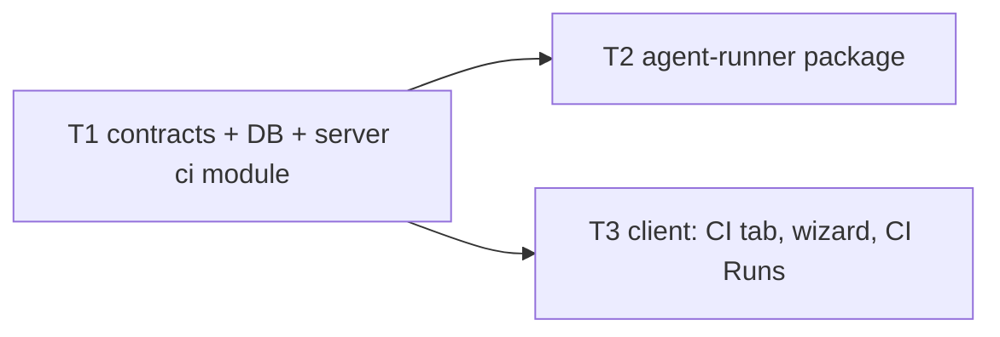

# Implementation Plan: Export to CI

## Overview

A tuned DevDigest agent is exported into a target repository as a committed bundle: a manifest,
skill bodies, repo-scoped memory, a self-contained agent-runner, and a GitHub Actions workflow.
The runner then reviews every PR in CI with `reviewer-core`. The studio pulls the results back
over GitHub's API when the user asks, verifies them, and shows them on a CI tab and a CI Runs page.

Source: `specs/cross-module/SPEC-04-export-to-ci.md` (SPEC-04, AC-1 … AC-51, decisions D1–D15).
The spec is the source of truth. This plan does not edit it.

## Execution mode

**multi-agent (parallel), hard-capped at 3 implementer tasks.** The user chose this because the
run-plan skill spawns one implementer per task. T1 (contracts, DB and server) runs alone. T2
(agent-runner) and T3 (client) then run in parallel against T1's contracts. Owned paths are
disjoint across all three tasks. No 4th task is needed.

## Requirements (verified)

The ACs are the spec's own. They are grouped by task so the mapping can be traced.

- R1 (wizard shell, Target): AC-1 … AC-5 → T3. AC-3's target registry and AC-5's
  `existing_installation` data → T1.
- R2 (Preview): AC-6 … AC-10. Generation and file lists (AC-6, AC-8, AC-9) → T1. UI and YAML
  edit validation (AC-7, AC-10) → T3.
- R3 (Configure): AC-11 … AC-14. Secret status (AC-14 data) → T1. UI → T3.
- R4 (Install): AC-15 … AC-20. Commit, PR, zip, upsert and typed errors → T1. UI states → T3.
- R5 (workflow correctness and safety): AC-21 … AC-28 → T1, since the workflow generator lives
  in the server.
- R6 (runner): AC-29 … AC-32 → T2.
- R7 (ingestion): AC-33 … AC-40 → T1.
- R8 (CI Runs page): AC-41 … AC-43 → T3.
- R9 (CI tab): AC-44 … AC-48. Installation DTO, out-of-date flag and republish → T1. UI → T3.
- R10 (scope and wiring): AC-49 and AC-50 → T1. AC-51 → all three tasks (existing suites stay
  green).
- Spec open questions, resolved with assumed defaults (confirm):
  - The artifact carries **counts only**. No findings list is ingested.
  - The workflow pins **Node 22**.

## Open questions & recommendations

- Q: Where does the runner get a diff parser? `UnifiedDiff` parsing lives only in
  `server/src/adapters/git/diff-parser.ts`. It is pure and imports only types from `@devdigest/shared`.
  → default: T2 imports that file **read-only** through a tsconfig path alias
  (`@devdigest/diff-parser`). It does not copy the file or move it into `reviewer-core`, whose
  logic is out of scope.
- Q: The agent slug. `agents` has no `slug` column.
  → default: derive it deterministically from the name (`[a-z0-9-]{1,64}`). If that comes out
  empty, fall back to `agent-<first 8 of id>`. Spec gap: two agents with the same name map to the
  same manifest path in one repo. D7 makes the last export win, which is acceptable.
- Q: The runner bundle path is read at generation time from `agent-runner/dist/`, but T2 builds
  it after T1.
  → default: T1 resolves the dir from a constant that can be overridden (`DEVDIGEST_RUNNER_DIST`
  env). Its tests use a tiny fixture dir. A missing dir gives the typed error
  `runner_bundle_missing` ("runner bundle not built").
- Rec: `OctokitGitHubClient.commitFiles` runs inside `withRetry`. A retry after
  `createCommit` succeeded can stack a duplicate commit on `devdigest/ci`. The result is harmless
  but noisy. Leave as is and log it under Risks. Do not change the shared retry policy in this
  slice.
- Rec: `ConfigTab` already edits `ci_fail_on`. The CI tab adds the AC-47 control alongside it,
  and the Config tab stays unchanged (AC-51).

## Reference cross-check (verified against code, 2026-10-17)

Each point was checked against the current repo, and against a known-working implementation of
the same feature. Items marked **fix** change a task below.

| # | Check | Status |
|---|---|---|
| C1 | `reviewer-core` exports `reviewPullRequest`, `toReviewPayload`, `gateTriggered`, `countBlockers`, `wrapUntrusted`, `OpenRouterProvider` | ok, it exists |
| C2 | `container.agentsRepo` / `container.skillsRepo` / `container.secrets` exist; `buildRunTrace` + `emptyPromptAssembly` in `platform/trace-builder.ts` | ok, reuse them for the CI trace (T1) |
| C3 | `fflate` is already a server dependency; `yaml` is not | ok, so only `yaml` is added |
| C4 | `server/src/adapters/git/diff-parser.ts` imports only types | ok, safe to alias-import and ncc inlines it (T2) |
| C5 | **The ncc output is a directory, not one file.** It holds `index.js`, lazily-imported chunk files, and must include a `package.json` with `{"type":"module"}`. Without that, ESM resolution breaks in a target repo whose own `package.json` is `commonjs` or absent | **fix**: T2's build writes `dist/package.json`; T1 copies **every file** in the dist dir, flat, to `.devdigest/runner/`, and its fixture dir has `index.js` + `package.json` |
| C6 | The runner needs the PR head SHA, title and body | **fix**: T2 reads the PR number, head SHA, title and body from `GITHUB_EVENT_PATH`, and env values override it |
| C7 | Pinned action SHAs need concrete values | **fix**: T1 uses `actions/checkout@11d5960a326750d5838078e36cf38b85af677262` (v4.4.0), `actions/setup-node@49933ea5288caeca8642d1e84afbd3f7d6820020` (v4.4.0) and `actions/upload-artifact@ea165f8d65b6e75b540449e92b4886f43607fa02` (v4.6.2), with the version as a YAML comment. Re-verify with `gh api repos/<o>/<r>/git/ref/tags/<tag>` if the network is available |
| C8 | Lock files and generated files bloat the diff and the token cost | **fix**: T2 drops lock files (`*.lock`, `package-lock.json`, `pnpm-lock.yaml`, `yarn.lock`) and binary hunks before review |
| C9 | Credential scan on the artifact | **fix**: T1's `verify-artifact.ts` scans the **raw text before `JSON.parse`** and again on the parsed values. The unzip filter inflates only `devdigest-result.json`, with at most 64 entries and 256 KB per entry, and refuses `..` or absolute paths. T2 also scrubs its own artifact with the same patterns |
| C10 | The workflow's `run:` is a single constant | ok: `node .devdigest/runner/index.js`; every value goes through `env:` |
| C11 | `client/src/vendor/ui/nav.ts` has no `ci-runs` item; `messages/en/ci.json` exists | ok, T3 adds the item |
| C12 | The runner's `yaml`/`zod` resolve from its own `node_modules`; `openai` resolves from `reviewer-core/node_modules` | ok, keep the `reviewer-core` install gotcha |

## Affected modules & contracts

- **server**: new `modules/ci/`, schema and migration for `ci_installations`/`ci_runs`, four new
  GitHub adapter methods, mock updates, module registration.
- **agent-runner** (new package): CLI entry, ncc bundle, tests.
- **client**: CI tab, Export Wizard, `/ci-runs` page, sidebar entry, hooks, i18n.
- **reviewer-core**: unchanged (consumed as source).
- **Contracts (all additive, but they edit EXISTING shared files, explicit callout):**
  - `contracts/eval-ci.ts` is extended in place per the spec's Contracts section:
    - `AgentManifest` adds `format`, `slug`, `agent_version`.
    - `CiExportInput`: `triggers` is narrowed, `workflow_override` is added, **`base` is removed**
      (breaking for any caller passing `base`; no caller exists today).
    - `CiInstallation` and `CiRun` are extended.
    - `CiResultArtifact` is extended.
    - New types: `CiTargetOption`, `CiPreview`, `CiSecretStatus`, `CiPreviewFileInput`,
      `CiRepublishResult`, `CiRefreshResult`, `CiExportErrorCode`, `MemoryRecord`.
  - `contracts/trace.ts` gets an additive nullish `RunTrace.ci` block for AC-38. That block holds
    `manifest_sha256`, `agent_version`, `dependencies{runner,reviewer_core,node}`, `commit_sha`
    and `workflow_run_id`.
  - `adapters.ts` (`GitHubClient` interface, server copy only) gets four additive methods:
    - `getDefaultBranch(repo)`
    - `listRepoSecretNames(repo)`, which returns `string[]` or throws a typed forbidden error
    - `listWorkflowRuns(repo, workflowFile, limit)`
    - `downloadRunArtifact(repo, runId, name)`, which returns the zip bytes or `null`

## Architecture changes

- `server/src/db/schema/ci.ts` (Infrastructure):
  - `ci_installations` adds `triggers` (jsonb text[]), `post_as`, `exported_agent_version`,
    `workflow_version`, `pr_url`, plus a unique index on (agent_id, repo, target_type).
  - `ci_runs` adds:
    - references: `workspace_id` FK, `agent_run_id` FK (set null)
    - run identity: `workflow_run_id` bigint unique, `repo`, `agent_name`, `pr_url`, `commit_sha`
    - results: `verdict`, `critical`/`warning`/`suggestion`, `blockers`, `duration_ms`
    - `failure_reason`
  - Index the FKs. One drizzle-kit migration `server/src/db/migrations/0018_*.sql`.
- `server/src/modules/ci/` (onion):
  - `routes.ts` (Presentation, zod type provider)
  - `service.ts` (Application, uses `container.github()`, `container.secrets`, `container.agentsRepo`, `container.skillsRepo`)
  - `repository.ts` (Infrastructure: installations, ci_runs, agent_runs `source='ci'` + run_traces, memory read)
  - pure units with no Fastify or Drizzle:
    - `targets.ts`: the registry; `gha` only
    - `manifest.ts`: slug and manifest YAML
    - `workflow.ts`: a fixed `run:` constant, `WORKFLOW_VERSION` constant, and SHA-pinned `uses:`
    - `bundle.ts`: assembles files and reads the runner dist
    - `verify-artifact.ts`: the D6 check, which includes the credential-shape regex
    - `errors.ts`: typed export errors
    - `helpers.ts`: row → DTO
- Routes (workspace-scoped, shared-schema validated, AC-49):
  - `GET /ci/targets`
  - `POST /agents/:id/ci/preview`
  - `POST /agents/:id/ci/preview/file`
  - `POST /agents/:id/ci/export`
  - `POST /agents/:id/ci/export/zip` (application/zip)
  - `GET /agents/:id/ci/installations`
  - `GET /ci/secrets?repo=`
  - `POST /agents/:id/ci/republish`
  - `POST /ci/runs/refresh`
  - `GET /ci/runs?agent_id=`
- `agent-runner/` (new package, not a workspace): `src/` is pure TS, with I/O isolated in
  `src/io/` (fs, GitHub REST via `fetch`, env). `dist/` is the ncc output, which the server
  copies into `.devdigest/runner/`.
- `client/`:
  - `app/agents/[id]/_components/AgentEditor/_components/CiTab/` with nested `ExportWizard/`
    (client components)
  - `app/ci-runs/page.tsx` (RSC shell) + `_components/CiRunsView/` (client)
  - `lib/hooks/ci.ts`

## Phased tasks

### Phase 1 — Contracts, persistence and server module

- **T1**
  - **Action:**
    - (a) **Contracts.** Extend `eval-ci.ts` per *Affected modules & contracts*. Copy it to the
      client so both copies are **byte-identical** (`cmp` passes). Add the nullish `RunTrace.ci`
      block to both `trace.ts` copies; the copies already differ, so make only the same additive
      hunk in each. Add the 4 `GitHubClient` methods to the server `adapters.ts`.
    - (b) **Schema + migration.** Make the schema changes above, then run `pnpm drizzle-kit generate`.
    - (c) **GitHub adapter.** Implement the 4 methods in `octokit.ts`. The artifact download uses
      `actions.downloadArtifact`, `listWorkflowRuns` takes `per_page ≤ 50`, and secret names come
      from `actions.listRepoSecrets`, where a 403 maps to `unknown`. Add matching behaviour to
      `MockGitHubClient`, which must record every ref write so AC-17 can be asserted.
    - (d) **`modules/ci/`**, per *Architecture changes*:
      - Generation is deterministic (no timestamps).
      - YAML goes through the `yaml` package, which is a new server dependency.
      - Memory is `scope='repo'` rows for the target repo only, emitted as `{kind,content}` JSONL.
      - Runner files list path and size, and their contents are fetched per file.
      - Export resolves the default branch, then `commitFiles` to `devdigest/ci`, then
        `findOpenPr`, else `openPullRequest`. It upserts the installation only on success.
      - The zip uses `fflate`, and the edited workflow goes in verbatim.
      - Republish loops over installations and reports per repo.
      - Refresh loops per installation, catching each installation's errors separately. It takes
        at most 50 runs and skips `skipped` conclusions. It runs D6 before storing any artifact
        field. It upserts on `workflow_run_id`, either inside a transaction or with
        `ON CONFLICT`, so concurrent refreshes converge. Each accepted run writes three things:
        - an `agent_runs` row with `source='ci'`
        - a `run_traces` row
        - a `ci_runs` row, with `pr_id` resolved only if the PR is imported
      - Listing runs reads the DB only.
    - (e) Register `ci` in `server/src/modules/index.ts`.
    - (f) Commit golden parity fixtures for T2: `server/test/fixtures/ci/manifest.golden.yaml`,
      produced by the generator and asserted equal in a test, and
      `server/test/fixtures/ci/artifact.valid.json`.
  - **Module:** server
  - **Type:** backend
  - **Skills to use:** onion-architecture, fastify-best-practices, drizzle-orm-patterns,
    postgresql-table-design, zod, typescript-expert, security
  - **Owned paths:**
    - `server/src/vendor/shared/contracts/eval-ci.ts`, `client/src/vendor/shared/contracts/eval-ci.ts`
    - `server/src/vendor/shared/contracts/trace.ts`, `client/src/vendor/shared/contracts/trace.ts`
    - `server/src/vendor/shared/adapters.ts`, `server/src/adapters/github/octokit.ts`,
      `server/src/adapters/mocks.ts`
    - `server/src/db/schema/ci.ts`, `server/src/db/rows.ts`, `server/src/db/migrations/0018_*.sql`,
      `server/src/db/migrations/meta/**`
    - `server/src/modules/ci/**`, `server/src/modules/index.ts`
    - `server/test/ci-*.test.ts`, `server/test/ci*.it.test.ts`, `server/test/fixtures/ci/**`
    - `server/package.json`, `server/pnpm-lock.yaml`
  - **Depends-on:** none
  - **Risk:** high
  - **Known gotchas:**
    - The vendored copies have already drifted in 6 files (`server/INSIGHTS.md`, 2026-10-10).
      Sync only `eval-ci.ts` in full. The client copy's narrower `ConformanceInput.provider` will
      widen to include `openrouter`, which is harmless. Verify with `cmp`.
    - DB `.it` suites time out when `server/.env` holds real keys. Run them with
      `OPENAI_API_KEY= ANTHROPIC_API_KEY= OPENROUTER_API_KEY= GITHUB_TOKEN= pnpm test`.
    - Migrations do not run on boot.
    - `RunTrace` requires `prompt_assembly`, `tool_calls` and the other fields. Fill CI traces
      with empty or zero values rather than loosening those fields.
    - Never import another module's `repository.ts`. Use `container.agentsRepo` and
      `container.skillsRepo`.
    - The `run:` bodies must be module constants; only `env:` carries values (D11).
    - Pin third-party `uses:` to the 40-hex SHAs in C7.
    - Runner bundle = the **whole** dist directory, copied flat under `.devdigest/runner/` (C5).
    - CI trace: build it with `buildRunTrace`/`emptyPromptAssembly` and add the `ci` block (C2).
    - `verify-artifact.ts` scans raw text before parsing, and inflates only the result file (C9).
  - **Acceptance:**
    - `cd server && pnpm typecheck && pnpm test` passes (env blanked as above).
    - `cmp server/src/vendor/shared/contracts/eval-ci.ts client/src/vendor/shared/contracts/eval-ci.ts`
      exits 0.
    - `cd client && pnpm typecheck` still passes.
    - New tests in `server/test/` cover:
      - AC-3: targets returns `[gha]`
      - AC-6, AC-8, AC-9: an agent with 2 skills gives the expected paths, and the manifest
        round-trips through `AgentManifest`
      - AC-14: ready / not_set / unknown
      - AC-16, AC-17: first install opens 1 PR, second opens 0 with the same URL, and there is
        no write to `heads/<default>`
      - AC-18: one row after two installs
      - AC-19: zip entries equal preview, with the edited workflow verbatim
      - AC-20: 403 → typed error, no row
      - AC-21 … AC-28: YAML assertions, including the byte-identical `run:` for a hostile agent
        name, SHA-pinned `uses:`, and `if: always()` on upload
      - AC-24: no stubbed secret value in any file
      - AC-33 … AC-39: 3 runs → 3 upserts; one case per D6 check; no-artifact → `failed`;
        `ghp_…` is in no row; refresh ×3 → 1 row each; trace has every AC-38 field
      - AC-40: 0 LLM calls; listing makes 0 GitHub calls
      - AC-45: out_of_date
      - AC-46: republish with one 403 → one PR, one failure
      - AC-49: foreign ids → 404, bad `repo` → 400 naming the field
      - AC-50: 3 matching lines, empty file when none
      - "runner bundle not built" when the dist is missing
    - Existing suites stay green (AC-51).

### Phase 2 — Runner and client (parallel)

- **T2**
  - **As landed (2026-10-18):** `agent-runner/` already existed on `main` (PR #10). This task
    was delivered as PR #12, which adapts that runner to the contract below (entry
    `src/index.ts` → `runCi` in `src/run.ts`, not `src/main.ts`). Only the server-side parity
    test (`agent-runner/src/parity.test.ts`) ships with export-to-CI. The original task text
    follows for traceability.
  - **Action:** Create `agent-runner/` as its own package:
    - `package.json` with deps `openai`, `zod`, `yaml` and dev deps `@vercel/ncc`, `vitest`,
      `typescript`
    - `tsconfig.json` with path aliases `@devdigest/shared` → `../server/src/vendor/shared/index.ts`,
      `@devdigest/reviewer-core` → `../reviewer-core/src/index.ts`, and `@devdigest/diff-parser` →
      `../server/src/adapters/git/diff-parser.ts`. Pin `zod`/`openai` to `./node_modules`, as
      reviewer-core does.
    - `vitest.config.ts` with the same aliases

    `src/main.ts` runs this flow:
    1. Read the env contract.
    2. Load and validate `.devdigest/agents/<DEVDIGEST_AGENT>.yaml` with `AgentManifest`, then load
       the skills. On any failure, exit 2 with no LLM call.
    3. Read the memory JSONL, skipping invalid lines, and pass it as `memory` (untrusted).
    4. Fetch the PR diff via the GitHub REST API (`application/vnd.github.diff`) and parse it.
    5. Run `reviewPullRequest` with an `OpenRouterProvider` and the D10 model id.
    6. Use only grounded findings. Compute blockers, verdict and exit code via `countBlockers` /
       `gateTriggered` (D9).
    7. Publish per `DEVDIGEST_POST_AS`: a review via `toReviewPayload`, a comment, or nothing. A
       publish failure does not change the exit code.
    8. Always write `devdigest-result.json` (shared `CiResultArtifact`, with no secret and no
       diff text) after the manifest validates.
    9. Exit 0, 1 or 2. A top-level catch maps any throw to exit 2.

    The `build` script runs `ncc build src/main.ts -o dist -m`, then writes
    `dist/package.json` = `{"type":"module"}` (C5). The whole `dist/` must be ≤ 5 MB.
    The PR context (number, head SHA, title, body) is read from `GITHUB_EVENT_PATH`, and env
    values override it (C6). Lock files and binary hunks are dropped before the review (C8). The
    artifact goes through the same credential-shape scrub as T1 before it is written (C9).
    Add `agent-runner/CLAUDE.md` (a short package map) and `INSIGHTS.md` (template only).
  - **Module:** agent-runner (new)
  - **Type:** core
  - **Skills to use:** typescript-expert, zod, security
  - **Owned paths:** `agent-runner/**`
  - **Depends-on:** T1
  - **Risk:** medium
  - **Known gotchas:**
    - `reviewer-core` needs its own `node_modules` (`cd reviewer-core && pnpm install`) or
      typecheck can't resolve `zod`/`openai`.
    - The repo is not a workspace, so do not add `workspace:` deps.
    - Never edit `reviewer-core/` or `server/`; read their files through aliases only.
    - ncc must inline the aliased sources. Verify that `dist/` runs with no `node_modules`
      present: `node dist/index.js` with an empty env must exit 2.
  - **Acceptance:**
    - `cd agent-runner && pnpm install && pnpm typecheck && pnpm test && pnpm build` all pass.
    - `du -sk dist` is ≤ 5120, and `dist/package.json` exists with `"type":"module"`.
    - After copying `dist/` to a temp dir with no `node_modules`, `node index.js` with an empty
      env exits 2.
    - Unit tests use a stubbed LLM and stubbed GitHub `fetch`:
      - AC-29: exit 0 / 1 / 2 per outcome
      - AC-30: missing or invalid manifest, or a missing skill → exit 2 with LLM call count 0
      - AC-31: an ungrounded finding appears nowhere; 1 invalid memory line is skipped
      - AC-32: one test per mode; publish 422 → artifact still written; the artifact parses
        with `CiResultArtifact` and contains no key value
      - Missing `OPENROUTER_API_KEY` → `missing_secret`, exit 2
    - Parity test: `server/test/fixtures/ci/manifest.golden.yaml` loads through the runner's
      loader, and `artifact.valid.json` plus a runner-produced artifact both parse with the shared
      schema.

- **T3**
  - **Action:** Build the client surfaces.
    - `lib/hooks/ci.ts`: TanStack hooks for every T1 route, re-exported from
      `lib/hooks/index.ts`. Refresh and republish invalidate the run and installation queries.
    - The CI tab, added to `TABS` after `evals` and rendered in `AgentEditor.tsx`:
      - a "CI deployment" header and an "Active in N repos" badge
      - **Update CI config** and **Add to CI** actions
      - installation rows showing workflow and agent version, an out-of-date badge, and last run
      - an "Add repository" row
      - the Fail CI on select (`never`/`critical`/`warning`; a stored `any` shows as "Any
        finding"), which saves through the existing agent update hook
      - run history
    - The Export Wizard modal, built on `ExportWizardSteps`:
      - focus trap and Esc to close
      - Back preserves all state
      - Target: the registry cards and a repo select that pre-selects the active repo
        (`repo-context`), plus the AC-5 notice
      - Preview: a file list; the workflow file is editable through a `yaml` parse, which shows
        an inline error and disables Continue; runner contents load on demand
      - Configure: triggers, post-as, secrets status, the merge-blocking hint, and the AC-12
        reset notice
      - Install: PR or zip; the button is disabled while in flight; typed errors stay on the step
        with zip still enabled
    - `app/ci-runs/page.tsx` + `CiRunsView`: the AC-41 columns, "—" for unknown values, an empty
      state with Refresh, and GitHub links rendered only for `https://github.com/` URLs.
    - Add a `ci-runs` item to `vendor/ui/nav.ts`.
    - Fill or extend the strings in `messages/en/ci.json` and `agents.json` (`editor.tabs.ci`
      already exists).
    - Add the `yaml` dependency.
  - **Module:** client
  - **Type:** ui
  - **Skills to use:** frontend-architecture, next-best-practices, react-best-practices,
    react-testing-library, typescript-expert, security
  - **Owned paths:**
    - `client/src/app/agents/[id]/_components/AgentEditor/constants.ts`,
      `client/src/app/agents/[id]/_components/AgentEditor/AgentEditor.tsx`
    - `client/src/app/agents/[id]/_components/AgentEditor/_components/CiTab/**`
    - `client/src/app/ci-runs/**`
    - `client/src/lib/hooks/ci.ts`, `client/src/lib/hooks/index.ts`
    - `client/src/vendor/ui/nav.ts`
    - `client/messages/en/ci.json`, `client/messages/en/agents.json`
    - `client/package.json`, `client/pnpm-lock.yaml`
  - **Depends-on:** T1
  - **Risk:** medium
  - **Known gotchas:**
    - Use only the client's vendored `@devdigest/shared`. T1 has already synced `eval-ci.ts`, so
      do not edit anything under `client/src/vendor/shared/**`.
    - The kit `FormField` does not link its label to the control (`client/INSIGHTS.md`), so add
      explicit `aria-label`/`htmlFor` for RTL queries.
    - jsdom has no `scrollIntoView`.
    - Component tests need a `QueryClientProvider`.
    - Keep `page.tsx` an RSC and push `"use client"` down to the view.
  - **Acceptance:**
    - `cd client && pnpm typecheck && pnpm test` passes.
    - Component tests cover:
      - AC-1: four labels in order, step 1 active
      - AC-2: back and forward preserve state
      - AC-4: Continue is gated on the repo
      - AC-5: notice
      - AC-7: only the workflow is editable; runner contents load on demand
      - AC-10: invalid YAML shows an error and disables Continue
      - AC-11: defaults; none selected disables Continue
      - AC-12: edit, then toggle `reopened`, shows the reset notice
      - AC-13: post-as options
      - AC-15: count equals Preview's count
      - AC-20: 403 stays on the step with zip enabled; a double click sends 1 request
      - AC-41 / AC-42 / AC-43: fixture rows, "—", empty state
      - AC-44: 2 installs → "Active in 2 repos"
      - AC-45: out-of-date badge
      - AC-46: per-repo result
      - AC-47: Warning+ → update with `warning`
      - AC-48: history without the agent column
    - Existing client tests stay green (AC-51).

## Testing strategy

- server: `cd server && pnpm typecheck && OPENAI_API_KEY= ANTHROPIC_API_KEY= OPENROUTER_API_KEY= GITHUB_TOKEN= pnpm test`.
  Pure units (workflow, manifest, verify-artifact) are plain vitest. Routes and ingestion are
  `.it` tests with `MockGitHubClient` and `MockSecretsProvider`.
- agent-runner: `cd reviewer-core && pnpm install`, then
  `cd agent-runner && pnpm install && pnpm typecheck && pnpm test && pnpm build`.
- client: `cd client && pnpm typecheck && pnpm test`.
- reviewer-core regression: `cd reviewer-core && pnpm test`, which must be unchanged.
- e2e: none in this slice. No `e2e/` flow is required by the spec.

## Risks & mitigations

- Contract edits to existing shared files (`eval-ci.ts`, `trace.ts`, `adapters.ts`) → they are
  additive except for removing `CiExportInput.base`, which has no callers (verify with grep in
  T1). T1 alone owns all of them before Phase 2 starts.
- `commitFiles` sits inside `withRetry`, so it can double-commit on a retried timeout → harmless
  on a dedicated branch. Noted, not fixed.
- T1 can't test against a real runner bundle → it uses a fixture dir plus the
  `runner_bundle_missing` error. A full end-to-end check needs a manual run after T2 builds `dist/`.
- The ncc bundle may exceed 5 MB because of `openai` → T2 measures it. If it's over, minify, or
  replace the `openai` import paths through reviewer-core's provider only.
- Artifact zip parsing on hostile input → D6 limits to 64 entries and 256 KB per relevant entry,
  rejects path traversal and absolute paths, and runs the credential regex before any write.

## Red-flags check

- [x] Every requirement maps to a task (R1–R10 → T1/T2/T3)
- [x] No specification was authored or edited (SPEC-04 is input only)
- [x] Execution mode is recorded (multi-agent, 3 tasks) and the plan is shaped for it
- [x] Dependencies form a DAG (T1 → T2, T1 → T3)
- [x] (multi-agent) T2 and T3 have no overlapping owned paths, and neither overlaps T1
- [x] Every Acceptance is measurable (commands + named AC tests)
- [x] Edits to existing shared contracts are explicitly called out (`eval-ci.ts`, `trace.ts`, `adapters.ts`)
