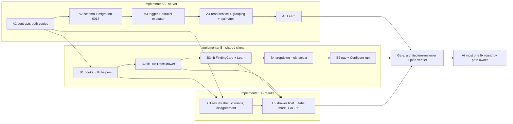

# Implementation Plan: Multi-Agent Review & live statuses (SPEC-04)

## Overview
Let a reviewer run 2–8 agents on one PR in parallel, either from a multi-select in the PR page's
Run Review dropdown or from a new Configure run page. Child runs are grouped under one
`multi_agent_runs` parent, and a results page shows them (Columns / Tabs + detail, live status by
4 s polling, a "Where agents disagree" block, estimated and actual time and cost, and per-agent
logs and trace through the PR page's existing run-trace drawer). Source:
`specs/cross-module/SPEC-04-multi-agent-review.md`. Decisions D1–D16 and non-goals N1–N14 are
binding. `ci/`, `agent-runner/`, `reviewer-core/` and `e2e/` are not touched.

## Execution mode
multi-agent (parallel), **at most 3 implementer agents**: A (server + contracts), B (shared client
pieces, PR page, Configure run), C (results page). The user decided this up front to keep token
cost down. Each implementer runs its own tasks in order. The three implementers run concurrently,
and their owned paths do not overlap.

## Requirements (verified)
All ids refer to SPEC-04. Every AC from AC-1 to AC-81 is in scope except AC-47 and AC-49, which
the spec withdrew.
- R1 (G1, US-1): PR-page dropdown multi-select. AC-1–AC-5, AC-68 (dropdown part), AC-71.
- R2 (G1/G2, US-2): Configure run page with PR select, agent cards, Select all (8-agent cap), estimates and run. AC-6–AC-13, AC-67–AC-69, AC-71.
- R3 (G2, D10): `GET /agents/estimates`, the average over each agent's last 20 `done` runs, with no LLM call. AC-10, AC-11.
- R4 (G3/G4, D1–D4): `RunRequest.agentIds` and the trigger extension. The parent and its linked children are created all-or-nothing, and the executor runs agents in parallel. AC-14–AC-21, AC-73–AC-75.
- R5 (D5/D6): `GET /multi-agent-runs/:id`, computed on read, with derived status and totals. AC-22–AC-25.
- R6 (G5, D8): a deterministic, pure location-grouping and conflict heuristic. AC-37–AC-41, AC-43.
- R7 (G6, D16): the "Where agents disagree" block with Show only conflicts. AC-42, AC-44–AC-46.
- R8 (G7, D7): the results page header, live polling, Columns and Tabs + detail. AC-26–AC-36, AC-48, AC-50–AC-52, AC-55, AC-70, AC-72.
- R9 (D9, N14): deterministic, idempotent Learn plus the FindingCard Learn action. AC-53, AC-54, AC-77.
- R10 (G8, D12): the lifted (not copied) run-trace drawer, used once per page. AC-56–AC-66.
- R11 (US-11/12): security and accessibility. AC-76, AC-78–AC-81.
- R12 (D11, D14, D15): derived agent colour and icon, the routes and nav item, and the "parallel fan-out" copy.

Assumed defaults. Each one is marked in the task that uses it:
- D5 cost (resolved with user, Q1): total cost = sum over `done` children only; failed/cancelled children are excluded; `null` only when a `done` child has `cost_usd = null`.
- AC-39 "spans more than 50 lines" means `end_line - start_line + 1 > 50`.
- The Configure run `pr` query parameter carries the PR **number**, matching the `/pulls/:number` URL convention.

## Open questions & recommendations
Spec-vs-code gaps found during verification. The plan's resolution is given for each.
- **G1 (AC-41 vs Contracts):** AC-41 needs every take to carry "the ids of all of that agent's findings in the group", but the Contracts section says `ConflictTake` is unchanged. → The plan adds `finding_ids: string[]` to `ConflictTake`. It is additive and the type has no consumers today. This is a naming/shape change, not a semantic one.
- **G2 (AC-52):** `AgentColumnFinding` has no confidence, rationale, suggestion or accepted/dismissed timestamps, and `FindingCard` needs a `FindingRecord`. → Tabs + detail mode and the drawer's `findings` prop read the existing `GET /pulls/:id/reviews` (`usePrReviews`) and filter by `run_id`. No contract change is needed. Accept and Dismiss invalidate `["reviews", prId]` only, so AC-55 holds without refetching the multi-agent run.
- **G3 (AC-32):** `MultiAgentRun` has no PR title. → The client looks it up through `usePulls(run.repo_id)`. No contract change.
- **G4 (AC-28 vs AC-63):** The current drawer opens SSE whenever `running` is set, whatever the tab. → The shared drawer subscribes only while `running && tab === "log"`. The Trace tab shows its "available when the run finishes" state until the `running` prop (driven by the 4 s poll) turns false, then loads the trace. The PR page never passes `running`, so its behaviour does not change (AC-65).
- **G5 (AC-64, AC-80):** The kit `Drawer` has no Escape handling or focus return, and the kit `Tabs` has no tablist semantics. → Escape and focus return are implemented inside the shared `RunTraceDrawer`, not in the kit. Agent tabs use a small local tablist component on the results page. Neither kit component is edited, which keeps the blast radius small.
- **G6 (AC-39):** `FULL_FILE_KINDS` (`reviewer-core/src/grounding.ts:16`) is not exported, and N12 forbids changing reviewer-core. → The server mirrors the set as a constant with a comment pointing at the source line.
- **G7 (D9):** `MemorySource` is `{ pr, context }`. It has no finding-id field, and the spec forbids schema changes other than the `agent_runs` link. → Learn writes `sources = [{ pr: <number>, context: "finding:<id>" }]`. Idempotency is a jsonb-containment lookup inside a transaction holding `pg_advisory_xact_lock(hashtext(findingId))`, so no unique index is needed.
- **G8 (FindingCard placement):** Importing `FindingCard` from `pulls/[number]/_components` into the results route would cross a feature boundary (frontend-architecture). → It is lifted to `client/src/components/finding-card/` together with the drawer (the D13 behaviour is unchanged). Its i18n stays on the `prReview` namespace, which is a recorded exception to the "namespace follows directory" insight.
- **G9 (spec text):** The spec says the server "rejects `learn` with 400". In fact no `/findings/:id/learn` route is registered (`FINDING_ACTIONS = ['accept','dismiss']`), so it returns 404 today. This does not change the plan.
- **G10:** The two `vendor/shared` copies already differ in 6 files (server INSIGHTS 2026-10-10). The touched files (`observability.ts`, `review-api.ts`, and the `RunRequest` block of `platform.ts`) must end up identical. Pre-existing drift elsewhere is out of scope.
- Q1 (requirement substance, for the user or spec-creator, not resolved here): read literally, D5 shows total cost "—" whenever any agent failed, because failed runs record a null cost. Should "finished" mean only `done` children? → RESOLVED by the user: sum over `done` children only (spec D5 amended).
- Rec: keep `GET /agents/estimates` in the **reviews** module's routes (it reads `agent_runs`). This avoids a second module touching run rows. Fastify matches the static `/agents/estimates` route before the parametric `/agents/:id`.

## Affected modules & contracts
- server: the reviews module (trigger, executor, a new multi-agent read service, a pure grouping helper, the estimate and memory repositories, the Learn action), the `agent_runs` schema, and migration 0018.
- client: the shared run-trace drawer and finding card (lifted), hooks, the PR page dropdown, the nav item, the Configure run page and the results page.
- Contracts. These are **edits to existing shared contracts** and must be identical in `server/src/vendor/shared` and `client/src/vendor/shared`:
  - `contracts/platform.ts`: `RunRequest.agentIds?: z.array(z.string().uuid()).min(2).max(8)` (additive, optional).
  - `contracts/review-api.ts`: `ReviewRunResponse.multi_agent_run_id: z.string().nullable()` (a new **required** field, which the server always sends), plus `LearnFindingResponse = { finding: FindingRecord, memory_id: string }`.
  - `contracts/observability.ts`: `AgentColumnFinding.end_line`. In `AgentColumn`, `status` gains `'cancelled'`, plus `error` and `last_log`. `ConflictTake.finding_ids` (G1). `Conflict.end_line` and `conflict`. `MultiAgentRun.status` (`running|done|failed`) and `repo_id`. A new `AgentEstimate` and `AgentEstimatesResponse = z.array(AgentEstimate)`. Doc comments that mention `POST /pulls/:id/multi-agent-run` are corrected (D1).
  - These are breaking only in theory: the observability types have zero consumers today, and `ReviewRunResponse` is consumed only by the client's `useRunReview` type.

## Architecture changes
- `server/src/db/schema/runs.ts` adds `agentRuns.multiAgentRunId` (uuid, nullable, FK `multi_agent_runs.id` **on delete set null**) and the index `agent_runs_multi_agent_run_idx`. `server/src/db/migrations/0018_*.sql` and its meta snapshot are generated.
- Infrastructure: `server/src/modules/reviews/repository/multi-agent.repo.ts` (a transactional create of parent + children, the parent read, children joined with agent name and review, findings by review, last-20-done estimates) and `repository/memory.repo.ts` (find-or-create a learning entry). Both are exposed through `ReviewRepository`.
- Application: `server/src/modules/reviews/multi-agent-service.ts` (`MultiAgentService`: `get(workspaceId, id)`, `estimates(workspaceId)`). `service.ts` (`resolveTargets` gains `agentIds`, and `runReview` gains a multi-agent branch). `findings.ts` (the `learn` case).
- Domain-pure helper: `server/src/modules/reviews/multi-agent-grouping.ts` with `buildLocationGroups`, `deriveRunStatus` and `deriveTotals`. It imports neither Fastify nor Drizzle.
- Presentation: `server/src/modules/reviews/routes.ts` adds `GET /multi-agent-runs/:id`, `GET /agents/estimates`, and `learn` in `FINDING_ACTIONS`. The trigger returns `multi_agent_run_id`.
- Client shared: `client/src/components/run-trace-drawer/**` and `client/src/components/finding-card/**`, moved with `git mv`. `client/src/lib/multi-agent.ts` holds the pure helpers (palette, estimate aggregation, selection rules). `client/src/lib/hooks/multi-agent.ts` holds the hooks.
- Client routes (D14): `client/src/app/multi-agent-review/page.tsx` (global Configure run with a repo select, nav item in the GLOBAL section; `client/src/app/repos/[repoId]/multi-agent/page.tsx` only redirects to it) and `client/src/app/repos/[repoId]/multi-agent/[multiRunId]/page.tsx` (results, owned by C). Both are `"use client"` pages, following the PR page pattern.

## Implementer split & owned paths (exclusive)

| Implementer | Tasks | Owned paths |
|---|---|---|
| **A — server + contracts** | A1–A5 | `server/src/vendor/shared/contracts/{platform,review-api,observability}.ts`, `client/src/vendor/shared/contracts/{platform,review-api,observability}.ts`, `server/src/db/schema/runs.ts`, `server/src/db/migrations/0018_*.sql`, `server/src/db/migrations/meta/{0018_snapshot.json,_journal.json}`, `server/src/modules/reviews/**`, `server/test/run-executor-parallel.test.ts`, `server/test/multi-agent-grouping.test.ts`, `server/test/multi-agent.it.test.ts` |
| **B — shared client + PR page + Configure run** | B1–B5 | `client/src/lib/hooks/{reviews,multi-agent,index}.ts`, `client/src/lib/hooks/multi-agent.test.tsx`, `client/src/lib/multi-agent.ts`, `client/src/lib/multi-agent.test.ts`, `client/src/components/run-trace-drawer/**`, `client/src/components/finding-card/**`, `client/src/app/repos/[repoId]/pulls/[number]/page.tsx`, `client/src/app/repos/[repoId]/pulls/[number]/_components/{RunTraceDrawer,FindingCard,FindingsPanel,DiffTab,RunReviewDropdown}/**` (the first two are deleted by the move), `client/src/vendor/ui/nav.ts`, `client/messages/en/{prReview,runs,multiAgent}.json`, `client/src/app/repos/[repoId]/multi-agent/page.tsx`, `client/src/app/repos/[repoId]/multi-agent/_components/**` |
| **C — results page** | C1–C2 | `client/src/app/repos/[repoId]/multi-agent/[multiRunId]/**`, `client/messages/en/multiAgentRun.json` |

C imports B's exports (hooks, `lib/multi-agent.ts`, the shared drawer and card) and A's client contract copy, but edits none of them. If C needs a change in a B-owned file, C reports it and B makes the change. C does not edit the file.

## Dependency DAG

Start order: A starts immediately. B starts when A1 is done. C starts when A1 and B1 are done. A1
and B1 are both small, so they unblock the other implementers quickly. The client tests mock the
hooks or the API, so B and C never wait on A2–A5.

## Phased tasks

### Phase 1 — Contracts (unblocks B and C)
- **T-A1** (Implementer A)
  - **Action:** Apply the contract edits listed under *Affected modules & contracts* to both copies of `platform.ts` (only the `RunRequest` block), `review-api.ts` and `observability.ts`. Use `.nullable()` (not `.nullish()`) for the new nullable fields, and add no `.default()` to the new fields (client INSIGHTS 2026-09-20). Do not add a `.refine` to `RunRequest`: the mutual-exclusion check goes in the service (A3).
  - **Module:** server (+ client vendored copy) · **Type:** backend
  - **Skills to use:** zod, typescript-expert, onion-architecture
  - **Owned paths:** the 6 contract files listed in the A row.
  - **Depends-on:** none · **Risk:** low
  - **Known gotchas:** The copies already diverge in other files. Compare only the three touched files. The barrel already re-exports `observability.ts`, so no `index.ts` edit is needed.
  - **Acceptance:** `diff server/src/vendor/shared/contracts/observability.ts client/src/vendor/shared/contracts/observability.ts` and the same for `review-api.ts` produce no output. The `RunRequest` block in both `platform.ts` copies is identical. `cd server && pnpm typecheck` and `cd client && pnpm typecheck` pass.

### Phase 2 — Server (Implementer A, sequential)
- **T-A2** (Implementer A)
  - **Action:** Add `multiAgentRunId` to `agentRuns` in `server/src/db/schema/runs.ts`: `uuid('multi_agent_run_id').references(() => multiAgentRuns.id, { onDelete: 'set null' })`, plus `index('agent_runs_multi_agent_run_idx')`. Generate `0018_*.sql` with drizzle-kit. Expose `multiAgentRunId` on `createAgentRun` values (optional).
  - **Module:** server · **Type:** backend
  - **Skills to use:** drizzle-orm-patterns, postgresql-table-design
  - **Owned paths:** `server/src/db/schema/runs.ts`, `server/src/db/migrations/0018_*.sql`, `server/src/db/migrations/meta/**` (0018 entries), `server/src/modules/reviews/repository/run.repo.ts`
  - **Depends-on:** T-A1 · **Risk:** low
  - **Known gotchas:** pnpm 12's build-approval gate can block `pnpm db:generate`. Run the drizzle-kit binary directly (server INSIGHTS 2026-09-16). This is a pure addition, so drizzle-kit shows no rename prompt. `agentRuns` is declared before `multiAgentRuns`, so the arrow-function FK reference is required. The migration must contain exactly one `ADD COLUMN`, one FK with `ON DELETE set null`, and one `CREATE INDEX`.
  - **Acceptance:** The 0018 SQL contains the column, the FK and the index. `cd server && pnpm typecheck` passes. `pnpm exec vitest run .it.test` still passes, which shows the migration applies on a fresh Testcontainers DB.

- **T-A3** (Implementer A)
  - **Action:**
    1. `service.resolveTargets` accepts `agentIds`. If it is combined with `agentId` or `all`, throw `AppError('invalid_run_request', …, 400)` (AC-16). De-duplicate the ids. If fewer than 2 distinct ids remain, return 400 naming the rule (AC-14; the Zod `max(8)` already covers 9+). Resolve every id with `agentsRepo.getById(workspaceId, id)` **before any insert**, and if any is missing throw `NotFoundError` (AC-15, AC-73).
    2. `runReview(…, { multiAgent: boolean })`: for a multi-agent request, call a new `multi-agent.repo.ts#createMultiAgentRunWithChildren(db, { workspaceId, prId, agents })`. It inserts the parent plus N `agent_runs` rows (status `running`, linked) in **one `db.transaction`** (AC-17). The legacy paths are unchanged and return `multi_agent_run_id: null` (AC-18).
    3. The route passes `agentIds` through and returns `{ pr_id, runs, reviews, multi_agent_run_id }`. The rate-limit config is unchanged (AC-74).
    4. `run-executor.ts`: replace the `for … await` loop with `await Promise.allSettled(jobs.map(job => runOne(job)))`. Keep the per-job try/catch and logging body exactly as it is. The diff and intent are still computed once before the fan-out (AC-19–AC-21).
  - **Module:** server · **Type:** backend
  - **Skills to use:** onion-architecture, fastify-best-practices, drizzle-orm-patterns, zod, security, typescript-expert
  - **Owned paths:** `server/src/modules/reviews/{service,routes,run-executor,repository}.ts`, `server/src/modules/reviews/repository/multi-agent.repo.ts`, `server/test/run-executor-parallel.test.ts`, `server/test/multi-agent.it.test.ts`
  - **Depends-on:** T-A2 · **Risk:** medium
  - **Known gotchas:** Route-level `rateLimit` does nothing under `nodeEnv: 'test'`. The AC-74 test needs a second app built with `nodeEnv: 'production', logLevel: 'silent'` (server INSIGHTS 2026-10-06). The `.it` suites time out when `server/.env` holds real keys, so blank them when running the suites (INSIGHTS 2026-10-11). The DB pool is `max: 10` (`db/client.ts:18`), and 8 parallel agents should stay below it. Do not hold a connection across an LLM call. The concurrent `markReviewed` calls are idempotent.
  - **Acceptance:** `server/test/run-executor-parallel.test.ts` is hermetic and uses `vi.mock` on `@devdigest/reviewer-core`'s `reviewPullRequest`, `./diff-loader.js` and the intent service. It covers: three agents with a 300 ms delay each finish in under 600 ms (AC-19); one stub throws, and the other two reach `completeAgentRun(status:'done')` (AC-20); `loadDiff` and the intent computation are each called exactly once for three agents (AC-21). `server/test/multi-agent.it.test.ts` covers: `[a]`, `[a,a]` and nine ids → 400 with zero new `multi_agent_runs`/`agent_runs` rows (AC-14); one foreign-workspace id → 404 with counts unchanged (AC-15, AC-73); `agentIds`+`agentId` and `agentIds`+`all` → 400 (AC-16); a valid request returns the parent id and N run ids, and the DB shows N children with `multi_agent_run_id` = the parent (AC-17); `all:true` returns `multi_agent_run_id: null` and creates no parent (AC-18); a non-UUID entry → 400 (AC-75); the 11th request in one minute on a rate-limit-enabled app → 429 (AC-74). The existing `reviews.it.test.ts` stays green.

- **T-A4** (Implementer A)
  - **Action:**
    1. Pure `multi-agent-grouping.ts`:
       - `deriveRunStatus(children)` follows D5.
       - `deriveTotals(children)` gives the max of the known `duration_ms` (0 if there are none) and the sum of cost. The cost is the sum over `done` children only; `null` only if a `done` child has a null cost (Q1, resolved).
       - `buildLocationGroups(columns)` uses only `done` columns (AC-37). Line findings are grouped per file, sorted by `start_line`, with an inclusive transitive sweep merge (AC-38). Findings whose `kind ∈ FILE_SCOPED_KINDS` (a mirrored `['secret_leak','lethal_trifecta','phantom','hook']` with a comment pointing at `reviewer-core/src/grounding.ts:16`) or that span more than 50 lines go to a file-level group keyed by `file + (kind ?? category)` (AC-39).
       - Each participating agent's take is its representative finding: most severe first (CRITICAL > WARNING > SUGGESTION), ties broken by lowest `start_line`, with `finding_ids` = all of that agent's ids in the group. An agent with no finding in the group gets `{verdict:'ignored', note:'', finding_ids:[]}`. The group header uses the min start, the max end, and the title of the group's most severe finding, with ties broken by start line, then agent name, then id (AC-40).
       - `conflict` is false only when every take has the same non-ignored severity. Sort conflicts first, then by file, then by start line (AC-43). Findings are never mutated (AC-41).
    2. `multi-agent.repo.ts` read functions: the parent is scoped by `workspace_id`. Children are fetched with a left join to `agents` (for the name) and `reviews` (on `run_id`, for verdict/summary), and findings by review ids. `estimatesForWorkspace` uses `row_number() over (partition by agent_id order by ran_at desc)` over `status='done'` rows with `≤ 20`, and averages the non-null duration and cost (AC-10).
    3. `multi-agent-service.ts`:
       - Map the rows to `AgentColumn`: a deleted agent becomes "Deleted agent" (AC-24); a null status maps to `failed`; `last_log` = the msg of the last `container.runBus.buffer(runId)` event while the run is running, else `null` (AC-28 data). Order columns by agent name (AC-23).
       - Assemble `MultiAgentRun`, including `pr_number` and `repo_id` from the PR.
       - Throw `NotFoundError` when the run is missing or belongs to another workspace (AC-70, AC-73).
       - Make no LLM call and no write (AC-25).
       - The service is constructed with the `Container` and uses `new ReviewRepository(container.db)`, as `ReviewService` does.
    4. Routes: `GET /multi-agent-runs/:id` (`IdParams`) and `GET /agents/estimates`. Both are thin handlers.
  - **Module:** server · **Type:** backend
  - **Skills to use:** onion-architecture, drizzle-orm-patterns, fastify-best-practices, zod, typescript-expert
  - **Owned paths:** `server/src/modules/reviews/{multi-agent-grouping,multi-agent-service,routes,repository}.ts`, `server/src/modules/reviews/repository/multi-agent.repo.ts`, `server/test/multi-agent-grouping.test.ts`, `server/test/multi-agent.it.test.ts`
  - **Depends-on:** T-A3 · **Risk:** medium
  - **Known gotchas:** `routes.ts` must not import `drizzle-orm` or `db/schema.js`. Map rows to DTOs in the service or helpers, never in the repo (onion-architecture). `reviews.run_id` has no FK, so the join is a plain equality. `run_traces` is written *after* the `agent_runs` status (INSIGHTS 2026-10-04), which does not matter here because the read does not touch traces.
  - **Acceptance:** `server/test/multi-agent-grouping.test.ts` (unit) covers: 10–12, 12–14 and 14–20 in one file → one group, and 30–31 → a second group (AC-38); a failed column appears in no group (AC-37); two `secret_leak` findings at different lines → one group (AC-39); representative and header (AC-40); the sum of column findings equals the input count, and every id appears in exactly one group's takes (AC-41); WARNING×3 → `conflict:false`, WARNING + ignored → true, WARNING + SUGGESTION → true, and conflicts sort first (AC-43); D5 status and totals for running, all-failed, mixed and null-cost cases. `server/test/multi-agent.it.test.ts` adds: a fixture parent with done, failed and running children asserts every `MultiAgentRun` field (AC-22); the failed column has `error` and no findings (AC-23); a nulled `agent_id` gives "Deleted agent" (AC-24); the mock LLM records zero calls and row counts are unchanged after GET (AC-25); another workspace's id → 404 (AC-73); estimates for runs [2s,$0.02],[4s,$0.04] → 3000 ms and $0.03, an agent without done runs → nulls with `sample_size: 0`, and zero LLM calls (AC-10).

- **T-A5** (Implementer A)
  - **Action:** Add `'learn'` to `FINDING_ACTIONS`. In `findings.ts` the `learn` case resolves `findingContext` (workspace-checked, so foreign → 404, AC-77) and calls `memory.repo.ts#findOrCreateLearning(db, { workspaceId, repoId: pull.repoId, findingId, prNumber, content })` inside a `db.transaction` with `pg_advisory_xact_lock(hashtext(findingId))`. Look up by `workspace_id`, `kind='learning'` and `sources @> '[{"context":"finding:<id>"}]'`. If no row matches, insert `{ scope:'repo', kind:'learning', content, sources:[{pr, context:'finding:<id>'}], confidence: null }`. `content` is a deterministic template, ``${title}\n\n${rationale}\n\n(${file}:${start_line}-${end_line})``, stored as data. Return `{ finding: findingRowToDto(row), memory_id }`. No LLM call (AC-53, AC-54).
  - **Module:** server · **Type:** backend
  - **Skills to use:** onion-architecture, drizzle-orm-patterns, security, zod
  - **Owned paths:** `server/src/modules/reviews/{findings,routes,repository}.ts`, `server/src/modules/reviews/repository/memory.repo.ts`, `server/test/multi-agent.it.test.ts`
  - **Depends-on:** T-A4 (same implementer; it only logically needs T-A1) · **Risk:** low
  - **Known gotchas:** `memory.embedding` stays null, so do not compute embeddings (N9). The `actOnFinding` return type widens to an optional `memory_id`, and accept and dismiss keep their current response shape.
  - **Acceptance:** In `multi-agent.it.test.ts`: Learn creates one `memory` row with `kind='learning'`, `repo_id` = the PR's repo, content containing the title, rationale and `file:line`, and `sources[0]` = `{pr:<number>, context:'finding:<id>'}`. The mock LLM records zero calls (AC-53). Two calls → one row and the same `memory_id` (AC-54). Learn on a foreign-workspace finding → 404 and no row (AC-77). `cd server && pnpm typecheck && pnpm exec vitest run --exclude '**/*.it.test.ts'` is green, and so is the `.it` lane with keys blanked.

### Phase 3 — Shared client pieces (Implementer B, sequential)
- **T-B1** (Implementer B)
  - **Action:**
    1. `client/src/lib/hooks/multi-agent.ts`:
       - `useMultiAgentRun(id)` uses `["multi-agent-run", id]` and `refetchInterval: q => q.state.data?.status === "running" ? 4000 : false`. On a fetch error it keeps the last data (AC-26).
       - `useAgentEstimates()` uses `["agent-estimates"]`.
    2. In `reviews.ts`:
       - `RunReviewInput.agentIds?` is sent as `{ agentIds }`.
       - `useLearnFinding()` posts `/findings/:id/learn` and on success calls `qc.setQueryData(["finding-learned", id], memory_id)`. `useFindingLearned(id)` reads that key with `enabled:false`.
       - Fix `useFindingAction`'s response type to `memory_id`.
    3. Export the new hooks from `hooks/index.ts`.
    4. Pure helpers in `client/src/lib/multi-agent.ts`:
       - `MAX_AGENTS = 8` and `MIN_AGENTS = 2`.
       - `agentAccent(agentId)` returns `{ color, textColor, icon }` from a fixed palette by a stable string hash (D11).
       - `aggregateEstimate(estimates)` returns `{ durationMs: max, costUsd: sum, excluded: K, none: boolean }` (AC-11).
       - `formatDuration` and `formatCost`, which render `null` as "—".
       - `selectAllCapped(agents)` checks enabled agents, in list order, up to 8.
  - **Module:** client · **Type:** ui
  - **Skills to use:** react-best-practices, frontend-architecture, react-testing-library, typescript-expert
  - **Owned paths:** `client/src/lib/hooks/{reviews,multi-agent,index}.ts`, `client/src/lib/hooks/multi-agent.test.tsx`, `client/src/lib/multi-agent.ts`, `client/src/lib/multi-agent.test.ts`
  - **Depends-on:** T-A1 · **Risk:** low
  - **Known gotchas:** Shared contracts are imported as types only. A runtime import from `@devdigest/shared` needs `pnpm build` to verify it (client INSIGHTS 2026-10-11). The existing `RunReviewDropdown.test.tsx` mocks `hooks/reviews`, so the new exports must not be required at import time by that test.
  - **Acceptance:** `multi-agent.test.tsx` uses fake timers and a `QueryClientProvider`. While the response is `running`, fetches happen at 0, 4 and 8 s. After a `done` response there are no further fetches (AC-26). `multi-agent.test.ts` covers: a mixed known/unknown estimate gives the max duration, the cost sum and `excluded=1`, and all-unknown gives `none=true` (AC-11); every palette entry has a contrast of at least 4.5:1 against its `textColor`, computed with the WCAG relative-luminance formula in the test (AC-81); `selectAllCapped` with 10 enabled agents → 8 (AC-9 logic). `cd client && pnpm typecheck && pnpm test` passes.

- **T-B2** (Implementer B)
  - **Action:** `git mv` `pulls/[number]/_components/RunTraceDrawer/**` to `client/src/components/run-trace-drawer/**` and convert the relative `lib/` imports to `@/lib/...`. Then add:
    - `initialTab?: "trace" | "log"`, defaulting to the current behaviour;
    - SSE subscribed only while `running && tab === "log"` (G4), with the Trace tab showing `tracePending` while `running` and loading the trace once `running` turns false (AC-63);
    - Escape closes the drawer (a `keydown` listener in an effect);
    - on mount, store `document.activeElement` and re-focus it on unmount (AC-64).
    Update the PR page import. Its props and behaviour stay the same (AC-65). Move the tests too, updating only the paths in the imports and in `vi.mock`. Add tests for the new behaviour.
  - **Module:** client · **Type:** ui
  - **Skills to use:** frontend-architecture, react-best-practices, react-testing-library, next-best-practices
  - **Owned paths:** `client/src/components/run-trace-drawer/**`, `client/src/app/repos/[repoId]/pulls/[number]/_components/RunTraceDrawer/**` (removed), `client/src/app/repos/[repoId]/pulls/[number]/page.tsx`, `client/messages/en/runs.json` (only if a string is needed)
  - **Depends-on:** T-B1 · **Risk:** medium
  - **Known gotchas:** jsdom has no `scrollIntoView` (client INSIGHTS 2026-10-06). `useEffect` cleanup runs on remount when the parent passes `key={runId}`, which is how C switches X to Y. The drawer test messages import path changes depth. The drawer stays on the `runs` namespace.
  - **Acceptance:**
    - `rg -l "function RunTraceDrawer|export default function RunTraceDrawer" client/src` returns exactly one file (AC-56).
    - The moved `RunTraceDrawer.test.tsx` passes with only path changes (AC-65), and also asserts the Configuration, Stats, Findings, Prompt assembly and Tool calls headings, and that "Copy raw output" calls `navigator.clipboard.writeText` with `raw_output` (AC-59).
    - New tests: `initialTab="log"` with a done trace renders the persisted log lines (AC-58, AC-60); a failed fixture's log shows the error line (AC-61); `running` with the Trace tab shows the pending note and constructs no `EventSource` (the global is stubbed), and switching the prop to `running=false` triggers the trace fetch (AC-63, AC-28); Escape calls `onClose`, and after unmount focus returns to the opener button (AC-64).
    - `pnpm typecheck && pnpm test` passes.

- **T-B3** (Implementer B)
  - **Action:** `git mv` `pulls/[number]/_components/FindingCard/**` to `client/src/components/finding-card/**`, including `_components/TurnIntoEvalCase`. Update the imports in `FindingsPanel` and `DiffTab`. Add a `_components/LearnButton` sub-component that mirrors `TurnIntoEvalCase`: it uses `useLearnFinding` and `useFindingLearned(f.id)`, shows "Learn", "Learning…" or "Learned" (disabled once learned), and shows the server message through the existing toast on error. Add the `prReview.json` keys `finding.learn`, `finding.learning` and `finding.learned`.
  - **Module:** client · **Type:** ui
  - **Skills to use:** frontend-architecture, react-best-practices, react-testing-library, security
  - **Owned paths:** `client/src/components/finding-card/**`, `client/src/app/repos/[repoId]/pulls/[number]/_components/FindingCard/**` (removed), `client/src/app/repos/[repoId]/pulls/[number]/_components/{FindingsPanel,DiffTab}/**`, `client/messages/en/prReview.json`
  - **Depends-on:** T-B2 · **Risk:** low
  - **Known gotchas:** The card keeps `useTranslations("prReview")` (G8). Every test that renders it must provide `prReview` messages and a `QueryClientProvider` (client INSIGHTS 2026-10-04). The kit `Modal` already portals. Rationale and suggestion render through the kit `Markdown` primitive, never `dangerouslySetInnerHTML` (AC-76).
  - **Acceptance:** The moved `FindingCard.test.tsx` passes. A new test: clicking Learn posts to `/findings/<id>/learn` (mocked `api`), after which the button reads "Learned" and is disabled. Remounting the card under the same `QueryClient` still shows "Learned" (N14, session scope). The card exposes Accept, Dismiss, Learn and Turn into eval case (AC-52 card part). `rg "pulls/\[number\]/_components/FindingCard" client/src` finds nothing. `pnpm typecheck && pnpm test` passes.

- **T-B4** (Implementer B)
  - **Action:** Replace the kit `Dropdown` item list in `RunReviewDropdown` with a local popover. It contains:
    - the header "Pick agents to run" with **Clear**;
    - one checkbox row per agent (name plus `~Xs` from `useAgentEstimates`, or "—");
    - the primary button: disabled at 0 checked, "Run review" at 1 checked (sends `agentId`, stays on the page), "Run multi-agent review (N)" at 2 or more checked (sends `agentIds`, then `router.push(/repos/${repoId}/multi-agent/${multi_agent_run_id})`);
    - the existing "Run all enabled agents" action;
    - **Configure agents…**, which goes to `/repos/${repoId}/multi-agent?pr=${prNumber}`;
    - when there are fewer than 2 agents, the text "Multi-agent review needs at least two agents" with a link to `/agents`.
    Checking a 9th agent is blocked with the note "max 8 agents per run". On failure the popover stays open, keeps the selection, and shows the server message (AC-71). New props `repoId` and `prNumber` are passed from `page.tsx`. Checkboxes have accessible names and are keyboard-operable (AC-79).
  - **Module:** client · **Type:** ui
  - **Skills to use:** react-best-practices, frontend-architecture, react-testing-library, next-best-practices
  - **Owned paths:** `client/src/app/repos/[repoId]/pulls/[number]/_components/RunReviewDropdown/**`, `client/src/app/repos/[repoId]/pulls/[number]/page.tsx`, `client/messages/en/prReview.json`
  - **Depends-on:** T-B3 · **Risk:** medium
  - **Known gotchas:** The kit `Checkbox` fails axe `button-name` unless it has `aria-labelledby` (client INSIGHTS 2026-10-04). Close the popover on outside mousedown, as the kit Dropdown does. The existing `onRunStart`/`onRunsStarted`/`onRunSettled` callbacks must still fire for the single-agent and run-all paths.
  - **Acceptance:** `RunReviewDropdown.test.tsx` uses userEvent:
    - three agents render the header, Clear, three checkboxes with hints, the primary button and the link (AC-1);
    - with 0 checked the button is disabled, and with 1 checked it reads "Run review" and the mutate payload has `agentId` and no `agentIds` (AC-2);
    - with 2 checked the payload's `agentIds` equals the checked set and `router.push` receives `/repos/r1/multi-agent/<parentId>` (AC-3);
    - Configure agents… pushes `/repos/r1/multi-agent?pr=482` (AC-4);
    - Clear sets N to 0 (AC-5);
    - one agent shows the needs-two message (AC-68);
    - a rejected mutation shows the message and the checkboxes stay checked (AC-71).
    `pnpm typecheck && pnpm test` passes.

- **T-B5** (Implementer B)
  - **Action:**
    1. Add `{ key: "multi-agent", label: "Multi-Agent Review", icon: "Users", href: "/repos/:repoId/multi-agent" }` to the NAV WORKSPACE group. The `shell.json` label already exists, and `activeKeyFor` already maps `/multi-agent`.
    2. Build the Configure run page at `client/src/app/repos/[repoId]/multi-agent/page.tsx` with `_components/{PrStep,AgentStep,AgentCard,RunFooter}`:
       - the breadcrumb, title and subtitle (AC-7);
       - the PR select "#number · title" from `usePulls(repoId)`;
       - `?pr=<number>` pre-selects; an unknown number shows the notice "That pull request was not found" and leaves the select empty (AC-69);
       - no PRs → an empty message linking to the pulls page (AC-67);
       - no PR selected → the dimmed step 2 empty card and a disabled "Run multi-agent review" (AC-8);
       - with a PR selected, agent cards with checkbox, `agentAccent` colour and icon, name, description and "Xs · $Y". Enabled agents are pre-checked; disabled ones are unchecked with a "disabled" hint. Select all is capped at 8 with the note, and a manual 9th check is blocked (AC-9);
       - the footer estimate via `aggregateEstimate`, which says "parallel fan-out" (D15, AC-11);
       - fewer than 2 checked → disabled with the hint "Pick at least two agents to compare", and 2 or more → "Run multi-agent review (N)" (AC-12);
       - the submit button is disabled while `isPending`, then navigates to the results URL (AC-13);
       - errors keep the selection and show the message (AC-71);
       - fewer than 2 workspace agents → the needs-two message with a link (AC-68).
    3. Put the strings in `messages/en/multiAgent.json`.
  - **Module:** client · **Type:** ui
  - **Skills to use:** next-best-practices, frontend-architecture, react-best-practices, react-testing-library, security
  - **Owned paths:** `client/src/vendor/ui/nav.ts`, `client/src/app/repos/[repoId]/multi-agent/page.tsx`, `client/src/app/repos/[repoId]/multi-agent/_components/**`, `client/messages/en/multiAgent.json`
  - **Depends-on:** T-B4 · **Risk:** medium
  - **Known gotchas:** `useSearchParams` in a client page needs a `<Suspense>` boundary (next-best-practices, suspense-boundaries). Check how `pulls/[number]/page.tsx` handles this and copy that pattern. Agent names and descriptions render as text (AC-76). The copy must never mention worktrees (N3).
  - **Acceptance:** `client/src/app/repos/[repoId]/multi-agent/_components/ConfigureRun.test.tsx` with mocked hooks covers:
    - the AC-7 texts;
    - no PR → the button is disabled and no agent checkbox is rendered (AC-8);
    - 10 enabled agents → Select all checks 8 and shows "max 8 agents per run" (AC-9);
    - "—" for null estimates (AC-10 UI);
    - 1 checked → disabled with the hint, and 2 → enabled "(2)" (AC-12);
    - two rapid clicks → one mutate call (AC-13);
    - no PRs (AC-67), fewer than 2 agents (AC-68), a bad `?pr` (AC-69), and a failed mutate (AC-71);
    - the keyboard toggles a checkbox (AC-79).
    A nav test (in the same file or `nav.test.ts`) checks that NAV contains `multi-agent` and that `activeKeyFor` returns `multi-agent` for both `/repos/r/multi-agent` and `/repos/r/multi-agent/x` (AC-6). `pnpm typecheck && pnpm test` passes.

### Phase 4 — Results page (Implementer C)
- **T-C1** (Implementer C)
  - **Action:** Build `client/src/app/repos/[repoId]/multi-agent/[multiRunId]/page.tsx` (`"use client"`, inside `AppShell`) and its local `_components/{ResultsHeader,ViewToggle,AgentColumn,StatusChip,ScoreRing,DisagreementBlock,StatusAnnouncer}` plus `helpers.ts`. It must provide:
    - polling through `useMultiAgentRun` (AC-26);
    - a 404 → not-found state with a link to Configure run (AC-70);
    - the header: breadcrumb "Multi-Agent Review › #PR", a Configure run button (`?pr=`), the title "Multi-Agent Review · N selected agents · parallel", the PR title from `usePulls(run.repo_id)`, the summary "N agents · parallel fan-out · <dur> total · $<cost>" (or "—"), "so far" while running (AC-32, AC-36), "No agent completed" or "This multi-agent run has no remaining agent runs" (AC-72);
    - the Columns ⇄ Tabs toggle stored in `?view=` with Columns as the default (AC-33);
    - each column with the `agentAccent` top border, icon, name, "duration · cost", a score ring with its numeric value as text or "—", the status chip with icon and text and elapsed time while running, finding rows (severity icon and text, title, `file:line`), and a footer with **View trace** and **Logs** buttons (accessible names "View trace for <agent>" / "Logs for <agent>"; in C1 their `onClick` takes an `onOpenTrace(runId, tab)` prop) and "N findings" (AC-27, AC-35, AC-48, AC-78, AC-79);
    - a running column shows `last_log`, a terminal column shows its results, and a failed column shows the reason with no ring (AC-28, AC-29, AC-30);
    - "No findings" for a done column with no findings (AC-50);
    - the DisagreementBlock below the content in both modes (AC-34), with one row per group, header "file:start-end  Title", and one cell per participating agent with name, severity icon and text plus title, or "did not flag". Show only conflicts is on by default and hides only `conflict=false` rows. It shows the "All participating agents agree…" empty text, and the needs-two text with "— N still running" (AC-42, AC-44–AC-46);
    - a polite `aria-live` region announcing column and run status changes, derived from the previous and current poll data (AC-31).
    The Tabs mode body is a placeholder until C2. All strings go in `multiAgentRun.json`.
  - **Module:** client · **Type:** ui
  - **Skills to use:** next-best-practices, frontend-architecture, react-best-practices, react-testing-library, security, typescript-expert
  - **Owned paths:** `client/src/app/repos/[repoId]/multi-agent/[multiRunId]/**`, `client/messages/en/multiAgentRun.json`
  - **Depends-on:** T-A1, T-B1 · **Risk:** medium
  - **Known gotchas:**
    - Columns must not call `useRunEvents` or construct an `EventSource` (D7).
    - Do not store derived status in state. Derive the announcement text from props, and use a ref only for the previous status (react-best-practices).
    - Every untrusted string renders as JSX text (AC-76).
    - Do not import from `pulls/**/_components`.
    - `useSearchParams` needs a Suspense boundary.
  - **Acceptance:** `[multiRunId]/_components/Results.test.tsx` mocks `@/lib/hooks` and covers:
    - a 4-column fixture renders AC-48 elements per column;
    - each status chip's text: Running with elapsed time, Done, Failed and Cancelled (AC-27);
    - a running column shows the `last_log` text and `window.EventSource` (a stub) is never constructed (AC-28);
    - rerendering with a done payload shows findings and an `aria-live` text naming the agent and "Done" (AC-29, AC-31);
    - a failed column shows the reason and no ring (AC-30);
    - the header texts, "—" for a null cost, and "so far" while running (AC-32, AC-35, AC-36);
    - toggling the view calls `router.replace` with `?view=tabs`, and a render with `?view=tabs` starts in Tabs (AC-33);
    - the block is present in both modes (AC-34);
    - a 2-group × 3-agent fixture renders headers and cells with "did not flag" (AC-42);
    - the toggle changes only the number of rows (AC-44);
    - the all-agree text (AC-45) and the needs-two plus running-count text (AC-46);
    - a 404 → not-found with the Configure link (AC-70);
    - the all-failed and no-children texts (AC-72);
    - `` as a finding title appears as visible text in a column and in a take cell, with no `img` element (AC-76 part);
    - severity, status and conflict are found by text queries (AC-78).
    `cd client && pnpm typecheck && pnpm test` passes.

- **T-C2** (Implementer C)
  - **Action:**
    1. Mount exactly **one** shared `RunTraceDrawer` on the page, keyed by `selected.runId`. Set `initialTab` from the action (View trace → "trace", Logs → "log"), `running` from the column status, `agentName` and `prNumber`, and `findings` from `usePrReviews(run.pr_id)` filtered by `run_id`. A new selection replaces the old one (AC-57, AC-58, AC-62).
    2. Tabs + detail mode: a local `AgentTabs` that follows the tablist pattern (`role=tablist/tab/tabpanel`, `aria-selected`, roving tabindex, ArrowLeft/ArrowRight/Home/End). Each label shows the agent name plus the score, or the status text while running or when failed/cancelled (AC-51, AC-80). Below the tabs, a summary card with the ring, name, verdict, summary, duration and cost, **View trace** and **Logs**. Then the selected run's `FindingRecord`s from `usePrReviews`, rendered with the shared `FindingCard` and `onAction` → `useFindingAction().mutate({ findingId, action, prId: run.pr_id })` (AC-52, AC-55).
    3. Write the AC-66 test.
  - **Module:** client · **Type:** ui
  - **Skills to use:** react-best-practices, frontend-architecture, react-testing-library, next-best-practices, security
  - **Owned paths:** `client/src/app/repos/[repoId]/multi-agent/[multiRunId]/**`, `client/messages/en/multiAgentRun.json`
  - **Depends-on:** T-C1, T-B2, T-B3 · **Risk:** medium
  - **Known gotchas:** The drawer's own tests mock `@/lib/hooks/trace`. Do the same here with a fixture trace and a persisted log, so the test needs no network. `FindingCard` needs the `prReview`, `eval` and `runs` messages plus a `QueryClientProvider` in the test wrapper. A remount via `key` is what resets the drawer tab between agents.
  - **Acceptance:** `[multiRunId]/_components/ResultsDrawer.test.tsx` (**AC-66**) uses a 2-agent fixture:
    1. Click the first column's "View trace for Security". Assert `getAllByRole("dialog")` has length 1, the dialog title names "Security" and "#482", and the Configuration and Stats headings are rendered.
    2. Click that column's "Logs for Security". Assert the Log tab content is shown and the fixture log lines are visible.
    3. Click "View trace for Performance". Assert there is still exactly one dialog and the title now names Performance (AC-62).
    4. Close with Escape. Assert focus is on the opener (AC-64).
    Further tests:
    - In Tabs: the tablist exists, ArrowRight moves `aria-selected` to the next agent (AC-80), and the summary card texts are present (AC-51).
    - A `FindingCard` exposes Accept, Dismiss, Learn and Turn into eval case. Clicking Accept calls the mutate with `action:"accept"` and does not refetch `useMultiAgentRun` (AC-52, AC-55).
    - A hostile title renders as text in a tab card (AC-76 part).
    - `rg "RunTraceDrawer" client/src/app/repos/\[repoId\]/multi-agent` shows a single import from `@/components/run-trace-drawer` (AC-56).
    `cd client && pnpm typecheck && pnpm test && pnpm build` passes. The build catches route and RSC errors.

### Phase 5 — Post-implementation gate (cost-capped)
- **G1** runs once, after T-A5, T-B5 and T-C2. One `architecture-reviewer` pass and one `plan-verifier` pass run **in parallel**, both against `git diff main` and this plan.
- **G2** is **at most one** fix round. Each finding is fixed by the implementer that owns the flagged path (per the table above), and that implementer re-runs its own package's typecheck and tests. Nothing is re-reviewed after G2. Anything left over is reported to the user rather than looped on.

## Testing strategy
- server unit (hermetic): `cd server && pnpm typecheck && pnpm exec vitest run --exclude '**/*.it.test.ts'`. This covers `run-executor-parallel.test.ts` and `multi-agent-grouping.test.ts`.
- server integration (Docker): `cd server && OPENAI_API_KEY= ANTHROPIC_API_KEY= OPENROUTER_API_KEY= GITHUB_TOKEN= pnpm exec vitest run .it.test`. This covers `multi-agent.it.test.ts` and the existing `reviews.it.test.ts`. If the suite self-skips, run `docker info` once and wait for it before concluding that Docker is absent (server INSIGHTS 2026-10-06).
- client: `cd client && pnpm typecheck && pnpm test`. C2 also runs `pnpm build`.
- Contract parity: `diff` the touched shared files (see T-A1).
- e2e: none (N11). `ci/` and `agent-runner/` have no tests to run because they are untouched.

## Risks & mitigations
- Parallel agents exhaust the DB pool (`max: 10`) or hit provider rate limits. → The cap of 8 agents per request still applies. Each agent holds no connection during its LLM call. The AC-19 test proves concurrency with stubs. Provider 429s become per-child failures (AC-20).
- Moving the drawer or card breaks the PR page. → `git mv` keeps history, the existing tests are moved with only path changes (AC-65), and `pnpm build` runs in C2.
- The shared contract copies drift. → T-A1's diff acceptance, and A owns both copies.
- Concurrent Learn clicks create duplicates. → An advisory transaction lock, plus a client button disabled while pending.
- The `.it` lane is flaky on this machine (INSIGHTS 2026-10-04 and 2026-10-11). → Blank the keys. Rerun once before treating a failure as real.
- Total cost excludes failed/cancelled agents (Q1, resolved) — the header shows the cost of successful runs only.

## Red-flags check
- [x] Every requirement maps to a task. R1→B4, R2→B5, R3→A4/B1/B5, R4→A3, R5→A4, R6→A4, R7→C1, R8→C1/C2, R9→A5/B3/C2, R10→B2/C2, R11→A3/A5/B3/B4/B5/C1/C2, R12→B1/B5/C1.
- [x] No specification was authored or edited. The plan works against SPEC-04, and gaps G1–G10 are flagged here, not written into the spec.
- [x] Execution mode is recorded (multi-agent, at most 3 implementers) and the plan is shaped for it.
- [x] Dependencies form a DAG (A1→…→A5; A1→B1→…→B5; A1,B1→C1; C1,B2,B3→C2; all→G1→G2).
- [x] (multi-agent) Concurrent tasks have non-overlapping owned paths (see the table). Within an implementer, tasks are sequential, so a repeated path such as `page.tsx` in B2 and B4 is safe.
- [x] Every Acceptance is measurable (a named test file plus asserted behaviour, or a command result).
- [x] Edits to existing shared contracts are explicitly called out (*Affected modules & contracts*).
