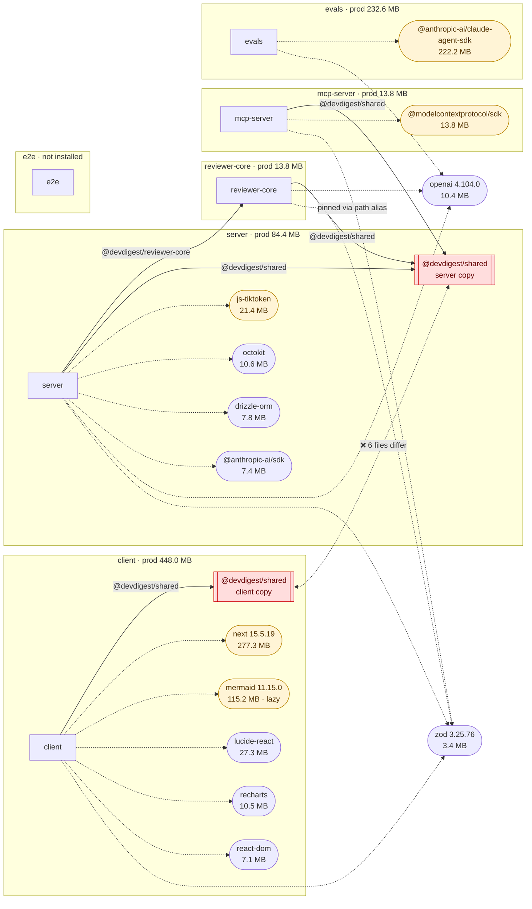

# Dependency report — 2026-10-10

| Mode | Packages | Installed | Declared deps | Total `node_modules` |
|------|----------|-----------|---------------|----------------------|
| offline | 6 | 5 | 78 | 1.3 GB |

## 1. TL;DR

- 🔴 The two vendored copies of `@devdigest/shared` (`client` and `server`) have **diverged in 6 files**. The server contract knows the `openrouter` provider and defaults to it; the client copy still defaults to `openai` / `gpt-4.1`.
- `client` is the heaviest install (555.1 MB). `next` alone is 277.3 MB of its 448.0 MB prod closure. `mermaid` (115.2 MB) is already loaded lazily, so nothing to trim there.
- `server` declares `@fastify/autoload` in prod, but nothing imports it, since modules are registered statically. Quick removal.
- Runtime versions are aligned: `zod` 3.25.76, `openai` 4.104.0, and `typescript` 5.9.3 are the same everywhere. Drift is limited to minor/patch tooling (`@types/node`, `tsx`).
- `e2e` is not installed, so it was not measured.

**Findings:** 🔴 P0 × 1 · 🟠 P1 × 1 · 🟡 P2 × 2 · ⚪ P3 × 3

## 2. Dependency map

Legend: solid arrow = internal edge (tsconfig path alias) · dashed arrow = external
prod dep · 🟥 red = out-of-sync vendored copy · 🟨 amber = more than 25% of its package's prod closure.

## 3. Package overview

| Package | Manager | Prod / Dev | Prod closure | Dev-only | `node_modules` | Flags |
|---------|---------|-----------:|-------------:|---------:|---------------:|-------|
| `client` | pnpm | 11 / 15 | 448.0 MB | 103.6 MB | 555.1 MB | — |
| `evals` | pnpm | 2 / 5 | 232.6 MB | 75.2 MB | 329.2 MB | — |
| `server` | pnpm | 23 / 8 | 84.4 MB | 145.7 MB | 242.2 MB | — |
| `reviewer-core` | npm | 2 / 4 | 13.8 MB | 55.1 MB | 157.2 MB | — |
| `mcp-server` | pnpm | 2 / 3 | 13.8 MB | 45.8 MB | 59.6 MB | — |
| `e2e` | npm | 0 / 3 | — | — | — | not-installed |

## 4. Per-package detail

### 4.1 `client`: Next.js studio UI

| Dependency | Type | Category | Version | Own | Closure | Transitive | Used via | Notes |
|------------|------|----------|---------|----:|--------:|-----------:|----------|-------|
| `next` | prod | framework | 15.5.19 | 133.0 MB | 277.3 MB | 17 | import ×36 | dominates-prod-closure |
| `mermaid` | prod | ui | 11.15.0 | 72.8 MB | 115.2 MB | 110 | import ×1 | dominates-prod-closure; already lazy `import()` |
| `vitest` | dev | test | 2.1.9 | 1.6 MB | 31.1 MB | 43 | import ×37 | — |
| `lucide-react` | prod | ui | 0.469.0 | 27.3 MB | 27.3 MB | 0 | import ×1 | per-icon ESM; tree-shaken |
| `typescript` | dev | build | 5.9.3 | 22.5 MB | 22.5 MB | 0 | script `tsc` | — |
| `@tailwindcss/postcss` | dev | build | 4.3.0 | 97.4 KB | 15.7 MB | 22 | `postcss.config.mjs` | — |
| `jsdom` | dev | test | 25.0.1 | 3.0 MB | 13.2 MB | 59 | `vitest.config.ts` env | — |
| `@vitejs/plugin-react` | dev | build | 4.7.0 | 58.9 KB | 11.9 MB | 48 | import ×1 | — |
| `recharts` | prod | ui | 2.15.4 | 4.4 MB | 10.5 MB | 40 | import ×2 | — |
| `@types/jest-axe` | dev | types | 3.5.9 | 6.5 KB | 8.4 MB | 44 | types for `jest-axe` | pulls Jest typings |
| `react-dom` | prod | framework | 19.2.7 | 7.0 MB | 7.1 MB | 1 | import ×1 | — |
| `jest-axe` | dev | test | 9.0.0 | 20.5 KB | 3.5 MB | 17 | import ×3 | — |
| `zod` | prod | validation | 3.25.76 | 3.4 MB | 3.4 MB | 0 | import ×12 | — |
| `@tanstack/react-query` | prod | ui | 5.101.0 | 838.8 KB | 3.0 MB | 1 | import ×16 | — |
| `react-markdown` | prod | ui | 9.1.0 | 50.7 KB | 2.7 MB | 81 | import ×1 | — |
| `@types/node` | dev | types | 22.19.19 | 2.3 MB | 2.4 MB | 1 | types for `node` | — |
| `next-intl` | prod | framework | 3.26.5 | 355.7 KB | 2.3 MB | 11 | import ×98 | — |
| `remark-gfm` | prod | ui | 4.0.1 | 21.5 KB | 2.3 MB | 67 | import ×1 | — |
| `@types/react` | dev | types | 19.2.16 | 398.1 KB | 1.6 MB | 1 | types for `react` | — |
| `@testing-library/jest-dom` | dev | test | 6.9.1 | 293.8 KB | 1020.5 KB | 9 | import ×1 | — |
| `tailwindcss` | dev | build | 4.3.0 | 737.2 KB | 737.2 KB | 0 | CSS `@import` ×2 | — |
| `@testing-library/react` | dev | test | 16.3.2 | 328.9 KB | 570.7 KB | 1 | import ×33 | — |
| `@testing-library/user-event` | dev | test | 14.6.7 | 427.3 KB | 427.3 KB | 0 | import ×8 | — |
| `postcss` | dev | build | 8.5.15 | 200.8 KB | 376.0 KB | 3 | `postcss.config.mjs` | — |
| `react` | prod | framework | 19.2.7 | 167.6 KB | 167.6 KB | 0 | import ×179 | — |
| `@types/react-dom` | dev | types | 19.2.3 | 29.4 KB | 29.4 KB | 0 | types for `react-dom` | — |

### 4.2 `server`: Fastify API + Drizzle/Postgres

| Dependency | Type | Category | Version | Own | Closure | Transitive | Used via | Notes |
|------------|------|----------|---------|----:|--------:|-----------:|----------|-------|
| `drizzle-kit` | dev | build | 0.30.6 | 7.4 MB | 47.1 MB | 22 | import ×1 | — |
| `vitest` | dev | test | 2.1.9 | 1.6 MB | 31.1 MB | 43 | import ×40 | — |
| `@testcontainers/postgresql` | dev | test | 10.28.0 | 17.8 KB | 29.2 MB | 157 | import ×1 | — |
| `testcontainers` | dev | test | 10.28.0 | 378.7 KB | 29.1 MB | 156 | **none** | indirect: already a dep of `@testcontainers/postgresql` |
| `typescript` | dev | build | 5.9.3 | 22.5 MB | 22.5 MB | 0 | script `tsc` | — |
| `js-tiktoken` | prod | llm-sdk | 1.0.21 | 21.4 MB | 21.4 MB | 1 | import ×1 | dominates-prod-closure (BPE rank tables) |
| `tsx` | dev | build | 4.22.4 | 506.3 KB | 20.9 MB | 3 | script `tsx` | — |
| `octokit` | prod | http | 4.1.4 | 50.0 KB | 10.6 MB | 32 | import ×1 | — |
| `openai` | prod | llm-sdk | 4.104.0 | 4.0 MB | 10.4 MB | 38 | import ×1 | — |
| `drizzle-orm` | prod | db | 0.38.4 | 7.8 MB | 7.8 MB | 0 | import ×46 | — |
| `@anthropic-ai/sdk` | prod | llm-sdk | 0.33.1 | 1.0 MB | 7.4 MB | 38 | import ×1 | — |
| `@ast-grep/napi` | prod | code-analysis | 0.43.0 | 352.2 KB | 7.1 MB | 1 | import ×1 | native binary (darwin-arm64) |
| `fastify` | prod | framework | 5.8.5 | 2.6 MB | 6.9 MB | 47 | import ×17 | — |
| `@vscode/ripgrep` | prod | code-analysis | 1.18.0 | 4.3 KB | 4.3 MB | 1 | dynamic `import()` | ships `rg` binary |
| `dependency-cruiser` | prod | code-analysis | 17.4.3 | 962.7 KB | 4.3 MB | 42 | import ×1 | — |
| `zod` | prod | validation | 3.25.76 | 3.4 MB | 3.4 MB | 0 | import ×23 | — |
| `graphology` | prod | code-analysis | 0.26.0 | 2.6 MB | 2.7 MB | 1 | import ×1 | — |
| `@types/node` | dev | types | 22.19.19 | 2.3 MB | 2.4 MB | 1 | types for `node` | — |
| `simple-git` | prod | git | 3.36.0 | 928.9 KB | 1.1 MB | 6 | import ×1 | — |
| `pino-pretty` | dev | cli-tool | 13.1.3 | 240.0 KB | 788.4 KB | 18 | pino transport target in `src/app.ts` | — |
| `fflate` | prod | other | 0.8.3 | 778.1 KB | 778.1 KB | 0 | import ×3 | — |
| `graphology-metrics` | prod | code-analysis | 2.4.0 | 123.5 KB | 755.6 KB | 7 | import ×1 | — |
| `@fastify/cors` | prod | http | 10.1.0 | 112.5 KB | 567.4 KB | 3 | import ×1 | — |
| `fastify-sse-v2` | prod | http | 4.2.2 | 21.1 KB | 393.4 KB | 15 | import ×1 | — |
| `@fastify/rate-limit` | prod | http | 11.0.0 | 202.5 KB | 301.5 KB | 3 | import ×1 | — |
| `postgres` | prod | db | 3.4.9 | 292.7 KB | 292.7 KB | 0 | import ×2 | — |
| `fastify-type-provider-zod` | prod | http | 4.0.2 | 24.6 KB | 274.7 KB | 2 | import ×14 | — |
| `@fastify/helmet` | prod | http | 13.0.2 | 67.8 KB | 210.7 KB | 2 | import ×1 | — |
| `@fastify/autoload` | prod | http | 6.3.1 | 170.7 KB | 170.7 KB | 0 | **none** | **confirmed unused** |
| `p-queue` | prod | other | 8.1.1 | 40.1 KB | 126.0 KB | 2 | import ×2 | — |
| `dotenv` | prod | cli-tool | 16.6.1 | 74.8 KB | 74.8 KB | 0 | import ×4 | — |

### 4.3 `evals`: skill eval harness

| Dependency | Type | Category | Version | Own | Closure | Transitive | Used via | Notes |
|------------|------|----------|---------|----:|--------:|-----------:|----------|-------|
| `@anthropic-ai/claude-agent-sdk` | prod | llm-sdk | 0.3.198 | 3.5 MB | 222.2 MB | 1 | import ×1 | dominates-prod-closure (bundled CLI binary) |
| `vitest` | dev | test | 2.1.9 | 1.6 MB | 31.1 MB | 43 | import ×5 | — |
| `typescript` | dev | build | 5.9.3 | 22.5 MB | 22.5 MB | 0 | script `tsc` | — |
| `tsx` | dev | build | 4.22.4 | 506.3 KB | 21.0 MB | 3 | script `tsx` | — |
| `openai` | prod | llm-sdk | 4.104.0 | 4.0 MB | 10.4 MB | 38 | import ×1 | — |
| `@types/node` | dev | types | 22.20.0 | 2.3 MB | 2.4 MB | 1 | types for `node` | — |
| `gray-matter` | dev | other | 4.0.3 | 37.7 KB | 812.2 KB | 9 | import ×1 | — |

### 4.4 `reviewer-core`: pure review engine

| Dependency | Type | Category | Version | Own | Closure | Transitive | Used via | Notes |
|------------|------|----------|---------|----:|--------:|-----------:|----------|-------|
| `typescript` | dev | build | 5.9.3 | 22.5 MB | 22.5 MB | 0 | script `tsc` | — |
| `vitest` | dev | test | 2.1.9 | 1.6 MB | 21.8 MB | 43 | import ×5 | — |
| `tsx` | dev | build | 4.23.13 | 520.3 KB | 10.9 MB | 3 | **none** | **confirmed unused** (no script, no import) |
| `openai` | prod | llm-sdk | 4.104.0 | 4.0 MB | 10.4 MB | 38 | import ×3 | dominates-prod-closure |
| `zod` | prod | validation | 3.25.76 | 3.4 MB | 3.4 MB | 0 | import ×2 | also pinned via tsconfig `paths` |
| `@types/node` | dev | types | 22.20.3 | 2.3 MB | 2.4 MB | 1 | types for `node` | — |

### 4.5 `mcp-server`: MCP bridge

| Dependency | Type | Category | Version | Own | Closure | Transitive | Used via | Notes |
|------------|------|----------|---------|----:|--------:|-----------:|----------|-------|
| `typescript` | dev | build | 5.9.3 | 22.5 MB | 22.5 MB | 0 | script `tsc` | — |
| `tsx` | dev | build | 4.23.15 | 387.6 KB | 20.9 MB | 3 | script `tsx` | — |
| `@modelcontextprotocol/sdk` | prod | llm-sdk | 1.31.0 | 4.2 MB | 13.8 MB | 91 | import ×7 | dominates-prod-closure (it's the whole point) |
| `zod` | prod | validation | 3.25.76 | 3.4 MB | 3.4 MB | 0 | import ×5 | — |
| `@types/node` | dev | types | 22.20.4 | 2.3 MB | 2.4 MB | 1 | types for `node` | — |

### 4.6 `e2e`: browser e2e

Not installed, so nothing could be measured. It declares 3 dev deps (`@types/node`, `tsx`, and `typescript`), all of which are referenced from scripts. Run `npm --prefix e2e install` and re-run to get sizes.

## 5. Cross-package

### 5.1 Internal edges

| From | To | Via | Kind |
|------|----|-----|------|
| `server` | `reviewer-core` | `@devdigest/reviewer-core` | cross-package |
| `reviewer-core` | `server` | `@devdigest/shared` | cross-package |
| `mcp-server` | `server` | `@devdigest/shared` | cross-package |
| `server` | `server` | `@devdigest/shared` | vendored-self |
| `client` | `client` | `@devdigest/shared` | vendored-self |
| `client` | `client` | `@devdigest/ui` | vendored-self |
| `reviewer-core` | `reviewer-core/node_modules/zod` | `zod` | pins-external |

### 5.2 Vendored copies

| Alias | Copies | In sync | Differing files |
|-------|--------|---------|-----------------|
| `@devdigest/shared` | `client/src/vendor/shared`, `server/src/vendor/shared` | ❌ | `adapters.ts`, `contracts/eval-ci.ts`, `contracts/knowledge.ts`, `contracts/platform.ts`, `contracts/productionize.ts`, `contracts/trace.ts` |

Drift sample: `adapters.ts` in server adds `sessionId`, the `'openrouter'` provider id, and `CommitFile`/`CommitFilesPayload`. In `contracts/platform.ts`, server defaults to `openrouter` / `deepseek/deepseek-v4-flash`, while client defaults to `openai` / `gpt-4.1`.

### 5.3 Version drift

| Dependency | Versions per package | Major mismatch | Shared-contract risk |
|------------|---------------------|----------------|----------------------|
| `@types/node` | client 22.19.19 · server 22.19.19 · evals 22.20.0 · reviewer-core 22.20.3 · mcp-server 22.20.4 (e2e not installed) | no | no |
| `tsx` | evals 4.22.4 · server 4.22.4 · reviewer-core 4.23.13 · mcp-server 4.23.15 (e2e not installed) | no | no |

Runtime deps that cross alias boundaries are aligned: `zod` 3.25.76 in all four consumers, `openai` 4.104.0 in all three.

### 5.4 Duplicate installs

| Dependency | Version | Packages | Apparent extra | Real disk cost |
|------------|---------|----------|---------------:|----------------|
| `typescript` | 5.9.3 | client, evals, mcp-server, reviewer-core, server | 90.1 MB | ≈22.5 MB (only the npm copy in `reviewer-core`; pnpm copies hardlink) |
| `zod` | 3.25.76 | client, mcp-server, reviewer-core, server | 10.3 MB | ≈3.4 MB (`reviewer-core`, npm) |
| `openai` | 4.104.0 | evals, reviewer-core, server | 8.1 MB | ≈4.0 MB (`reviewer-core`, npm) |
| `vitest` | 2.1.9 | client, evals, reviewer-core, server | 4.7 MB | ≈1.6 MB (`reviewer-core`, npm) |
| `@types/node` | 22.19.19 | client, server | 2.3 MB | ≈0 (pnpm hardlinks) |
| `tsx` | 4.22.4 | evals, server | 506.3 KB | ≈0 (pnpm hardlinks) |

This is expected for a non-workspace repo. The real cost comes from the two npm packages (`reviewer-core` and `e2e`) not sharing the pnpm store.

### 5.5 Vulnerabilities

_Not checked (offline run)._ Re-run with `--online` to include `audit` results.

### 5.6 Outdated

_Not checked (offline run)._

## 6. Size breakdown

### 6.1 Heaviest dependencies (repo-wide, by closure)

| # | Dependency | Package(s) | Type | Closure | Transitive |
|--:|------------|------------|------|--------:|-----------:|
| 1 | `next` | `client` | prod | 277.3 MB | 17 |
| 2 | `@anthropic-ai/claude-agent-sdk` | `evals` | prod | 222.2 MB | 1 |
| 3 | `mermaid` | `client` | prod | 115.2 MB | 110 |
| 4 | `drizzle-kit` | `server` | dev | 47.1 MB | 22 |
| 5 | `vitest` | `client`, `evals`, `reviewer-core`, `server` | dev | 31.1 MB | 43 |
| 6 | `@testcontainers/postgresql` | `server` | dev | 29.2 MB | 157 |
| 7 | `testcontainers` | `server` | dev | 29.1 MB | 156 |
| 8 | `lucide-react` | `client` | prod | 27.3 MB | 0 |
| 9 | `typescript` | `client`, `evals`, `mcp-server`, `reviewer-core`, `server` | dev | 22.5 MB | 0 |
| 10 | `js-tiktoken` | `server` | prod | 21.4 MB | 1 |

Disk size is not bundle size. `client` sizes are install/CI cost, not bytes shipped to the browser.

### 6.2 By category

| Category | Deps | Own size (sum) |
|----------|-----:|---------------:|
| framework | 5 | 143.1 MB |
| build | 16 | 123.0 MB |
| ui | 6 | 105.4 MB |
| llm-sdk | 7 | 42.2 MB |
| validation | 4 | 13.7 MB |
| types | 9 | 12.0 MB |
| test | 9 | 10.3 MB |
| db | 2 | 8.1 MB |
| other | 11 | 6.1 MB |
| http | 7 | 649.2 KB |
| cli-tool | 2 | 314.7 KB |

## 7. Prioritized recommendations

| ID | Pri | Package | Finding | Evidence | Action | Effort | Risk |
|----|-----|---------|---------|----------|--------|--------|------|
| DEP-01 | 🔴 P0 | `repo` | Vendored `@devdigest/shared` copies diverged: client and server disagree on provider ids and defaults | `vendoredCopies.inSync=false`, 6 differing files, server has `'openrouter'` but client doesn't | Review the diff, then `rsync -a --delete server/src/vendor/shared/ client/src/vendor/shared/`, then `pnpm -C client typecheck`. Add a `diff -r` check to CI. | M | Client typecheck may surface places that need the new provider id |
| DEP-02 | 🟠 P1 | `server` | `@fastify/autoload` declared in prod but never imported (modules register statically in `modules/index.ts`) | `importCount=0`, no string or script references, 170.7 KB | `pnpm -C server remove @fastify/autoload` | S | None |
| DEP-03 | 🟡 P2 | `reviewer-core` | `tsx` unused: no script, no import | closure 10.9 MB, `usedVia=null` | `npm --prefix reviewer-core uninstall tsx` | S | Anyone running `npx tsx` ad hoc in `reviewer-core` needs a global `tsx` |
| DEP-04 | 🟡 P2 | `e2e` | Not installed, so it can't be measured | flag `not-installed` | `npm --prefix e2e install`, then re-run the checker | S | None |
| DEP-05 | ⚪ P3 | `server` | `testcontainers` is declared directly but only consumed through `@testcontainers/postgresql` | `importCount=0`; it is in the `dependencies` of `@testcontainers/postgresql` (`^10.28.0`) | `pnpm -C server remove testcontainers` (or keep it deliberately as a version pin) | S | None |
| DEP-06 | ⚪ P3 | `repo` | Patch/minor drift on tooling | `@types/node` 22.19.19 → 22.20.4; `tsx` 4.22.4 → 4.23.15 | Align ranges (`^22.20.0`, `^4.23.0`) in each `package.json`, then reinstall per package | S | None |
| DEP-07 | ⚪ P3 | `reviewer-core`, `e2e` | npm packages don't share the pnpm store, so real duplicate bytes on disk | ≈31.5 MB of real duplicates (`typescript`, `zod`, `openai`, `vitest` in `reviewer-core`) | Migrate both to pnpm (`pnpm import` from `package-lock.json`) | M | Lockfile churn; CI scripts calling `npm` need updating |

### Quick wins

- **DEP-02**: one command removes a dead prod dependency from the API server.
- **DEP-03**: drops 10.9 MB of unused tooling from `reviewer-core`.
- **DEP-04**: makes the next run cover all six packages.

No recommendation for the heavy-but-justified deps: `next` is the framework; `mermaid` is already lazily `import()`-ed in `MermaidDiagram.tsx`; `js-tiktoken`'s size is its rank tables and doesn't shrink with a `/lite` import; `@anthropic-ai/claude-agent-sdk` ships its CLI binary.

## 8. Appendix

- **Method:** `collect-deps.mjs` (1.8 s) reads `package.json`, lockfiles,
  `node_modules` (resolving pnpm symlinks), and tsconfig `paths`, then
  regex-scans source for imports. Offline: no `outdated` or `audit` was run.
  `possibly-unused` hits were verified with Grep. Categories `code-analysis`
  and `git` were re-labeled from `other` by hand.
- **Limits:** sizes are apparent on-disk bytes, not bundle bytes · usage scan
  is regex-based · pnpm duplicates share physical disk through hardlinks.
- **Raw data:** regenerate with `node .claude/skills/dependency-checker/scripts/collect-deps.mjs > deps.json`
