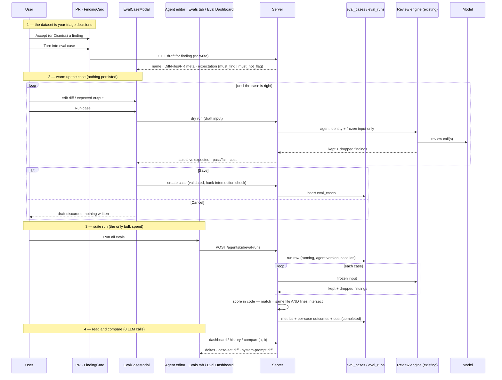

# Spec: Eval Pipeline   |   Spec ID: SPEC-03   |   Status: approved
Supersedes: none

Lesson L06. **Affected modules:** `server`, `client` (cross-module, hence
`specs/cross-module/`). `reviewer-core` is a consumer-only dependency and is
deliberately unchanged (D6). `mcp-server` and `e2e` are non-goals for this slice
(N9, N10).

> **Disambiguation, stated once and normatively.** The `evals/` directory at the
> repository root (plus `.github/workflows/eval-*.yml`) is a *different system*:
> it evaluates the Claude Code harness — skills in `.claude/skills`, agents in
> `.claude/agents`, `CLAUDE.md` routing — that is used to *build* DevDigest, and
> it runs from the terminal and CI. This spec describes a **product feature**: a
> regression harness for DevDigest's *own* review agents, living in `server/` and
> `client/` and surfaced in the studio UI. The two share the word "eval" and the
> methodology, and nothing else — no schema, no contracts, no scripts, no graders.
> Nothing in this spec reads from, writes to, or depends on `evals/`, and nothing
> in `evals/` depends on this feature (N13).

## Problem & Motivation

DevDigest ships review agents (General, Security, Performance, API Contract, …)
whose behaviour is determined by three editable things: a **system prompt**, a
**model**, and a set of **linked skills**. All three are editable from the Agent
editor, and every config change is already snapshotted into `agent_versions`
(`server/src/db/schema/agents.ts:39`, served by `GET /agents/:id/versions` and
`GET /agents/:id/versions/:version` in `server/src/modules/agents/routes.ts`).
What does **not** exist is any way to answer the question that immediately
follows an edit:

> Did the agent get better or worse?

Today the only answer is to open pull requests and eyeball findings — slow,
unrepeatable and unfalsifiable. A prompt edit that quietly introduces a class of
false positives is invisible until somebody complains.

The raw material for a proper answer already exists and is already paid for.
Every review produces findings, and reviewers already triage them:
`POST /findings/:id/accept` and `POST /findings/:id/dismiss` are shipped routes
(`server/src/modules/reviews/routes.ts:150`), and the decision is persisted as
`accepted_at` / `dismissed_at` on the finding row
(`server/src/db/schema/reviews.ts:44-45`; contract
`vendor/shared/contracts/review-api.ts:17-18`). Those two timestamps — the
accept/dismiss decisions made throughout L01–L05 — are a **labelled dataset**
the product has been accumulating without ever reading back:

- An **accepted** finding is a human saying *"this is a real problem, at this
  file and these lines"* — a positive example the agent must keep finding
  (`must_find`).
- A **dismissed** finding is a human saying *"this is noise"* — a negative
  example the agent must stop producing (`must_not_flag`).

No test scenarios need to be invented. This feature turns those decisions into a
curated regression set, runs an agent against that set on demand, and scores the
result **entirely in code**. On the lab, an LLM judge was needed because
"explained the reason" cannot be checked by substring. Here every expectation is
a `file:line` range, and a match is file equality plus line-range intersection —
so **no LLM call exists anywhere in scoring**. The citation-validity predicate
also already exists: the grounding gate `groundFindings`
(`reviewer-core/src/grounding.ts:52`) decides whether a finding's `file` +
`[start_line, end_line]` corresponds to real changed lines.

The outcome is the thing the product cannot do today: change a system prompt, run
the same fixed case set before and after, and read the difference as three
numbers — **recall**, **precision**, **citation accuracy** — then deliberately
break the prompt and watch precision fall. That is the same sensitivity test done
on the lab with `SKILL.md` and an agent definition, moved into the studio.

### This space is already reserved

Like earlier lessons, this feature has reserved surface with zero consumers. It is
adopted rather than duplicated (D1):

1. **Tables.** `eval_cases` and `eval_runs` exist in
   `server/src/db/schema/eval.ts` and shipped in `0000_init.sql`. Neither is read
   or written anywhere outside the schema file and the `db/schema.ts` barrel.
   The reserved `eval_runs.case_id` is `NOT NULL` — i.e. the reserved row is *per
   case execution*, which cannot express a suite run (D2).
2. **Base contracts.** `EvalPerTrace`, `EvalRun`, `EvalOwnerKind`, `EvalCase` in
   `vendor/shared/contracts/knowledge.ts:49-84`. `EvalCase.expected_output` is
   `z.unknown()` (D3).
3. **API contracts.** `EvalCaseInput`, `EvalRunRecord`, `EvalRunResult`,
   `EvalTrendPoint`, `EvalDashboard` in `vendor/shared/contracts/eval-ci.ts`,
   whose header names this lesson ("A4 — Eval / CI / Compose / Conformance API
   contracts (L06)").
4. **UI slots.** `client/messages/en/eval.json` (an unwired namespace),
   `client/messages/en/shell.json` (`nav.eval: "Eval Dashboard"`),
   `client/messages/en/agents.json` (`editor.tabs.evals: "Evals"`), the
   AgentEditor `TABS` array (`…/AgentEditor/constants.ts`, "later lessons add the
   rest"), and the SKILLS LAB section of `client/src/vendor/ui/nav.ts`.

Each mismatch between the reserved shapes and the feature as briefed is resolved
explicitly below.

## Goals / Non-goals

### Goals

- **G1** — Turn a single triaged finding into an eval case from the finding card,
  with the expectation type derived from the human decision already recorded:
  accepted → `must_find`, dismissed → `must_not_flag`.
- **G2** — Let the user **warm up** a candidate case before it joins the set:
  inspect and correct the pre-filled diff and expectation, dry-run the agent on
  it, see actual vs expected and pass/fail, and only then save (or discard).
- **G3** — Store each case with a **frozen, self-contained input**, so the only
  thing that varies between two runs of the same case set is the agent's own
  configuration.
- **G4** — Run one agent against its whole case set as a single, identifiable
  **suite run**, recording what it scored, which agent version produced it, and
  which cases it covered.
- **G5** — Score every run with **zero LLM calls**: matching is file equality plus
  line-range intersection, computed in code.
- **G6** — Define `citation_accuracy` as a *read* of the existing grounding gate's
  result, never as a second definition of what a valid citation is.
- **G7** — Make a prompt change legible: two runs on the same case set compare side
  by side, with per-metric deltas and a diff of the two system prompts.
- **G8** — Give one agent's evals a home inside the Agent editor (Evals tab: case
  set + metrics + run history) and give all agents a global **Eval Dashboard** in
  the left sidebar (latest metrics, trend, recent runs, per-agent detail, compare).
- **G9** — Make the cost of a run visible before and after it runs, and ship a
  mechanical `verify:l06` check that proves the feature is wired end to end.

### Non-goals (explicitly out of scope for this slice)

- **N1 — Any LLM-based grading.** No judge model, no rubric scoring, no
  model-authored explanation of a metric move. Every number and sentence this
  feature displays is computed deterministically from stored data.
- **N2 — Synthetic case authoring as the primary path.** Cases originate from real
  triaged findings. A secondary "New eval case" entry (empty modal) exists for
  editing convenience, but the acceptance bar (≥ 8 cases) is met from real
  findings only, and no fixture cases are seeded.
- **N3 — Skill-owned eval cases** and an Evals tab in the Skill Editor. The
  reserved `EvalOwnerKind` admits `'skill'`; this slice implements `'agent'`
  only. The polymorphic owner shape keeps the door open.
- **N4 — Scoring the agent's verdict, summary or PR score.** Only findings are
  scored (D7).
- **N5 — Automatic runs.** No run is triggered by a review completing, a prompt
  save, opening a page, a schedule, or CI. Every run is an explicit user action.
- **N6 — Cross-agent ranking.** Agents are listed side by side, but their metrics
  are computed over *different* case sets and are not a leaderboard.
- **N7 — Changing how reviews, findings, accept/dismiss, grounding or agent
  versioning work.** This feature is a pure consumer of all of them.
- **N8 — Gating anything on a metric.** No run blocks a merge, fails CI, disables
  an agent or prevents a prompt from being saved.
- **N9 — An MCP tool** exposing eval cases, runs or metrics.
- **N10 — An e2e browser flow.**
- **N11 — Exporting or importing case sets** across workspaces.
- **N12 — "Promote vN" as a shipped action.** The compare modal mockup shows it;
  it is deferred (AC-37). If it ships later it must restore by recording a *new*
  agent version, never by rewriting `agent_versions` history.
- **N13 — Any change to the root `evals/` lab harness** or its CI workflows.

## Decisions

- **D1 — Adopt and reshape the reserved `eval_cases` / `eval_runs` tables and
  `Eval*` contracts in place; no parallel tables.** Both tables are empty and
  unread, so reshaping needs no data migration and no compatibility shim. The
  implementation must re-confirm zero rows before adding `NOT NULL` columns.
- **D2 — A run is suite-level.** The brief's unit of work and of comparison is
  "the agent against **all** its cases", and recall / precision are only
  meaningful over a set. One suite run = one row owned by an agent, carrying a
  lifecycle status (`running | completed | errored`), the set-level metrics, and
  the per-case outcomes nested under it. The reserved per-case `case_id NOT NULL`
  column does not survive. Whether per-case outcomes live as a nested array on the
  run row or in a child table is a planning decision; the contract exposes them
  nested.
- **D3 — The expectation is explicit, typed and closed.** Each case carries
  exactly one expectation: `{ type: must_find | must_not_flag, file, start_line,
  end_line }` plus optional display metadata (`severity`, `category`, `title`)
  carried over from the source finding. The scorer branches on `type`, never on
  the shape of a JSON blob. The modal's "Expected output" editor edits this
  object (D12).
- **D4 — A suite run records the agent configuration version it ran against.**
  Without it, "old prompt vs new prompt" has no source for the prompt diff, and
  "which change moved the number?" is unanswerable. The version is the existing
  `agents.version` / `agent_versions.version`.
- **D5 — A suite run records the exact set of case ids it covered.** Cases are
  added and deleted between runs; recording the covered set is what lets compare
  detect and state case-set drift (AC-35).
- **D6 — `citation_accuracy` reuses the grounding gate verbatim; `reviewer-core` is
  untouched.** `groundFindings` already defines a valid citation (file present in
  the diff and `[start_line, end_line]` intersecting a real hunk; full-file kinds
  `secret_leak`, `lethal_trifecta`, `phantom`, `hook` need only the file —
  `grounding.ts:16`). Each review execution already returns the kept and dropped
  sets. `citation_accuracy = kept / (kept + dropped)` is a read of numbers the
  engine already computes. `git diff reviewer-core/` must be empty.
- **D7 — Only findings are scored.** Verdict, summary and score are model-authored
  and irrelevant to whether the agent located the right lines.
- **D8 — A case's input is frozen at capture and never re-fetched.** A case stores
  its own self-contained unified diff, file list and trimmed PR metadata rather
  than a pointer to a live PR. A pointer would drift with force-pushes, repo
  deletion and branch cleanup and destroy reproducibility. Consequently a case
  outlives the finding, review, PR and repo it came from. Note: a stored
  `pr_files.patch` (`server/src/db/schema/pulls.ts:44`) is hunks only, with no
  `diff --git` / `---` / `+++` header; the frozen diff must be a synthesized,
  parseable unified diff (header + stored patch).
- **D9 — An eval execution's prompt gets only what the frozen input can supply.**
  A live review enriches the prompt with derived intent, a repo map, a callers
  digest and project-context documents (`server/src/modules/reviews/run-executor.ts`),
  all of which depend on a live checkout and live PR. Feeding them from *today's*
  repo state would make a case's result change when unrelated code is pushed. An
  eval execution therefore receives the agent's versioned identity (system prompt,
  model, strategy, linked skill bodies) plus the case's frozen input — nothing
  else. It goes through the same review engine entry point (`reviewPullRequest`,
  `reviewer-core/src/review/run.ts:128`) and the same grounding gate.
- **D10 — Scope of the frozen diff: the finding's own file.** The brief calls it a
  "diff fragment". The frozen diff is the full diff of the finding's file (all its
  hunks, so context survives), the file list is that one file, and PR metadata is
  trimmed to `{ pr_number, title, body }`. A whole-PR input would let the agent rack
  up unrelated findings in untouched files and dilute precision on noise the case
  was never about. Two findings in the same file become two separate cases.
- **D11 — Every run is an explicit user action; looking is free.** Opening the
  Evals tab, the dashboard, the agent detail, a case, or a comparison renders
  stored data and makes no LLM call. A suite run costs one review execution per
  case; "Run all agents" multiplies that by the agent count. Auto-running on prompt
  save would turn every config edit into a bill.
- **D12 — Case creation is two-step: draft → warm-up → Save.** *(Normative; this is
  the main behavioural requirement beyond the brief.)* The "Turn into eval case"
  button does **not** write a case. It opens **EvalCaseModal**, pre-filled from the
  finding: name, Diff / Files / PR meta tabs, and the expected output. Inside the
  modal the user warms the case up — checks the expected output, edits the diff or
  the expectation if needed, presses **Run case** to execute the agent once on the
  in-modal input and see actual output and pass/fail, and repeats until the case is
  right. Only **Save** persists it (it then appears in the agent's Evals tab under
  "Eval cases"); **Cancel** / close discards it. Rationale: a case in the set is a
  regression test everyone will steer by after every prompt, model or skill change.
  A bad case is worse than no case — it is either always red or always green and
  measures nothing. Nothing is written to `eval_cases` before Save, and a dry run
  ("Run case") writes no suite-run row.
- **D13 — One case per (finding, agent).** The case records `source_finding_id`.
  WHEN the button is activated on a finding that already has a saved case for that
  agent, the modal opens the **existing** case in edit mode instead of a new draft,
  so the set never double-counts the same expectation.
- **D14 — Deleting an agent deletes its cases and runs.** `eval_cases.owner_id` is
  polymorphic with no FK to `agents`, so nothing cascades at the DB level; the
  agent-delete path must delete them explicitly. Orphaned, unreachable rows are
  worse than losing the history of a deleted agent.
- **D15 — A stuck run is always reconciled.** On server startup, **every** suite
  run still `running` is marked `errored` ("interrupted") — the server is a single
  instance, so no run can genuinely be in flight across a restart (the same posture
  the product already applies to review runs at boot). Additionally, on the next
  run-start request for an agent, a run of that agent `running` for longer than 15
  minutes is treated as stale and marked `errored` before the in-flight guard is
  evaluated. A restart or a hung execution can therefore never deadlock an agent's
  runs.
- **D16 — The dashboard banner is derived, never narrated.** The mockup's
  "Precision dipped 2pts on v7 — a new false positive slipped in" has a computable
  half (largest absolute metric delta between the two most recent runs + version)
  and a causal half. The causal half is shown **only** when the data shows it — a
  specific case flipped pass ↔ fail between those runs — and then names that case.
  Never model-authored.
- **D17 — "Traces passed" is a count tile, not a fourth metric.** It shows cases
  passed of cases scored (`traces_passed / traces_total`).
- **D18 — Editing or deleting a case never rewrites history.** Past runs keep the
  metrics and per-case outcomes they recorded at the time; nothing is recomputed.
  A run's per-case outcome carries the case name and expectation type as captured,
  so it stays readable after the case is edited or deleted.
- **D19 — Both `vendor/shared` copies, by hand.** `server/src/vendor/shared` and
  `client/src/vendor/shared` are independent copies. Every contract this feature
  adds or reshapes lands in both, identically, and the feature does not widen
  existing drift (AC-52).
- **D20 — A run with errored cases stays comparable.** Errored cases are excluded
  from that run's metrics (AC-18); a comparison is computed over cases scored in
  both runs (AC-35), so an errored case narrows the intersection.
- **D21 — `verify:l06` lives in `server/package.json`.** There is no root
  `package.json`. DB-backed checks follow the existing `*.it.test.ts` /
  testcontainers convention and self-skip without Docker. Contract parity and the
  scoring suite are plain Vitest and run from the same command.

## User stories

- **US-1** — As a reviewer who just **accepted** a finding, I click "Turn into
  eval case" and get a pre-filled case saying *this agent must find this problem
  at this file:line*. *(AC-1–AC-5)*
- **US-2** — As a reviewer who just **dismissed** a noisy finding, I do the same
  and get a case saying *this agent must not comment here*. *(AC-1–AC-5)*
- **US-3** — As a case author, before saving I can check and fix the expected
  output and the diff, dry-run the agent, see what it actually produced and
  whether the case passes, iterate, and then Save or Cancel. *(AC-3–AC-10)*
- **US-4** — As an agent owner, I see every case in my agent's set in the Evals
  tab, each with its expectation, tags, and last-run outcome. *(AC-39, AC-40)*
- **US-5** — As an agent owner, I open a saved case, correct it, run it alone, or
  delete it. *(AC-12–AC-14, AC-41)*
- **US-6** — As an agent owner, I run my agent against its whole case set with one
  action and get recall, precision and citation accuracy. *(AC-15–AC-26)*
- **US-7** — As an agent owner, I change the system prompt, run again, and see the
  numbers move; when I deliberately break the prompt, precision falls.
  *(AC-30–AC-32)*
- **US-8** — As an agent owner, I open run history, select exactly two runs and
  compare them: old → new per metric, and a diff of the two system prompts.
  *(AC-33–AC-37, AC-46)*
- **US-9** — As a workspace owner, I open the Eval Dashboard from the sidebar and
  see every agent's latest metrics and trend, plus recent runs across agents.
  *(AC-42–AC-45)*
- **US-10** — As a workspace owner, I drill into one agent and see tiles with
  deltas, a trend, a plain statement of the biggest recent move, and the run
  table. *(AC-46, AC-47)*
- **US-11** — As a workspace owner, I know what a run will cost before triggering
  it and what it cost after; looking never costs anything. *(AC-27–AC-29)*
- **US-12** — As a user with no cases or no runs yet, every surface tells me what
  is missing and what to do, instead of zeroes I would misread. *(AC-48–AC-51)*
- **US-13** — As a security-conscious owner, hostile content in a stored diff,
  path or finding text cannot instruct my model or inject markup into my
  browser, and I can never touch another workspace's cases. *(AC-52–AC-56)*
- **US-14** — As a maintainer, `pnpm verify:l06` tells me mechanically whether
  the feature is wired end to end. *(AC-59)*

## Acceptance criteria (EARS)

*Terms.* A **case** is a saved eval case belonging to exactly one agent. A
**draft** is an unsaved candidate case living only in the open EvalCaseModal. An
**expectation** is a case's `{type, file, start_line, end_line}` (D3). A **suite
run** is one execution of one agent against its case set (D2). A **dry run** is a
single-case execution from the modal or a case row that is not a suite run. A
finding **matches** an expectation when the finding's `file` equals the
expectation's `file` **and** the finding's `[start_line, end_line]` intersects
`[start_line, end_line]` of the expectation (inclusive; a one-line overlap
matches). A case's **frozen input** is its stored diff, file list and PR
metadata (D8, D10).

### Case creation — FindingCard button and EvalCaseModal

- **AC-1** — The FindingCard shall show a "Turn into eval case" action alongside
  Accept / Dismiss, and the action shall be enabled only WHILE the finding has
  been accepted or dismissed; otherwise it shall be disabled with a tooltip
  stating that the finding must be accepted or dismissed first.
  *Verify: the action is disabled on a finding with neither `accepted_at` nor
  `dismissed_at`, and enabled once either is set.*
- **AC-2** — WHEN the user activates "Turn into eval case", the system shall open
  EvalCaseModal for the agent that produced the finding and shall not create,
  update or delete any `eval_cases` or `eval_runs` row.
  *Verify: clicking the button then pressing Cancel leaves the agent's case count
  and run count unchanged.*
- **AC-3** — WHEN EvalCaseModal opens from a finding, the system shall pre-fill:
  a **name** (a kebab-case slug derived from the finding title, editable,
  required); the **frozen input** split into **Diff** (the self-contained unified
  diff of the finding's file — D8, D10), **Files** (that file) and **PR meta**
  (`pr_number`, title, body); and the **Expected output** as the expectation
  object. The header shall show the agent name.
- **AC-4** — WHEN the source finding is **accepted**, the pre-filled expectation
  type shall be `must_find`; WHEN it is **dismissed**, it shall be
  `must_not_flag`. In both cases the expectation shall carry the finding's `file`,
  `start_line`, `end_line`, and its `severity`, `category` and `title` as display
  metadata.
- **AC-5** — WHILE the user edits the Expected output, the modal shall validate it
  against the expectation contract on every change, show a "valid JSON" indicator
  when it parses and validates, and otherwise name the failing field; Save and
  Run case shall be disabled while it is invalid.
  *Verify: an unknown `type` or a non-integer `start_line` shows a field error and
  disables Save.*
- **AC-6** — The modal shall offer a "Finding skeleton" helper that inserts a
  template expectation object, and shall let the user edit the Diff, Files and PR
  meta tabs.
- **AC-7** — WHEN the user presses **Run case**, the system shall execute the
  agent once on the modal's *current* (possibly edited, unsaved) input through the
  same execution path as a suite run (D9), score it with the same code (AC-18),
  and display: pass/fail, the expected vs actual finding counts, the actual
  findings with which of them matched the expectation, duration and cost. It shall
  persist nothing.
  *Verify: a dry run from a draft returns an outcome and the case and run counts
  are unchanged.*
- **AC-8** — WHEN the user presses **Save** on a draft, the system shall validate
  the name, frozen input and expectation, create exactly one case in that agent's
  set with `source_finding_id` set, close the modal, and show the case in the
  Evals tab's "Eval cases" list. WHERE the "Run on save" toggle is on, the system
  shall then dry-run the saved case once and record its outcome as that case's
  latest single-case result.
- **AC-9** — WHEN the user presses **Cancel** or closes the modal, the system shall
  discard the draft and create nothing.
- **AC-10** — IF the expectation's line range intersects no hunk of the frozen diff
  for its file (including a null or empty stored patch), THEN Save and Run case
  shall be refused with that reason stated and no case created — because such an
  expectation can never be matched by a finding that survives grounding. The check
  shall reuse the grounding gate (treating the expectation as an ordinary,
  non-full-file finding), not re-implement it.
  *Verify: an expectation whose lines fall outside every hunk is refused with a
  stated reason.*
- **AC-11** — WHEN the button is activated on a finding that already has a saved
  case for that agent (D13), the modal shall open that existing case in edit mode,
  and Save shall update it rather than create a second case.
  *Verify: activating the button twice on one finding and saving each time yields
  exactly one case.*
- **AC-12** — The system shall keep a saved case's expectation independent of its
  source finding, so a later re-triage of that finding does not alter the case.
  *Verify: dismissing a previously accepted source finding leaves its case's type
  as `must_find`.*

### Case management

- **AC-13** — The system shall allow a saved case's name, notes, frozen input and
  expectation to be edited through the same EvalCaseModal, and a case to be
  deleted after an explicit confirmation. IF an edit fails contract validation,
  THEN it shall be rejected naming the field, and the stored case shall be
  unchanged.
- **AC-14** — WHEN a case is edited or deleted, the system shall leave previously
  stored suite runs and their recorded outcomes unchanged and shall not recompute
  them (D18).

### Running a suite

- **AC-15** — WHEN the user triggers `POST /agents/:id/eval-runs`, the system shall
  create one suite run in `running` state and execute the agent against **every**
  case in its set, each with its frozen input as the diff, through the existing
  review engine and grounding gate. The request shall return immediately with the
  run id; the client shall poll the run until it leaves `running`.
- **AC-16** — The prompt assembled for an eval execution shall contain only the
  agent's versioned identity — system prompt, model, strategy, linked skill
  bodies — and the case's frozen input, and shall contain no repo map, callers
  digest, project-context document, live PR description or derived intent (D9).
  *Verify: for a case whose repo has a repo map, the assembled eval prompt has no
  repo-map section.*
- **AC-17** — WHERE two suite runs cover the same cases and the agent's
  configuration is unchanged, the system shall supply byte-identical model input
  for each corresponding case. *Verify: assemble the input for the same case twice
  with no config change and assert equality.*
- **AC-18** — IF a case's execution fails — provider error, timeout, or an
  unvalidatable model response — THEN the system shall complete the run, mark that
  case `errored` with its reason, exclude it from every metric's numerator and
  denominator, and record the errored count.
  *Verify: a run where one of several cases fails stores metrics over the rest and
  `cases_errored = 1`.*
- **AC-19** — WHILE a suite run is in flight for an agent, the system shall not
  start a second run for that agent and shall report the in-flight run instead
  (after D15's stale reconciliation). *Verify: two rapid triggers produce exactly
  one run.*
- **AC-20** — IF a run cannot start — the agent has no cases, no API key is
  configured for the agent's provider, or a run is already in flight — THEN the
  system shall respond with a 4xx stating which applies and create no run row.
- **AC-21** — The system shall rate-limit run triggering (single-agent and
  run-all), so repeated or scripted triggers cannot start an unbounded number of
  executions.

### Scoring — deterministic, zero LLM calls

- **AC-22** — The system shall compute a run's `recall`, `precision`,
  `citation_accuracy`, per-case pass/fail, and every displayed delta, trend point
  and banner without any LLM call. *Verify: score stored execution outputs with a
  stubbed provider and assert zero provider calls.*
- **AC-23** — A `must_find` case shall pass WHEN at least one of the agent's
  grounded findings for it matches the expectation; a `must_not_flag` case shall
  pass WHEN none of them matches.
- **AC-24** — `recall` = (number of `must_find` cases with ≥ 1 matching grounded
  finding) ÷ (number of scored `must_find` cases). *"Share of what was expected
  that was found."*
- **AC-25** — `precision` = 1 − (false positives ÷ total grounded findings across
  the run), where a false positive is a grounded finding produced for a
  `must_not_flag` case that matches that case's expectation. *"Share of findings
  that are not noise — dismissed cases act here."*
  *Verify: one `must_not_flag` case, four grounded findings, one overlapping the
  forbidden range → precision 0.75.*
- **AC-26** — `citation_accuracy` = grounded (kept) findings ÷ all findings the
  agent produced (kept + dropped by the grounding gate), across the run. *"Share of
  findings that survived the grounding gate."* The system shall not define or
  vary the citation-validity rule (D6).
  *Verify: four produced, three kept → 0.75.*
- **AC-27** — Only grounded findings shall be matched against expectations and
  counted in precision's denominator, so a finding is never counted as both a
  citation failure and a false positive.
- **AC-28** — WHERE a metric's denominator is zero — no scored `must_find` cases
  (recall), no grounded findings (precision), no findings at all (citation) — the
  system shall report it as not applicable (`null`, rendered "n/a"), never as 0,
  1 or an error. *Verify: a run over only `must_not_flag` cases reports recall
  n/a.*
- **AC-29** — WHEN a run completes, the system shall store: status, set-level
  metrics, `traces_passed` / `traces_total`, `cases_errored`, per-case outcomes
  (case id, captured name and expectation type, status, pass, error reason,
  findings total / matched, grounding kept / total, actual findings with a
  `matched` flag, duration, cost), the agent version (D4), the covered case ids
  (D5), total duration and total cost.

### Cost and spend control

- **AC-30** — WHEN the user is about to run a suite, the UI shall state the number
  of cases (executions) and an estimated cost before execution starts, from a
  read-only estimate endpoint that makes no LLM call.
- **AC-31** — WHEN the user runs all agents from the dashboard, the system shall
  require an explicit confirmation stating the total number of executions
  (agents × cases), start nothing until confirmed, and then report progress and
  failure per agent rather than one combined result.
- **AC-32** — WHEN a run completes, its total cost and duration shall be displayed
  alongside its metrics.

### The demonstration this feature must support

- **AC-33a** — The system shall run and score, as one suite run, an agent whose
  set contains **at least eight cases created from real triaged findings**, with
  at least one `must_find` and at least one `must_not_flag` case.
- **AC-33b** — WHEN an agent's system prompt is changed between two suite runs over
  the same case set, each run shall be attributed to the distinct agent version
  that produced it, and the compare view shall show a visible difference in
  recall and/or precision.
- **AC-33c** — WHERE a deliberately degraded system prompt causes the agent to
  produce a finding matching a `must_not_flag` expectation it did not match
  before, the later run shall report lower `precision` than the earlier one over
  the same set. *Verify: run the set, add an instruction provoking a finding on a
  known must-not-flag range, re-run, read the precision drop.*

### Compare

- **AC-34** — Compare shall be enabled only WHEN exactly two suite runs of one
  agent are selected.
- **AC-35** — WHEN two runs are compared, the system shall show, for recall,
  precision, citation accuracy and cost, the older value, the newer value and the
  delta with its direction (▲/▼ plus text, not colour alone). IF the runs covered
  different case sets, THEN it shall state that they differ, name the added and
  removed cases, and compute the metric deltas over the cases scored in both.
- **AC-36** — WHEN two runs are compared, the system shall show a line-oriented
  diff of the system prompts of the two agent versions, distinguishing removed
  (old) from added (new) lines; WHERE both runs used the same version, it shall
  say the prompt is unchanged.
- **AC-37** — *Deferred (N12).* A "Promote vN" action is not shipped this slice.

### Client — AgentEditor Evals tab

- **AC-38** — The AgentEditor shall present an **Evals** tab after Config / Skills
  / Context, selected by the same tab mechanism, without changing the existing
  tabs' behaviour.
- **AC-39** — The Evals tab shall show: an **Eval metrics** row of tiles — Recall,
  Precision, Citation accuracy (each with its delta vs the previous run in points)
  and Traces passed (`passed/total`) — from the latest completed run; a "View full
  dashboard →" link to the agent's dashboard detail; an **Eval cases** header with
  "N / M passing", a **Run all evals** action and a **New eval case** action.
- **AC-40** — Each case row shall show its name, a pass / fail / never-run state
  (icon plus text), "expected X finding(s), got Y" from its latest result (or
  "never run"), a `SEVERITY · category` tag for `must_find` or an "empty []" /
  must-not-flag tag for `must_not_flag`, and actions **Run** (dry-run that case),
  **Edit** (open EvalCaseModal) and **Delete**.
- **AC-41** — The Evals tab shall show the agent's **run history** (newest first:
  ran at, version, recall, precision, citation, passed/total, cost, status).

### Client — Eval Dashboard (left sidebar)

- **AC-42** — The sidebar SKILLS LAB section shall contain an **Eval Dashboard**
  entry routing to a workspace-level page (`/eval`), not scoped to a repo.
- **AC-43** — The dashboard shall list every agent with its model, last run
  version and time, `passed/total`, a sparkline trend over recent runs, and latest
  recall / precision / citation; each row opens that agent's detail.
- **AC-44** — The dashboard shall show **Recent eval runs · all agents**, newest
  first: agent, ran at, version, recall / precision / citation (bar + value),
  `passed/total`.
- **AC-45** — The dashboard shall state that each agent's metrics are computed
  over its own case set and shall not order or style agents as a ranking. It shall
  offer **Run all agents** (AC-31).
- **AC-46** — The agent detail page (`/eval/agents/:id`) shall show: an agent
  selector, **Run eval**, metric tiles with deltas vs the previous run, a **metric
  trend** chart (three lines) with a non-graphical table equivalent, and a **recent
  runs** table with row checkboxes (ran at, version, recall, precision, citation,
  pass, cost) and a **Compare** button enabled at exactly two selections, opening
  the Compare modal (AC-34–AC-36).
- **AC-47** — The detail page shall show the derived banner (D16): the largest
  metric change between the two most recent runs, naming metric, direction,
  magnitude and version; WHERE specific cases flipped pass ↔ fail, it shall name
  them; WHERE none did, it shall assert no cause.
  *Verify: a move with no case transition yields no causal clause.*

### Empty, degraded and failure states

- **AC-48** — WHERE an agent has no cases, its eval surfaces shall say so and
  explain how to create one (accept/dismiss a finding → "Turn into eval case"),
  and show no metric values.
- **AC-49** — WHERE an agent has cases but no completed run, its surfaces shall
  say it has never been run, with no metric values and no trend.
- **AC-50** — WHERE an agent has exactly one completed run, the system shall show
  its metrics without deltas, disable compare, and say a second run is needed.
- **AC-51** — WHERE a run ended `errored`, its row shall say so with the reason,
  and it shall not be used as the "latest" for tiles.

### Contracts, security and access

- **AC-52** — Every contract this feature adds or reshapes shall be present and
  identical in both `vendor/shared` copies (D19). *Verify: a test compares the two
  copies of the eval contract sections and finds no difference.*
- **AC-53** — The system shall treat a case's frozen diff, file paths, PR metadata
  and any text carried from its source finding as untrusted data, passed to the
  model under the existing shared injection guard (`reviewer-core/src/prompt.ts`),
  never as instructions; no per-feature keyword scanning is added.
- **AC-54** — The client shall render case names, notes, expectation contents,
  finding titles and rationales, and system-prompt diffs as text, never as markup.
  *Verify: a case named `` renders as visible text.*
- **AC-55** — The system shall accept an expectation only after validating it
  against the expectation contract at the route boundary, and shall never
  evaluate, execute or interpolate it as code or as a query. Request bodies shall
  enforce size limits on the frozen diff and text fields.
- **AC-56** — WHERE an eval case or run belonging to another workspace is
  requested — for read, dry run, suite run, edit, delete or compare — the system
  shall respond as not found and act on nothing.

### Accessibility

- **AC-57** — Every metric, delta and pass/fail state shall be distinguishable
  without colour alone, and the trend chart shall have a non-graphical equivalent.
- **AC-58** — Opening the modal, Run case, Save/Cancel, running a suite, selecting
  two runs and opening Compare shall be keyboard-operable; the modal shall trap
  focus and close on Escape; a run's status change shall be announced via an
  `aria-live` region.

### Verification command

- **AC-59** — `cd server && pnpm verify:l06` shall exist and pass, mechanically
  checking at least: the eval migrations apply cleanly; the two `vendor/shared`
  copies of the eval contracts agree (AC-52); the eval routes respond over their
  documented surface (including that the draft endpoint and dry run write no
  rows); and the scoring unit suite covering AC-23–AC-28 (pass rules, the three
  metrics, the worked examples, zero denominators, zero provider calls) is green.
  DB-backed checks self-skip without Docker (D21).

## Edge cases

- **Finding re-triaged after the case was saved.** The case's expectation is fixed
  (AC-12); re-triage does not invert a regression case under the owner's feet.
- **Button clicked on an untriaged finding.** Disabled with an explanation (AC-1).
- **Same finding turned into a case twice.** Opens the existing case (AC-11, D13);
  no double counting.
- **Draft abandoned (Cancel, Escape, navigation away).** Nothing persisted (AC-9).
- **Dry run on a draft fails** (provider error / no key). The modal shows the
  reason; the draft stays editable; nothing persisted.
- **Source PR force-pushed, review deleted or repo removed.** The case is
  unaffected — it holds its own frozen input (D8).
- **Source file's stored patch is null or binary** (seeded PRs may have
  `patch: null`). There are no hunks, so AC-10 refuses Save with that reason; the
  user can paste a diff into the Diff tab.
- **Full-file-kind finding** (`secret_leak`, `lethal_trifecta`, `phantom`,
  `hook`). It survives grounding on file presence alone, but expectation matching
  still requires line intersection; AC-10's check (as a non-full-file finding)
  catches an expectation whose lines are outside every hunk.
- **Agent deleted while it owns cases.** Its cases and runs are deleted (D14).
- **A `must_find` case the agent has never matched.** A legitimate failing
  regression target; renders as fail, not as broken.
- **Agent produces zero findings everywhere.** Recall 0 (if any `must_find`);
  precision and citation n/a (AC-28). Reporting precision 1.0 for an agent that
  says nothing would mislead.
- **Findings only outside every expectation.** Not false positives under AC-25's
  definition, so precision stays 1.0 while recall falls. A deliberate consequence
  of the brief's definition: without a judge there is no LLM-free way to call an
  unexpected finding "noise" unless a human dismissed it.
- **A long finding overlapping an expectation by one line.** Matches (AC-23).
- **Cases added/deleted between two compared runs.** Stated, deltas over the
  intersection (AC-35).
- **Run interrupted** (outage, restart). Reconciled to `errored` on boot, or after
  15 min on the next run start (D15); never a permanent block.
- **Two different agents run simultaneously.** Allowed — the guard is per agent;
  rate limiting (AC-21) bounds total load.
- **Very large frozen diff.** Replayed on every run forever; rejected above the
  size limit (AC-55).
- **Hostile content in diff, path or finding text.** Data, not instructions
  (AC-53); rendered as text (AC-54). Note the amplification: a live PR diff is
  reviewed once, a stored case's diff is replayed on every run indefinitely.
- **Malformed or huge expectation JSON.** Rejected at the boundary naming the
  field (AC-5, AC-13, AC-55).
- **Agent's provider has no key.** Run refused with that reason, no run row
  (AC-20).
- **Linked skill edited between two runs** (known limitation, L1). Editing a
  skill's body does not bump `agents.version`, yet skill bodies are part of the
  eval prompt (D9). Two runs attributed to the same version can therefore differ
  in model input, and compare would report "prompt unchanged". Accepted for this
  slice — the demonstration (AC-33b/c) varies the system prompt, which does bump
  the version. See Known limitations.
- **Model non-determinism.** Two runs of an unchanged config may still differ by
  sampling; the input is byte-identical (AC-17), so any variance is the model's.

## Non-functional

- **Determinism and reproducibility** are the primary quality attribute. If two
  runs of an unchanged agent over an unchanged set can differ for reasons other
  than model sampling, every number is worthless. AC-17 states the invariant; D8,
  D9 and D10 make it achievable.
- **Cost.** A suite run is N review executions; run-all is agents × cases. Spend is
  stated before (AC-30, AC-31), attributed after (AC-29, AC-32), rate-limited
  (AC-21), and never incurred by looking (D11). Scoring is free by construction.
- **Security — untrusted input to the model.** Stored diffs, paths and PR metadata
  are attacker-influenceable on repos taking outside contributions and travel under
  the existing injection guard as data (AC-53). An eval execution sends strictly
  *less* repository content than the live review it came from (D9); this feature
  must not become a path for more repo content to reach a provider.
- **Security — untrusted output in the browser.** All model- and user-authored
  text renders as text (AC-54).
- **Security — expectation is data, never a program** (AC-55).
- **Security — workspace scoping.** Every read, run, edit, delete and comparison
  resolves the caller's workspace before touching a row (AC-56).
- **Log privacy.** Run logs record ids, counts, metrics, model, tokens and cost —
  never diff content, expectation content or finding prose.
- **Performance.** Scoring is an in-memory comparison and must not re-fetch a
  diff, read a checkout or contact the host. Read surfaces render from stored data.
  A suite run must not block the HTTP request that triggered it (AC-15).
- **Backwards compatibility.** No existing route response, finding action, review
  behaviour or agent-versioning behaviour changes (N7). An agent with no cases
  renders its editor as today plus one tab.
- **Architecture.** Server work follows the repo's onion layering (routes → service
  → repository, adapters via the DI container) and is registered statically in
  `server/src/modules/index.ts`. ESM relative imports carry `.js`.

## Known limitations

- **L1 — Skill-body edits are not versioned into a run's attribution.** A suite run
  records the agent version (D4), and `agents.version` changes only when the
  agent's own config changes — not when a linked skill's body is edited. Because
  skill bodies are part of the eval prompt (D9), two runs at the same agent version
  may have run with different skill text, and the compare view's "which change
  moved the number" (AC-35, AC-36) cannot attribute a skill edit. Out of scope for
  this slice; a later slice could record a digest of the linked skill bodies per
  run. Workaround for experiments: change one thing at a time and note skill edits
  in the case/run notes.

## Inputs (provenance)

| Input | Provenance |
|---|---|
| Source finding's file, line range, severity, category, title, kind | `[reused: the persisted finding row from an earlier review]` |
| Expectation type (`must_find` / `must_not_flag`) | `[deterministic: from the finding's accepted_at / dismissed_at — no new judgement]` |
| Frozen diff, file list, PR meta | `[deterministic: captured once from the stored PR file patch + PR row at draft time; editable in the modal; immutable unless the case is edited]` |
| Agent identity for a run (system prompt, model, strategy, skill bodies, version) | `[reused: the agent row and agent_versions snapshots]` |
| Agent findings per case | `[new: LLM call(s) — one review execution per case (suite run) or per dry run, through the existing engine]` |
| Kept vs dropped findings | `[reused: the existing grounding gate, already run inside every execution]` |
| Match, pass/fail, recall, precision | `[deterministic: file equality + line-range intersection, in code]` |
| Citation accuracy | `[deterministic: kept ÷ (kept + dropped)]` |
| Cost and duration | `[reused: existing per-execution token accounting and cost estimation]` |
| Trend points, deltas, banner text, prompt diff | `[deterministic: computed from stored run rows and the two stored version snapshots]` |

## Untrusted inputs

- **Frozen diff, including code and file paths** — contributor-controlled;
  replayed to the model on every run. Data, never instructions.
- **PR metadata on a case** (title, body) — author-controlled free text that
  reaches the model.
- **Text carried from the source finding** (title, rationale) — model-authored over
  attacker-influenceable input; displayed in the modal.
- **Case name and notes** — user-authored, rendered on several surfaces.
- **Expectation payload** — user-editable structured data consumed by the scorer;
  schema-checked at the boundary.
- **Findings produced during a run** — untrusted for citation truth (that is what
  grounding measures) and for rendering in actual-vs-expected views.
- **System prompts rendered in the compare diff** — workspace-authored config,
  rendered as text.

## Contracts (shape, not code)

Both `vendor/shared` copies (D19). Names are indicative; the planner may adjust
naming but not semantics.

- **`EvalExpectationType`** = `must_find | must_not_flag`.
- **`EvalExpectation`** = `{ type, file (non-empty), start_line (int),
  end_line (int ≥ start_line), severity?, category?, title? }`.
- **`EvalCaseMeta`** = `{ pr_number: int | null, title, body | null }`.
- **`EvalCase`** (reshaped) = `{ id, owner_kind, owner_id, name, input_diff,
  input_files: string[], input_meta: EvalCaseMeta, expectation: EvalExpectation,
  source_finding_id | null, notes?, created_at, updated_at, last_result? }` where
  `last_result` is the latest single-case outcome (from a suite run or a saved-case
  dry run) used by the case list.
- **`EvalCaseDraft`** — the pre-fill returned for a finding: the `EvalCase` fields
  minus ids/timestamps, plus `existing_case_id | null` (AC-11).
- **`EvalCaseInput`** (reshaped) — create/update body: `name, input_diff,
  input_files, input_meta, expectation, notes?, source_finding_id?`.
- **`EvalActualFinding`** = `{ file, start_line, end_line, severity, category,
  title, matched: boolean }`.
- **`EvalCaseOutcome`** (replaces `EvalPerTrace`) = `{ case_id, name,
  expectation_type, status: scored | errored, pass: boolean | null, error_reason |
  null, findings_total, findings_matched, grounding_kept, grounding_total,
  duration_ms, cost_usd | null, actual: EvalActualFinding[] }`.
- **`EvalRun`** (set-level metrics) = `{ recall | null, precision | null,
  citation_accuracy | null, traces_passed, traces_total, cases_errored,
  duration_ms, cost_usd | null, per_case: EvalCaseOutcome[] }`.
- **`EvalRunRecord`** (reshaped, suite-level) = `{ id, agent_id, agent_version,
  status: running | completed | errored, error_reason | null, ran_at,
  finished_at | null, case_ids: string[] } & EvalRun`.
- **`EvalDryRunInput`** = an `EvalCaseInput` (draft) or a case id;
  **`EvalDryRunResult`** = `EvalCaseOutcome`.
- **`EvalRunEstimate`** = `{ cases, executions, est_cost_usd | null }`.
- **`EvalCompare`** = `{ old: EvalRunRecord, new: EvalRunRecord, metrics: { recall,
  precision, citation_accuracy, cost_usd } each `{ old, new, delta }` (over common
  cases), case_set: { same: boolean, added: string[], removed: string[] },
  prompt_diff: { op: equal | add | remove, line }[] }`.
- **`EvalAgentSummary`** = `{ agent_id, name, model, last_run: EvalRunRecord | null,
  trend: EvalTrendPoint[] }`; **`EvalDashboard`** (reshaped) = `{ agents:
  EvalAgentSummary[], recent_runs: (EvalRunRecord & { agent_name })[] }`;
  **`EvalAgentDetail`** = `{ agent, cases_total, latest, delta, trend, runs, banner
  | null }`.

### Endpoints (indicative)

| Method & path | Purpose | Writes? | LLM? |
|---|---|---|---|
| `GET /findings/:id/eval-case-draft` | Pre-fill for the modal (AC-3, AC-4, AC-11) | no | no |
| `POST /agents/:id/eval-cases/dry-run` | Run case on a draft or saved case (AC-7) | no (saved case: latest result only) | yes |
| `GET /agents/:id/eval-cases` | List an agent's cases | no | no |
| `POST /agents/:id/eval-cases` | Save a draft (AC-8) | yes | no |
| `GET / PUT / DELETE /eval-cases/:id` | Read / edit / delete a case (AC-13) | PUT/DELETE | no |
| `GET /agents/:id/eval-runs/estimate` | Pre-run count + cost (AC-30) | no | no |
| `POST /agents/:id/eval-runs` | Start a suite run (AC-15) | yes | yes |
| `GET /agents/:id/eval-runs` | Run history (AC-41) | no | no |
| `GET /eval-runs/:id` | Poll / read a run | no | no |
| `POST /eval-runs/all` | Run all agents (AC-31) | yes | yes |
| `GET /eval-runs/compare?a=&b=` | Compare two runs (AC-34–AC-36) | no | no |
| `GET /eval/dashboard` | Dashboard (AC-43–AC-45) | no | no |
| `GET /eval/agents/:id` | Agent detail (AC-46, AC-47) | no | no |

## Flow

## Resolved decisions

1. **Spec location** — `specs/cross-module/SPEC-03-eval-pipeline.md`, per
   `specs/README.md`.
2. **Skill-owned evals** — out of scope (N3); optional per the course reviewer.
3. **Eight-case bar** — met entirely from real triaged findings via the modal
   (AC-33a); no seeded fixture cases. Tests use their own fixtures.
4. **Case creation UX** — two-step draft → warm-up → Save/Cancel (D12), per the
   course reviewer's note; one-click direct insert is explicitly rejected.
5. **Precision formula** — the brief's literal `1 − FP / total`, not textbook
   `TP / (TP + FP)` (see Edge cases).
6. **Promote** — deferred (N12, AC-37).
7. **Stale runs on boot** — reap every `running` run at startup, plus the 15-min
   staleness check on run start (D15).
8. **Skill-body versioning gap** — accepted as known limitation L1, not fixed
   this slice.

No open `[NEEDS CLARIFICATION]` items.

## Traceability — brief & reviewer notes → AC

| Requirement | AC |
|---|---|
| Create a case from a real finding in one click; accepted → must_find, dismissed → must_not_flag | AC-1–AC-4, AC-8 |
| Button active only on accepted/dismissed findings (reviewer) | AC-1 |
| Click opens EvalCaseModal, no immediate DB write (reviewer) | AC-2, AC-9, D12 |
| Pre-filled diff, PR meta, name, expected output; warm-up with Run case; Save / Cancel (reviewer) | AC-3–AC-10 |
| Saved case appears under Evals tab → Eval cases (reviewer) | AC-8, AC-40 |
| See all cases in an agent's set | AC-39, AC-40 |
| `POST /agents/:id/eval-runs` — run on all cases, fixed inputs, comparable across versions | AC-15–AC-21, D4, D8, D9 |
| Code-only scoring: file match + line intersection; recall / precision / citation_accuracy | AC-22–AC-29 |
| Scoring makes no LLM call | AC-22, AC-59 |
| Evals tab in AgentEditor: cases + run history | AC-38–AC-41 |
| Eval Dashboard in left sidebar, latest evals | AC-42–AC-47 |
| Run history, compare two side by side — "old prompt vs new" | AC-34–AC-36, AC-46 |
| ≥ 8 cases | AC-33a |
| Both expectation types work | AC-4, AC-23, AC-33a |
| System prompt change visibly moves recall/precision | AC-33b |
| Deliberately broken prompt → precision drops | AC-33c |
| `pnpm verify:l06` green | AC-59 |
| Skill evals optional (reviewer) | N3 |
| Lab harness (`evals/`, CI workflows) is separate (reviewer) | Disambiguation, N13 |
