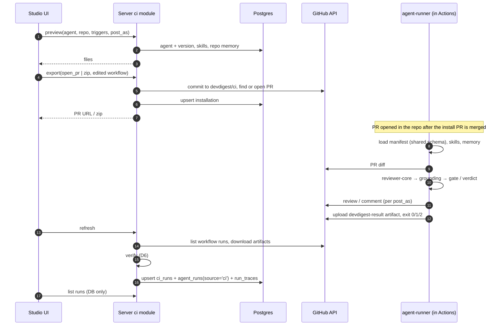

# Spec: Export to CI   |   Spec ID: SPEC-04   |   Status: draft
Supersedes: none

## Problem & users

A DevDigest reviewer agent is tuned in the studio — model, system prompt,
linked skills, strategy, gate policy — but it only ever runs on the machine of
the person who tuned it. The rest of the team cannot rely on it reviewing every
pull request, because nothing runs it when they open one. **Export to CI**
moves the agent's configuration into the target repository and runs the review
there on every pull request through GitHub Actions, then brings the result back
into the studio.

Technically, a tuned agent already *is* a versioned configuration
(`agents` + `agent_versions` with an `AgentVersionConfig` snapshot). Export
serialises that configuration into a repository-committed **manifest**
(`.devdigest/agents/<slug>.yaml`) that both the studio (writer) and a new
**agent-runner** (reader, executing in CI) validate against **one** shared
Zod schema. An identical manifest guarantees an identical *configuration* — it
does **not** guarantee a byte-identical *result*: model answers vary between
calls and the CI environment may carry different tool versions. Every CI run
therefore records, in its trace, the manifest version, the model, the runner's
dependency versions and the reviewed commit SHA, so a result can always be
traced back to exactly what produced it.

The space for this feature is already partially reserved but unwired:

- Tables `ci_installations` (`agent_id`, `repo`, `target_type`,
  `installed_at`) and `ci_runs` (`ci_installation_id`, `pr_number`, `ran_at`,
  `status`, `findings_count`, `cost_usd`, `github_url`, `source`) exist and are
  never read or written.
- `agent_runs.source` already has the enum `local | ci` (default `local`) and
  an `agent_runs.blockers` column ("findings that tripped the agent's gate").
- `agents.ci_fail_on` (`never | critical | warning | any`, default `critical`)
  exists and is editable on the Config tab.
- The shared contracts file `eval-ci.ts` already declares `CiTarget`,
  `CiFile`, `AgentManifest`, `CiExportInput`, `CiInstallation`, `CiExport`,
  `CiRunStatus`, `CiRun` and `CiResultArtifact` — none of them used.
- The GitHub adapter already exposes `commitFiles` (create-or-advance a branch
  layered on its parent tree), `openPullRequest` and `findOpenPr`.
- The UI kit already ships an `ExportWizardSteps` indicator, and the app shell
  already maps the `/ci-runs` path to a `ci-runs` nav key — but there is no
  page, no wizard, no CI tab on the agent editor, no `ci/` server module, and no
  agent-runner package.

Affected users:

- **Agent authors** — want to ship a tuned agent to a repository in a few
  clicks, reviewed like any other change (through a PR), not pushed into `main`.
- **Teams working in that repository** — get an automatic DevDigest review on
  every PR, published as a GitHub review, a PR comment, or only as a check
  status, and can make it block merges.
- **Workspace admins** — need to see where an agent is deployed, whether its
  deployment is up to date with the agent's current config, and what the CI
  runs cost, without leaving the studio.

This is **worktree B** of a two-worktree lesson. The sibling worktree (A) owns
the multi-run service and the PR feed; this feature must not touch either.

## Goals / Non-goals

- **Goal:** an **Add to CI** action on the agent's CI tab opens an **Export
  Wizard** with exactly four steps — **Target → Preview → Configure →
  Install** — matching the provided mockups.
- **Goal:** generate a repository bundle: the agent manifest, one body file per
  linked skill, a repository-scoped memory file, the bundled agent-runner, and
  an editable GitHub Actions workflow `.github/workflows/devdigest-review.yml`.
- **Goal:** one shared manifest schema, validated identically by the studio on
  write and by the agent-runner on read.
- **Goal:** install by **opening a pull request** from the dedicated branch
  `devdigest/ci` (recommended), or by **downloading a zip** of the same files.
  The studio never writes to the default branch.
- **Goal:** a new **agent-runner** package that runs a review in CI with the
  manifest, skills and memory from the repository and the existing
  `reviewer-core` engine (including its grounding gate), publishes the result
  per the chosen mode, writes a result artifact, and exits with a code driven
  by the agent's `ci_fail_on` gate.
- **Goal:** ingest CI results back into the studio through a **verified
  channel** — the studio pulls workflow runs and their result artifact from
  GitHub with the user's token, verifies them, and records each as a CI run and
  as an `agent_runs` row with `source = 'ci'`, plus a run trace with the
  reproducibility fields.
- **Goal:** a workspace-level **CI Runs** page listing repository, PR, agent,
  verdict, findings, cost, duration and a link to the GitHub job.
- **Goal:** a **CI** tab on the agent page showing installations, the workflow
  version each one runs, run history, the **Fail CI on** setting, and an
  **Update CI config** action that republishes.
- **Non-goal: CircleCI, Jenkins and Generic CLI targets.** No generator exists
  for them in this slice, so they are **not rendered** in the Target step. The
  target list is a small registry a later slice can extend; `CiTarget` keeps
  its four enum values.
- **Non-goal: a published `devdigest/review-action@v1` GitHub Action.** The
  mockup's `uses: devdigest/review-action@v1` is a **placeholder**; until such
  an action is published, the workflow runs the runner shipped in the bundle.
- **Non-goal: push-based ingestion.** No endpoint receives results from CI; the
  studio is local-first and unreachable from GitHub's runners (D5).
- **Non-goal: automatic polling of GitHub.** Ingestion runs only when the user
  presses **Refresh**.
- **Non-goal: LLM providers other than OpenRouter in CI.** `reviewer-core`
  ships only an OpenRouter client; the runner uses it for every agent (D10).
- **Non-goal: preserving hand edits to the workflow across regeneration.**
  Configure changes and **Update CI config** regenerate the workflow from
  scratch (D8).
- **Non-goal: changing `reviewer-core`'s review logic.** The runner uses it
  as-is.
- **Non-goal: the multi-run service and the PR feed** (worktree A).
- **Non-goal: memory write paths, editing or embedding retrieval.** This
  feature only reads memory rows to export them.
- **Non-goal: more than one active DevDigest agent per repository** (D7).
- **Non-goal: managing repository secrets.** The studio reports whether the
  expected secret exists; it never creates, reads or transmits a secret value.
- **Non-goal: GitHub App, webhooks, CI Runs filters, findings-level ingestion,
  Agent Performance dashboards.**

### Decisions

- **D1 — Adopt the reserved tables and contracts.** `ci_installations`,
  `ci_runs`, `agent_runs.source`, `agent_runs.blockers`, `agents.ci_fail_on`
  and the `eval-ci.ts` contracts are extended in place; no parallel set.
- **D2 — An installation is (agent × repository × target).** A second
  repository is a second installation ("Add repository").
- **D3 — The target repository is chosen on the Target step** from the
  workspace's imported repositories, pre-selecting the active one.
- **D4 — Install offers two peers: open a PR (recommended) or download a zip.**
  The zip is always available. Both record the installation.
- **D5 — Ingestion is pull-based and user-triggered, over GitHub's API.** On
  Refresh the studio lists the runs of the installation's workflow file in the
  installation's repository with the user's token, downloads each run's result
  artifact, verifies it (D6) and upserts it. GitHub is the verified channel:
  the studio only accepts data it fetched itself from that repository's runs of
  that workflow. The refresh route is a normal workspace-scoped route.
- **D6 — Artifact verification is one pure check** run before anything is
  stored: within size limits, safe archive entries only, schema-valid,
  commit SHA equals the workflow run's head SHA, repository equals the
  installation's repository, and no credential-shaped value.
- **D7 — One active agent per repository, selected by the workflow.** Each
  agent's manifest lives at `.devdigest/agents/<slug>.yaml`; the workflow tells
  the runner which slug to run. Exporting a different agent into the same
  repository rewrites the single workflow to point at the new slug — the old
  manifest stays in the repository, inert. The wizard shows an informational
  notice; no file deletion is needed.
- **D8 — Only the workflow is editable in Preview; edits are sent verbatim on
  Install.** Any Configure change regenerates the workflow and discards edits,
  with an inline notice saying so. Manifest, skills and memory are read-only:
  the studio is the source of truth for agent configuration.
- **D9 — Verdict and exit code are deterministic** from grounded finding
  severities and `ci_fail_on`, never from the model's verdict:
  `request_changes` iff ≥1 blocker; otherwise `comment` when there are
  findings and `approve` when there are none. `never` never blocks.
- **D10 — OpenRouter only in CI; one secret.** The runner calls OpenRouter with
  model id `model` when the agent's provider is `openrouter`, otherwise
  `<provider>/<model>`. The only expected secret is `OPENROUTER_API_KEY`.
- **D11 — Generated files are data, never shell.** No agent- or user-authored
  string reaches a `run:` command. The workflow's `run:` bodies are fixed
  constants; variable values arrive via `env:` from GitHub context, secrets, or
  closed-set/validated values (post mode, agent slug). **Carve-out:** the
  workflow body the authenticated user edits in Preview (D8) is the user's own
  code and is committed verbatim; D11 governs only what the generator emits.
- **D12 — Memory export is repository-scoped and content-only.** Rows of the
  caller's workspace with `scope = 'repo'` for the target repository, carrying
  only `kind` and `content`. The runner injects them as untrusted context.
- **D13 — Versions are two integers.** The installation records the agent
  version it exported and the generator's workflow version (a constant bumped
  when the generator output changes). The CI tab marks an installation **out of
  date** when either differs from the current value.
- **D14 — `post_as` and the agent slug travel via the workflow's `env:`**, not
  the manifest.
- **D15 — Fork PRs are excluded by the workflow.** `pull_request` only, never
  `pull_request_target`, and the job is skipped for fork-headed PRs.

## User stories

1. As an agent author, I want an **Add to CI** button on the agent's CI tab that
   opens a four-step wizard. → AC-1, AC-2
2. As an agent author, I want to pick GitHub Actions and the target repository,
   without seeing CI systems that cannot be generated. → AC-3, AC-4, AC-5
3. As an agent author, I want to preview every file to be committed and edit
   the workflow before installing. → AC-6 … AC-10
4. As an agent author, I want to choose the PR events and how results are
   published, and see whether the repo has the needed secret. → AC-11 … AC-14
5. As an agent author, I want to install via a PR from a dedicated branch or a
   zip, never by writing to the default branch. → AC-15 … AC-20
6. As a team member, I want every PR reviewed automatically by the same agent
   configuration using our own secrets. → AC-21 … AC-32
7. As a team member, I want to block merges on blocking findings. → AC-29,
   AC-14, AC-47
8. As anyone in the workspace, I want CI results in the studio with enough
   provenance to understand why two runs on one config differ. → AC-33 … AC-40
9. As an admin, I want a CI Runs page with repository, PR, agent, verdict,
   findings, cost, duration and a job link. → AC-41 … AC-43
10. As an agent author, I want a CI tab with installations, workflow version,
    history, Fail CI on, and a way to push an updated config.
    → AC-44 … AC-48
11. As a workspace owner, I want other workspaces' CI data never exposed and
    secrets never written anywhere. → AC-24, AC-36, AC-49

## Acceptance criteria (EARS)

### Wizard shell and Target step

- AC-1: WHEN the user activates **Add to CI** on an agent's CI tab, the system
  shall open the Export to CI wizard with the agent's name in the subtitle and
  the step indicator **Target → Preview → Configure → Install**, Target active.
  _(observable: component test — dialog with four labels in order, step 1 active)_
- AC-2: The wizard shall advance only via **Continue** once the current step is
  valid, and **Back** shall keep every choice made, except workflow edits
  discarded per AC-12.
  _(observable: component test — go back and forward; selections preserved)_
- AC-3: The Target step shall render one option per registered target, which in
  this slice is **GitHub Actions** only, pre-selected and badged "recommended".
  _(observable: the targets endpoint returns exactly `gha`; no CircleCI,
  Jenkins or Generic CLI option renders)_
- AC-4: The Target step shall require a target repository chosen from the
  workspace's imported repositories, pre-selecting the active repository.
  _(observable: component test — Continue disabled until a repo is chosen;
  enabled immediately when an active repo exists)_
- AC-5: IF the chosen repository already has an installation of a different
  agent, THEN the Target step shall show a notice naming that agent and saying
  that installing will switch the repository's CI review to this agent.
  _(observable: component test with a stubbed existing installation)_

### Preview step

- AC-6: WHEN the user enters Preview, the system shall list every file to be
  created: `.devdigest/agents/<slug>.yaml`, one `.devdigest/skills/<skill>.md`
  per linked skill, `.devdigest/memory.jsonl`, the runner files under
  `.devdigest/runner/`, and `.github/workflows/devdigest-review.yml`.
  _(observable: integration test — agent with 2 skills lists those paths)_
- AC-7: WHEN the user selects a file, the system shall show its contents with
  its path as header; the workflow shall be badged **editable** and be the only
  editable file; runner files shall show path and size, with contents loaded
  only on demand.
  _(observable: component test)_
- AC-8: The generated manifest shall validate against the shared
  `AgentManifest` schema and carry the agent's name, slug, version, provider,
  model, system prompt, ordered skill slugs, strategy and `ci_fail_on` as stored
  at generation time.
  _(observable: parse with the shared schema; fields equal stored values)_
- AC-9: The bundle shall contain a body file for every skill slug the manifest
  names and no other skill file.
  _(observable: set equality)_
- AC-10: IF the edited workflow does not parse as YAML, THEN the system shall
  show the parse error inline and disable Continue until it parses.
  _(observable: component test)_

### Configure step

- AC-11: The Configure step shall offer toggles `pull_request:opened`,
  `pull_request:synchronize` (both on by default) and `pull_request:reopened`
  (off), requiring at least one.
  _(observable: component test — defaults; none selected disables Continue)_
- AC-12: WHEN a Configure value changes, the system shall regenerate the
  workflow, and IF the workflow had been edited, THEN shall show an inline
  notice that manual edits were reset.
  _(observable: component test — edit, toggle `reopened`, notice shown, file
  regenerated)_
- AC-13: The Configure step shall offer **Post results as**: GitHub review
  (default, "recommended"), PR comment, or None (exit code only).
  _(observable: component test)_
- AC-14: The Configure step shall list the expected secrets — `OPENROUTER_API_KEY`
  with status **ready**, **not set** or **unknown** (when GitHub refuses the
  lookup), and `GITHUB_TOKEN` always **ready** — and the hint that blocking
  merges needs **Fail CI on** (CI tab) plus a required status check in branch
  protection.
  _(observable: integration test — stubbed secret-name listing with / without
  the key / 403 → ready / not set / unknown)_

### Install step

- AC-15: The Install step shall offer **Open a PR with these files**
  (recommended, default) — naming the repository, the title "Add DevDigest CI
  review" and the actual file count — and **Download files as a zip**.
  _(observable: component test — count equals Preview's count)_
- AC-16: WHEN the user installs via PR, the system shall commit all bundle files,
  including the edited workflow verbatim, to `devdigest/ci` based on the
  repository's default branch, and open a PR from `devdigest/ci` into the
  default branch; IF an open PR from `devdigest/ci` already exists, THEN it
  shall add a commit on top of that branch and return the existing PR's URL.
  _(observable: integration test with a stubbed GitHub client — commit on
  `devdigest/ci`; first install 1 PR created, second install 0 created, same URL)_
- AC-17: The system shall never write a ref on the repository's default branch.
  _(observable: stubbed client records no write to `heads/<default>`)_
- AC-18: WHEN an install (PR or zip) succeeds, the system shall upsert the
  installation (agent, repository, target, triggers, publishing mode, exported
  agent version, workflow version, PR URL or none, installed-at) and show the
  PR link or start the download.
  _(observable: one row per agent×repo×target after two installs)_
- AC-19: WHEN the user chooses zip, the system shall download a zip whose
  entries are exactly the bundle files at their repository paths, with the
  edited workflow verbatim.
  _(observable: unzip and compare to the preview)_
- AC-20: IF no GitHub token is configured or GitHub refuses the write (including
  a token lacking the `workflow` scope), THEN the system shall show the reason,
  stay on Install, keep zip available, and record no installation; WHILE an
  install is in flight, the Install button shall be disabled.
  _(observable: stubbed 403 → typed error shown, zip enabled; double click → one
  request)_

### Generated workflow — correctness and safety

- AC-21: The workflow shall trigger on `pull_request` with exactly the selected
  types and shall never declare `pull_request_target`.
  _(observable: parse YAML)_
- AC-22: The workflow shall check out the repository, set up Node, and execute
  the bundled runner entrypoint; it shall contain no `uses:` reference to any
  DevDigest action.
  _(observable: run step executes the runner path from AC-6; no `uses: devdigest/`)_
- AC-23: The runner step shall receive via `env:` the OpenRouter key by secret
  reference, `GITHUB_TOKEN`, repository, PR number, head SHA, workflow run id,
  the agent slug and the publishing mode.
  _(observable: YAML assertion — each variable present)_
- AC-24: No generated file shall contain a secret value held by the studio;
  credentials appear only as `${{ secrets.<NAME> }}`.
  _(observable: with known values in the stubbed secrets provider, no file
  contains any of them)_
- AC-25: The workflow's `run:` commands shall be identical for every agent,
  repository and skill set; agent- or user-authored text shall never appear in
  them.
  _(observable: agent name `x"; rm -rf / #\n$(id)` yields `run:` bodies
  byte-identical to agent `x`, and the manifest round-trips the name)_
- AC-26: The workflow shall declare `permissions` with `contents: read` always
  and `pull-requests: write` only when publishing as a review or comment.
  _(observable: YAML assertion per mode)_
- AC-27: The workflow's job shall be skipped for fork-headed PRs, and every
  third-party `uses:` shall be pinned to a full 40-hex commit SHA.
  _(observable: job `if:` condition present; `uses:` regex)_
- AC-28: The workflow shall upload the result artifact under the fixed name
  `devdigest-result` even when the runner step fails.
  _(observable: upload step has `if: always()`)_

### agent-runner (executes in CI)

- AC-29: The runner shall exit **0** when the review completed and the gate did
  not trip, **1** when the gate tripped, and **2** when it could not complete a
  review.
  _(observable: unit tests per outcome with stubbed LLM/GitHub)_
- AC-30: WHEN the runner starts, it shall load `.devdigest/agents/<slug>.yaml`
  for the slug given by the workflow, validate it with the shared
  `AgentManifest` schema, and load every listed skill; IF the manifest is
  missing or invalid or a skill file is missing, THEN it shall exit 2 naming
  the problem without any LLM call.
  _(observable: unit tests; LLM stub call count = 0)_
- AC-31: The runner shall review the PR diff with `reviewer-core` using the
  manifest's model (D10), prompt, skills, strategy and the memory records as
  untrusted context, and shall count, publish and record only findings that
  passed `reviewer-core`'s grounding gate; invalid memory lines shall be skipped.
  _(observable: unit test — an ungrounded stub finding appears nowhere; 1 invalid
  memory line skipped, run succeeds)_
- AC-32: The runner shall publish per mode — one GitHub review with the D9
  verdict and inline comments, one PR comment, or nothing — and shall write the
  result artifact (`status` succeeded or failed with an error category) on
  every run that passed AC-30, even when publishing fails; the artifact shall
  never contain a secret or diff text.
  _(observable: unit tests per mode; publishing 422 → artifact still written;
  artifact parses with the shared schema and contains no key)_

### Ingestion — CI results back into the studio

- AC-33: WHEN the user presses **Refresh** (CI Runs page or CI tab), the system
  shall list, for each workspace installation, the repository's runs of
  `devdigest-review.yml` with the user's token (at most the 50 most recent per
  installation) and ingest every run not yet stored or stored as `running`.
  _(observable: stubbed GitHub with 3 runs → 3 upserts)_
- AC-34: The system shall accept an artifact only if every D6 check passes; IF
  one fails, THEN it shall record the run as `failed` naming the check and store
  no field from the artifact.
  _(observable: one integration case per check)_
- AC-35: IF a workflow run is completed but has no artifact (runner crashed,
  cancelled, expired), THEN the system shall record a `failed` run with PR
  number, time and job URL and no counts or cost.
  _(observable: integration test)_
- AC-36: The system shall never persist, log or render a credential-shaped value
  found in an artifact.
  _(observable: artifact with `ghp_…` rejected; value in no row or log line)_
- AC-37: WHEN a run is accepted, the system shall store it as a CI run
  (installation, PR number, time, status, verdict, findings and per-severity
  counts, blockers, cost, duration, job URL, workflow run id, commit SHA) and as
  an `agent_runs` row with `source = 'ci'` linked to the agent and, when the PR
  is imported, to the PR.
  _(observable: one row in each table; no `local` row changes)_
- AC-38: WHEN a run is accepted, the system shall store a run trace with the
  manifest SHA-256, agent version, model, dependency versions (runner,
  `reviewer-core`, Node) and the commit SHA.
  _(observable: `run_traces` document contains each field)_
- AC-39: The system shall ingest each workflow run at most once; repeated or
  concurrent refreshes shall update the same rows.
  _(observable: refresh 3× → 1 row in `ci_runs` and in `agent_runs`)_
- AC-40: The system shall make no LLM call in generation, ingestion or any
  surface this feature adds, and no GitHub call when listing stored runs.
  _(observable: stubbed clients record 0 calls on page loads)_

### CI Runs page

- AC-41: The system shall present a **CI Runs** page from the sidebar entry
  "CI Runs", newest first, with repository, PR (link), agent, verdict, findings
  (total + per-severity), cost, duration, status, time and a job link.
  _(observable: component test against fixtures)_
- AC-42: IF cost or duration is unknown, THEN the page shall show "—".
  _(observable: fixture with null cost)_
- AC-43: WHERE no runs exist, the page shall show an empty state explaining how
  to add an agent to CI, and a **Refresh** action.
  _(observable: component test)_

### Agent CI tab

- AC-44: The agent page shall have a **CI** tab after Evals with a "CI
  deployment" header, an "Active in N repos" badge, **Update CI config** and
  **Add to CI** actions, one row per installation (repository, target, last run
  status and time), and an "Add repository" row that opens the wizard.
  _(observable: 2 installations → 2 rows, "Active in 2 repos")_
- AC-45: Each installation row shall show its workflow version and exported
  agent version and mark **out of date** when either differs from current (D13).
  _(observable: agent v5, exported v4 → "out of date")_
- AC-46: WHEN the user activates **Update CI config**, the system shall
  regenerate and republish (PR mode) every installation of the agent with that
  installation's stored triggers and publishing mode, and report success or
  failure per repository.
  _(observable: 2 installs, one 403 → one PR, one reported failure)_
- AC-47: The CI tab shall show a **Fail CI on** control (Never / Critical /
  Warning+ → `never` / `critical` / `warning`) that saves the agent's
  `ci_fail_on`, showing a stored `any` as "Any finding"; saving shall make no
  repository change until republish.
  _(observable: select Warning+ → agent update with `warning`; 0 GitHub writes)_
- AC-48: The CI tab shall show the agent's CI run history with the CI Runs
  columns minus agent.
  _(observable: component test)_

### Scope and wiring

- AC-49: WHERE an agent, installation, CI run or repository belongs to another
  workspace, the system shall not disclose or act on it via any new route, and
  all new routes shall validate input with shared schemas (400 naming the field).
  _(observable: route tests — foreign ids → not found; bad `repo` → 400)_
- AC-50: The memory file shall contain exactly the workspace's `scope = 'repo'`
  rows for the target repository, one JSON line each with only `kind` and
  `content`, and shall exist (empty) when none match.
  _(observable: 3 matching + other-repo rows → 3 lines, no other keys; zero → empty)_
- AC-51: The feature shall not change local runs, multi-agent runs or the PR
  feed; their existing tests shall pass unchanged.
  _(observable: existing suites green)_

## Edge cases

- Agent with no skills → `skills: []`, no skill files → AC-8, AC-9.
- Agent name that slugifies to empty → slug `agent-<short id>` → AC-8.
- Name / prompt / skill / memory with YAML or shell characters, or `${{ … }}`
  → serialised as YAML/JSON data by a real serializer; only the workflow is
  evaluated by Actions and it never contains such text → AC-8, AC-25.
- Disabled agent → export allowed; accepted: no handling.
- Agent deleted after export → installations cascade-delete; ingested
  `agent_runs.agent_id` becomes null; CI Runs shows the agent name from the
  artifact → AC-37, AC-41.
- No GitHub token / token without `workflow` scope / archived repo → AC-20.
- Default branch not `main` → resolved from the repository → AC-16.
- `devdigest/ci` exists without an open PR, or with human commits → new commit
  on top of its head, PR opened if none open → AC-16.
- Different agent already installed in the repo → notice; workflow switched;
  old manifest inert → AC-5, D7.
- User edits workflow then changes Configure → edits reset with notice → AC-12.
- User edits workflow so it no longer runs the runner → accepted: only YAML
  validity is checked; ingestion records `failed` (no artifact) → AC-10, AC-35.
- Fork PR → job skipped; skipped runs are not ingested → AC-27, AC-33.
- `OPENROUTER_API_KEY` missing in repo → runner exits 2, artifact `failed`
  (`missing_secret`) → AC-29, AC-32.
- LLM timeout / rate limit → exit 2, artifact `failed`, nothing posted → AC-32.
- PR with nothing reviewable → 0 findings, `approve`, exit 0 → AC-29, D9.
- Publishing fails (PR closed, 422) → artifact still written, exit by gate
  → AC-32.
- Run in progress at refresh → stored `running`, updated next refresh → AC-33.
- Artifact expired → `failed` (`artifact_unavailable`) → AC-35.
- Artifact oversize, unsafe zip entry, malformed, wrong SHA, wrong repo,
  token-shaped value → rejected, named → AC-34, AC-36.
- Forged artifact by someone with repo write access → accepted: such a person
  can already change the workflow; the trust boundary is the repository.
- PR not imported into the studio → `agent_runs.pr_id` null → AC-37.
- Runner bundle not built in the studio → preview/export fail with "runner
  bundle not built" instead of committing an incomplete bundle → AC-6.

## Non-functional requirements

- **Security:** no secret in any generated file, artifact, DB row, log line or
  response (AC-24, AC-32, AC-36); workflow hardening per AC-21 … AC-28;
  artifact archive ≤ 64 entries, each relevant entry ≤ 256 KB.
- **Prompt injection:** diff, PR text, skills and memory are untrusted model
  input; the runner relies on `reviewer-core`'s existing injection guard and
  grounding gate unchanged.
- **Runner footprint:** self-contained bundle (no runtime `node_modules`, no
  install step in the workflow), ≤ 5 MB total.
- **Determinism:** for fixed agent version, workflow version, repository,
  triggers and publishing mode, the generated files are byte-identical (no
  timestamps or random ids).
- **Preview latency:** p95 ≤ 500 ms excluding runner file contents.
- **Accessibility:** modal with focus trap, Esc closes, all controls keyboard
  reachable; WCAG 2.1 AA contrast for status badges.
- **i18n:** all new strings through the existing catalogue.

## Cross-module interactions

Modules: **client** (wizard, CI tab, CI Runs page), **server** (new `ci`
module; reads agents, skills, memory, repos; GitHub adapter; secrets provider),
**shared contracts**, **agent-runner** (new package; shared schema +
`reviewer-core`), **reviewer-core** (unchanged), **GitHub** (external).

Failure contract: export maps GitHub failures to typed errors (`no_token`,
`forbidden`, `missing_workflow_scope`, `not_found`, `upstream_unavailable`) and
persists nothing on failure; refresh reports errors per installation without
aborting others; the runner never throws past its top level (exit 1/2 + artifact
after manifest validation); studio↔runner drift is prevented by a parity test
on the shared schemas.

## Contracts

Shapes only. `eval-ci.ts` contracts are extended in place; both vendored copies
stay byte-identical.

**AgentManifest** (`.devdigest/agents/<slug>.yaml`; studio writes, runner
reads): existing `name`, `provider`, `model`, `system_prompt`, `skills`
(ordered slugs, null → []), `strategy`, `ci_fail_on` + **new** `format`
(literal `devdigest-agent/v1`), `slug` (`[a-z0-9-]{1,64}`), `agent_version`
(int ≥ 1).

**Memory record** (one JSON per line): `{ kind: MemoryKind, content: string }`.

**CiTargetOption** (server → client): `{ target: CiTarget, label_key }`; only
`gha` in this slice.

**CiExportInput** (client → server: preview, export, zip): existing `repo`
(`owner/name`), `target`, `action` (`open_pr | files`), `post_as`, `triggers`
(**narrowed** to non-empty subset of `opened | synchronize | reopened`) +
**new** optional `workflow_override` (string). `base` is **removed**; the
default branch is resolved server-side.

**CiPreview** (server → client): `{ files: CiFile[], secrets: { name,
status: ready | not_set | unknown }[], existing_installation: { agent_id,
agent_name } | null }`. **CiFile**: `path`, `contents` (null for runner files,
fetched per file), `editable`, `size_bytes`.

**CiInstallation**: existing `id, agent_id, repo, target_type, installed_at` +
**new** `triggers[]`, `post_as`, `exported_agent_version`, `workflow_version`,
`pr_url | null`, derived `out_of_date`, derived `last_run { status, ran_at } |
null`.

**CiResultArtifact** (runner → server via GitHub): existing `findings_count`,
`critical`, `warning`, `suggestion`, `cost_usd`, `duration_ms`, `agent`,
`pr_number` + **new** `status` (`succeeded | failed`), `error_category`
(`manifest | missing_secret | llm | github | internal`, nullable), `verdict`
(nullable), `blockers`, `agent_slug`, `agent_version`, `manifest_sha256`,
`model`, `dependencies` (`{ runner, reviewer_core, node }`), `repository`,
`commit_sha`, `workflow_run_id`. Existing `version` is superseded by
`dependencies.runner`.

**CiRun** (server → client): existing fields + **new** `repo`, `pr_url`,
`verdict`, `critical`, `warning`, `suggestion`, `blockers`, `commit_sha`,
`failure_reason | null`.

**API surface** (workspace-scoped): list targets; preview; fetch one preview
file; export (PR); export zip; list installations for agent; secret status for
repo; republish all of an agent's installations; refresh; list CI runs
(optional `agent_id`).

**Runner env contract:** `OPENROUTER_API_KEY`, `GITHUB_TOKEN`,
`GITHUB_REPOSITORY`, PR number, head SHA, workflow run id, `DEVDIGEST_AGENT`
(slug), `DEVDIGEST_POST_AS`. Exit codes 0 / 1 / 2. Artifact `devdigest-result`
containing `devdigest-result.json`.

**Persistence (shape):** installations gain the new `CiInstallation` fields
and uniqueness on (agent, repo, target); CI runs gain the new `CiRun` fields,
workspace and agent-run references, and uniqueness on the workflow run id.

## Inputs and provenance

- Feature brief (Ukrainian, pasted by the user) for worktree B.
- Five mockups: CI tab with installations, "Update CI config", "Add to CI",
  "Add repository"; Target with four target cards; Preview with "Files to
  create" and an editable workflow showing `uses: devdigest/review-action@v1`;
  Configure with triggers, "Secrets expected" (`OPENROUTER_API_KEY`,
  `GITHUB_TOKEN`), "Post results as" and the merge-blocking hint; Install with
  PR / zip options.
- User clarifications: pull-based ingestion through GitHub; agent-runner is a
  new package in scope; memory exported and read by the runner; GitHub Actions
  only; decisions kept minimal to avoid implementation complexity.
- Code read: `server/src/db/schema/{ci,runs,agents,knowledge}.ts`;
  `server/src/vendor/shared/contracts/{eval-ci,knowledge,findings,trace}.ts`;
  `server/src/adapters/github/octokit.ts` (`commitFiles`, `openPullRequest`,
  `findOpenPr`); `reviewer-core/src/index.ts` and `src/llm/` (OpenRouter only);
  client agent editor tabs, app-shell `/ci-runs` mapping, `ExportWizardSteps`.

## Untrusted inputs

- **Runner:** PR diff, PR title/body, skill bodies, prompt and memory are
  untrusted model input, wrapped by `reviewer-core`'s guard; findings pass the
  grounding gate. Nothing is executed or placed in a shell command.
- **Generation:** agent/skill/memory text is written as YAML/JSON data only.
  The edited workflow is the user's own code; only YAML validity is checked.
- **Ingestion:** the artifact is untrusted third-party JSON in a zip; verified
  per D6 and rendered as text. GitHub URLs are rendered as links only when they
  start with `https://github.com/`.

## Open questions

- [NEEDS CLARIFICATION: include the full grounded findings list in the artifact
  and ingest it as findings (enabling accept/dismiss of CI findings), or counts
  only as drafted?]
- [NEEDS CLARIFICATION: Node major version pinned in the workflow — draft
  assumes the same major the repo uses (≥ 22).]
