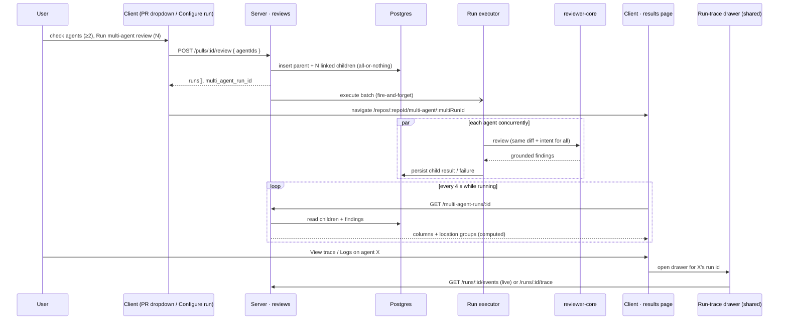

# Spec: Multi-Agent Review & live statuses   |   Spec ID: SPEC-04   |   Status: draft
Supersedes: none

Lesson L07. **Affected modules:** `server` (reviews module, a new multi-agent run
read surface, the shared contracts), `client` (PR page, new Multi-Agent Review
pages, the shared run-trace drawer). Cross-module, hence `specs/cross-module/`.
`reviewer-core` is consumed unchanged. `ci/`, `agent-runner/` and `e2e` are
non-goals (N1, N2, N11).

> **Simplicity is the primary design constraint of this slice.** Every capability
> below is built by *reusing* what already exists — the review trigger, the run
> executor, the per-run SSE stream, the run trace, the run-trace drawer, the live
> log component and the finding card — and by filling contracts that are already
> declared but unused. Anything genuinely new is tagged **[NEW]** where it is
> introduced, so the planner can see the full delta at a glance.

## Problem & Motivation

One pull request can carry a security risk, a performance regression and a
domain-rule violation at the same time. A single general reviewer tends to cover
one of those well and the others thinly. DevDigest already ships several
specialised reviewer agents (Security, Performance, Junior Mentor, Customer-Facing,
Architecture, …), and running more than one of them on a PR gives broader coverage
— **but only if the product**:

1. **removes duplicates** — four agents flagging the same line must read as one
   location with four opinions, not four unrelated cards;
2. **shows disagreement** — where one agent flags a line as a WARNING and another
   did not flag it at all, that difference is the most useful signal on the page;
3. **does not hide the price** — N agents cost N reviews; the user must see the
   expected time and cost before running and the actual time and cost after.

### What exists today (verified)

- **The trigger.** `POST /pulls/:id/review` accepts `{ agentId? , all? }`
  (`RunRequest`, `server/src/vendor/shared/contracts/platform.ts`), creates one
  `agent_runs` row per target up front, returns their run ids immediately and runs
  the reviews in the background (`server/src/modules/reviews/service.ts`). It
  cannot accept an arbitrary *subset* of agents.
- **The executor runs agents one after another** (`for … await` over the jobs in
  `server/src/modules/reviews/run-executor.ts`). The diff and the PR intent are
  already computed once per batch and shared by every agent.
- **The grouping table is reserved but unused.** `multi_agent_runs`
  (`id, workspace_id, pr_id, ran_at`) exists in `server/src/db/schema/runs.ts`;
  nothing reads or writes it, and `agent_runs` has no link to it.
- **The contracts are reserved but unused.** `AgentColumnFinding`, `AgentColumn`,
  `ConflictTake`, `Conflict` and `MultiAgentRun` are declared in
  `vendor/shared/contracts/observability.ts` (both copies identical) with zero
  consumers. The `Conflict` doc comment already states the rule this spec adopts:
  a location flagged by at least one agent and not by another, or with divergent
  severities — *computed from persisted findings, not stored*.
- **No grouping heuristic exists** anywhere in the codebase.
- **The run-trace drawer exists but is page-private.** `RunTraceDrawer` (Trace tab:
  Configuration, Stats, Findings, Prompt assembly, Tool calls, footer *Copy raw
  output*; Log tab: `LiveLogStream` fed by the `useRunEvents` SSE hook while
  running, or the persisted log afterwards) lives under the PR page's private
  `_components/` and is mounted only by the PR page.
- **The PR page "Run Review" dropdown** offers only "Run all enabled agents" or a
  single agent.
- **Navigation.** There is no Multi-Agent Review nav item or route, although the
  app shell already maps any `/multi-agent` path to an active key `multi-agent`.
- **Finding actions.** `FindingCard` shows confidence, rationale, suggested fix,
  Accept, Dismiss and *Turn into eval case* (SPEC-03). The shared
  `FindingActionKind` enum already lists `learn` and `reply`, but the server
  rejects `learn` with 400 and there is no Learn button. There is no *Reply to
  author* action in `FindingCard`.
- **Memory.** A `memory` table (kinds include `learning`) and `MemoryItem`
  contract exist; review prompts do not currently pull memory.

## Goals / Non-goals

### Goals

- **G1** — Let the user pick a **set of agents** for one PR from two entry points:
  a multi-select in the PR page's Run Review dropdown, and a dedicated
  **Configure run** page.
- **G2** — Show an **estimate of time and cost** per agent and for the whole set,
  derived from each agent's past runs, *before* anything runs.
- **G3** — Run the selected agents **in parallel** through the existing trigger and
  executor; the UI only passes the chosen set.
- **G4** — Group the child `agent_runs` of one fan-out under **one parent**
  `multi_agent_runs` row, addressable by its own URL.
- **G5** — Group findings by code location with a **deterministic heuristic**,
  without merging away any individual finding or losing which agent produced it.
- **G6** — A **Where agents disagree** block: per location, every participating
  agent's take — its severity and title, or *did not flag* — plus a **Show only
  conflicts** toggle.
- **G7** — A results page with two modes: **Columns** (one live column per agent)
  and **Tabs + detail** (full finding cards with confidence, suggested fix,
  Accept, Dismiss, Learn, Turn into eval case).
- **G8** — **Per-agent logs and trace on the results page**, by reusing the exact
  run-trace drawer the PR page uses (no copy).
- **G9** — Show the **actual** time and cost per agent and for the whole run.

### Non-goals (explicitly out of scope)

- **N1 — `ci/` is untouched.** No CI review path changes.
- **N2 — `agent-runner/` is untouched.**
- **N3 — Per-agent isolation (separate checkouts / worktrees per agent).** All
  agents of a fan-out review the same diff, loaded once. UI copy must not claim
  per-agent worktrees.
- **N4 — Any LLM call to explain a disagreement.** *did not flag* is a static
  label; no agent is asked why it did not flag something.
- **N5 — A run-history list page** for multi-agent runs. *(withdrawn 2026-10-17 —
  once a user left a results page the UI had no way back to it, so Multi-Agent
  Review now lands on the repo's recent runs; see AC-6b.)*
- **N6 — Re-running or cancelling a whole group.** Cancelling a single child run
  stays exactly as it works today.
- **N7 — Agent Performance and CI Runs pages.**
- **N8 — *Reply to author*.** It is shown in the design but does not exist in
  `FindingCard`; it is not added.
- **N9 — Pulling learned memory into review prompts.** Learn writes a memory entry
  (D9); feeding memory into prompts is a later slice (Known limitation L1).
- **N10 — A new agent attribute for colour or icon** (no schema change for agent
  appearance; see D11).
- **N11 — An e2e browser flow** for this feature.
- **N12 — Changing `reviewer-core`, the grounding gate or the injection guard.**
- **N13 — Cross-navigation** (clicking a disagreement cell or a column finding to
  jump into Tabs mode with that finding expanded). Users switch modes with the
  Columns ⇄ Tabs toggle.
- **N14 — Persisting a "learned" flag on findings.** Learn is idempotent on the
  server (AC-54); the card shows "Learned" after a successful click in the current
  session only. No finding DTO change.

## Decisions

- **D1 — One trigger, extended.** `POST /pulls/:id/review` gains an optional
  **[NEW]** `agentIds` list. A request with `agentIds` is a *multi-agent request*;
  `agentId` and `all` keep their current meaning and current response shape. No
  separate multi-agent trigger endpoint is added (the `MultiAgentRun` doc comment's
  mention of `POST /pulls/:id/multi-agent-run` is superseded by this decision).
- **D2 — A multi-agent request needs at least two distinct agents.** A group of one
  is not a comparison and would leave an empty disagreement block. Both entry
  points require ≥ 2 selected agents for the multi-agent action; selecting exactly
  one agent in the PR dropdown runs an ordinary single-agent review instead (D3).
- **D3 — Grouping happens only for multi-agent requests.** For a multi-agent request
  the server creates one `multi_agent_runs` row and links every child
  `agent_runs` row to it via a **[NEW]** nullable link on `agent_runs`
  (deleting the parent leaves children intact; the link is indexed). The
  legacy `agentId` / `all` paths create no parent row.
- **D4 — Parallel execution for every batch.** The executor runs a batch's agents
  concurrently, and one agent's failure or cancellation never fails, cancels or
  delays its siblings. This also makes the existing "Run all" faster; its
  observable statuses are unchanged.
- **D5 — Parent status and totals are derived, never stored.** No status, duration
  or cost column is added to `multi_agent_runs`. Status: `running` WHILE any child
  is running; otherwise `done` if at least one child is done; otherwise `failed`.
  Total duration = the **maximum** child duration (parallel wall-clock); total cost
  = the **sum** of the costs of `done` children (failed/cancelled children are
  excluded), `null` only when a `done` child's cost is unknown.
- **D6 — One read endpoint, computed on read.** **[NEW]** `GET /multi-agent-runs/:id`
  returns the existing `MultiAgentRun` contract (columns + location groups),
  computed from persisted runs and findings on every read. Nothing derived is
  stored.
- **D7 — Live status by polling the read endpoint, live logs by the existing SSE.**
  The results page polls the read endpoint every 4 s WHILE the run is `running` and
  stops when it is not. Columns carry no SSE connection: a running column shows
  its status, elapsed time and the latest log line delivered by that poll. The full
  live log (existing per-run SSE stream → existing `LiveLogStream`) is opened only
  in the run-trace drawer's Log tab, so the page holds at most one SSE connection
  regardless of agent count (avoids the ~6-connections-per-origin browser cap).
- **D8 — The grouping heuristic is deterministic, pure, server-side.** Defined in
  the "Location grouping" ACs. It never calls a model, never mutates or deletes a
  finding, and only *points to* findings by id.
- **D9 — Learn is deterministic and idempotent.** Learn creates one memory entry
  (`kind = learning`, scoped to the PR's repo) whose content is built from the
  finding's own fields (title, rationale, file:line) and whose source records the
  finding and PR. No LLM call. Repeating Learn on the same finding returns the
  existing entry instead of creating a second one.
- **D10 — Estimates from history, no model call.** **[NEW]** `GET /agents/estimates`
  returns, per agent, the average duration and average cost over its most recent
  20 `done` runs (`null` when the agent has no such run). The set estimate is
  max(duration) and sum(cost) — the same aggregation as D5.
- **D11 — Agent colour and icon are derived.** Each agent's accent colour and icon
  are a deterministic function of its id over a fixed palette, so the same agent
  looks the same on every surface and across reloads. Colour is never the only
  carrier of identity (the agent name is always shown).
- **D12 — The run-trace drawer is lifted, not copied.** The existing
  `RunTraceDrawer` moves to a shared client location and is imported by both the PR
  page and the Multi-Agent Review results page; its current behaviour on the PR page
  is unchanged. Exactly one drawer instance exists on the results page, keyed by the
  selected run id.
- **D13 — The finding card is reused as is, plus Learn.** Tabs + detail mode renders
  the existing `FindingCard`. The only addition to `FindingCard` is a **[NEW]**
  Learn action (D9), which therefore also appears on the PR page.
- **D14 — Results URL.** **[NEW]** routes: Configure run is **global** at
  `/multi-agent-review` (optionally pre-selecting a repository and PR via `repo`
  and `pr` query parameters; the repository defaults to the active repo, else the
  first repo) and results stay repo-scoped at `/repos/:repoId/multi-agent/:multiRunId`.
  The old `/repos/:repoId/multi-agent` redirects to the global URL. **[NEW]** nav
  item "Multi-Agent Review" in a new **GLOBAL** sidebar section, routed to Configure run.
- **D15 — Copy.** The design's "fan-out via worktrees" becomes **"parallel
  fan-out"** everywhere (N3).
- **D16 — "Show only conflicts" filters the disagreement block only** and defaults
  to **on**. It never hides columns, tabs or findings.

## User stories

- **US-1** — As a reviewer on a PR page, I tick two or more agents in the Run
  Review dropdown, see roughly how long each takes, and start them together with
  one click. *(AC-1–AC-5)*
- **US-2** — As a reviewer, I open Configure run, pick a PR, pick agents (or
  Select all), see time and cost per agent and for the whole set, and run.
  *(AC-6–AC-13)*
- **US-3** — As a reviewer, I know what a multi-agent run will cost before I start
  it and what it actually cost afterwards. *(AC-10, AC-11, AC-32, AC-35, AC-36)*
- **US-4** — As a reviewer, the selected agents run in parallel and one agent
  failing does not take the others down. *(AC-14–AC-21)*
- **US-5** — As a reviewer, all agent runs of one fan-out live under one parent
  run that I can reload or share by URL. *(AC-17, AC-22–AC-25)*
- **US-6** — As a reviewer, I watch each agent's status change live in its own
  column. *(AC-26–AC-31)*
- **US-7** — As a reviewer, I see the same code location once, with every agent's
  take on it — including which agents did not flag it — and can filter to
  disagreements only. *(AC-37–AC-46)*
- **US-8** — As a reviewer, I switch to Tabs + detail and triage each agent's
  findings with confidence, suggested fix, Accept, Dismiss, Learn and Turn into
  eval case. *(AC-48–AC-55)*
- **US-9** — As a reviewer, from any agent's column or tab I open that agent's
  logs and full trace — configuration, stats, prompt assembly, tool calls, raw
  output — exactly as on the PR page. *(AC-56–AC-66)*
- **US-10** — As a reviewer with no history, no PRs, or failed agents, every
  surface tells me what is missing instead of showing misleading zeros.
  *(AC-67–AC-72)*
- **US-11** — As a workspace owner, nobody can read or trigger another workspace's
  multi-agent runs, and hostile text in findings cannot inject markup.
  *(AC-73–AC-77)*
- **US-12** — As a keyboard or screen-reader user, I can run and read a
  multi-agent review without a mouse or colour vision. *(AC-78–AC-81)*

## Acceptance criteria (EARS)

*Terms.* A **multi-agent request** is a review trigger carrying `agentIds` (D1). A
**multi-agent run** (parent) is one `multi_agent_runs` row; its **children** are
the `agent_runs` rows linked to it. A **column** is one child as shown on the
results page. A **participating agent** is a child whose status is `done`. A
**location group** is one row of the disagreement block (defined in AC-37–AC-41).
An agent's **take** on a group is either the severity and title of its
representative finding there, or *did not flag*. A group is a **conflict** unless
every participating agent flagged it with the same severity.

### Entry point 1 — PR page Run Review dropdown

- **AC-1** — The Run Review dropdown shall show a "Pick agents to run" header with
  a **Clear** action, one checkbox row per agent (name, and a `~Xs` duration hint
  from AC-10 or "—" without history), a primary **Run multi-agent review (N)**
  button where N is the number of checked agents, and a **Configure agents…** link.
  The existing "Run all enabled agents" action shall remain available.
  *(observable: RTL test renders the dropdown with three agents and asserts the
  header, Clear, three checkboxes with hints, the primary button and the link)*
- **AC-2** — WHILE fewer than two agents are checked, the primary button shall
  not start a multi-agent request: with zero checked it shall be disabled, and with
  exactly one checked it shall read "Run review" and run an ordinary single-agent
  review that stays on the PR page (D2). *(observable: RTL — 0 checked → disabled;
  1 checked → label "Run review" and the request body carries `agentId`, not
  `agentIds`)*
- **AC-3** — WHEN the user activates **Run multi-agent review (N)** with N ≥ 2,
  the client shall send one multi-agent request carrying exactly the checked agent
  ids and, on success, navigate to that run's results page.
  *(observable: RTL with mocked API — request body `agentIds` equals the checked
  set; router receives the results URL with the returned parent id)*
- **AC-4** — WHEN the user activates **Configure agents…**, the client shall open
  Configure run with the current PR pre-selected. *(observable: router receives the
  configure URL carrying this PR)*
- **AC-5** — WHEN the user activates **Clear**, all checkboxes shall be unchecked
  and N shall become 0. *(observable: RTL)*

### Entry point 2 — Configure run page

- **AC-6** — The sidebar GLOBAL section shall contain a **Multi-Agent Review**
  item routing to `/multi-agent-review`, and it shall be highlighted on
  every Multi-Agent Review page. *(observable: nav renders the item; active key is
  `multi-agent` on both configure and results URLs)*
- **AC-6b** — WHEN Multi-Agent Review opens without a `pr` or `new=1` query
  parameter AND the selected repository has at least one multi-agent run, the page
  shall show "Recent multi-agent runs": that repo's runs newest first (at most 10),
  the first marked "Latest run", each showing "#number · title", status chip, agent
  count, total duration, total cost and relative time, and each linking to
  `/repos/:repoId/multi-agent/:multiRunId`, plus a **New multi-agent review** action
  that opens Configure run (`?new=1`). WHERE the repo has no runs, or `pr` / `new=1`
  is set, Configure run shall show directly; WHILE runs exist, Configure run shall
  offer "← Back to recent runs". Switching repository keeps the current view.
  *(observable: RTL — list order/links, New → `?new=1`, `?pr=` and zero runs open
  Configure run; integration test — `GET /multi-agent-runs` order, repo filter,
  workspace scope, derived status/totals, read-only)*
- **AC-6c** — WHERE the PR selected on Configure run already has a multi-agent
  run, Configure run shall show a primary "View latest results" affordance (with
  that run's status, agent count and age) ahead of the agent picker, and shall not
  navigate away by itself; configuring a new run stays available.
  *(observable: RTL — picked PR with a run → card + button routes to its results,
  no run started, no auto-push)*
- **AC-6d** — WHERE a PR already has a multi-agent run, the PR page header shall
  offer "Multi-agent results", opening that PR's latest run; activating it shall
  start no run. *(observable: manual / RTL)*
- **AC-7** — Configure run shall show breadcrumb "Global › Multi-Agent Review", title "Run a Multi-Agent Review", the subtitle "Pick a pull request and
  choose which agents to fan out — they run in parallel and you compare their
  findings side by side.", step 1 **Repository and pull request** (a repository select to the left of a
  select listing the chosen repo's PRs as "#number · title"), a "Configure agents…"
  link to `/agents`, step 2 **Agents to run**, and the run button.
  *(observable: RTL)*
- **AC-7a** — WHEN the user switches the repository in step 1, Configure run shall
  clear the selected PR and the agent selection and update `?repo=`; a `?repo=` /
  `?pr=` deep-link shall pre-select that repository and PR, and the old
  `/repos/:repoId/multi-agent` route shall redirect to the global URL.
  *(observable: RTL)*
- **AC-8** — WHILE no PR is selected, step 2 shall be visually dimmed and show the
  empty card "Pick a pull request first — Choose which PR to review above, then
  select the agents to run on it.", and the run button shall be **disabled** with
  the text "Run multi-agent review" and no count. *(UX gap fix: the design shows an
  enabled "(4)" button with no PR.)* *(observable: RTL — no PR → button disabled,
  no agent checkboxes rendered)*
- **AC-9** — WHEN a PR is selected (by the user, or pre-selected from the URL),
  step 2 shall list every agent of the workspace as a card with a checkbox, its
  derived colour and icon (D11), name, one-line description, and per-agent
  estimate "Xs · $Y" (AC-10); enabled agents shall be pre-checked, disabled agents
  shall be shown unchecked with a "disabled" hint, and a **Select all** action
  shall check enabled agents up to the 8-agent cap (in list order) and, when more
  than 8 are enabled, show the note "max 8 agents per run"; checking a 9th agent
  manually shall be prevented with the same note. *(observable: RTL — 10 enabled
  agents → Select all checks 8 and shows the note)*
- **AC-10** — The system shall estimate each agent's duration and cost as the
  average over its most recent 20 `done` runs, without any LLM call, and shall
  report `null` for an agent with no such run; the UI shall render `null` as "—".
  *(observable: server test — agent with runs [2s,$0.02], [4s,$0.04] → 3s, $0.03;
  agent without done runs → nulls; provider stub records zero calls)*
- **AC-11** — WHILE at least one agent is checked, the footer shall show
  "≈ <max duration> · $<sum cost> · parallel fan-out" over the checked agents;
  WHERE some checked agents have no history, the cost and duration shall be
  computed over the agents that do and the footer shall add "excludes K agent(s)
  without history"; WHERE none have history, it shall show "no estimate yet".
  *(observable: helper unit test over mixed known/unknown estimates)*
- **AC-12** — WHILE a PR is selected and fewer than two agents are checked, the run
  button shall be disabled with the hint "Pick at least two agents to compare";
  WHEN a PR is selected and N ≥ 2 agents are checked, it shall read **Run
  multi-agent review (N)** and be enabled. *(observable: RTL)*
- **AC-13** — WHEN the user runs from Configure run, the client shall send one
  multi-agent request for the selected PR with the checked agent ids and navigate
  to the results page; WHILE the request is in flight the button shall be disabled
  to prevent a double submit. *(observable: RTL — two rapid clicks → one request)*

### Trigger, grouping and parallel execution (server)

- **AC-14** — WHEN a multi-agent request is received, the system shall de-duplicate
  `agentIds`, and IF fewer than two distinct ids remain or more than 8 are given,
  THEN it shall respond 400 naming the rule and create nothing.
  *(observable: route test — `[a]`, `[a,a]` and nine ids each → 400, zero rows)*
- **AC-15** — IF any id in `agentIds` does not resolve to an agent of the caller's
  workspace, THEN the system shall respond 404 and create no parent or child row.
  *(observable: route test with one foreign id → 404, row counts unchanged)*
- **AC-16** — IF `agentIds` is combined with `agentId` or `all`, THEN the system
  shall respond 400 and create nothing. *(observable: route test)*
- **AC-17** — WHEN a valid multi-agent request is received, the system shall create
  one parent row for the PR and one child `agent_runs` row per agent linked to that
  parent, all-or-nothing, and shall respond immediately — before any agent
  finishes — with the existing run list plus the **[NEW]** `multi_agent_run_id`.
  *(observable: integration test — response has the parent id and N run ids; DB
  shows N children linked to it; response time does not wait for the provider stub)*
- **AC-18** — WHEN a request uses `agentId` or `all`, the system shall create no
  parent row and shall return `multi_agent_run_id: null` alongside the current
  response fields. *(observable: route test — existing tests stay green)*
- **AC-19** — The system shall execute all agents of one batch concurrently, so the
  batch's wall-clock time is bounded by its slowest agent rather than by the sum.
  *(observable: executor test — three stubbed agents each delaying 300 ms finish in
  < 600 ms total)*
- **AC-20** — IF one agent of a batch fails (provider error, missing key, timeout,
  invalid output) or is cancelled, THEN the system shall persist that child's
  terminal status and error as today, and the sibling agents shall continue and
  persist their own results. *(observable: executor test — one stub throws, the
  other two reach `done` with findings)*
- **AC-21** — The system shall load the PR diff and compute the PR intent once per
  batch and give every agent of the batch the same inputs, exactly as the
  sequential executor does today; parallelism shall not change any agent's prompt.
  *(observable: executor test — diff loader and intent computation each called
  once for a three-agent batch)*

### Reading a multi-agent run (server)

- **AC-22** — WHEN `GET /multi-agent-runs/:id` is requested, the system shall
  return a `MultiAgentRun` with: the PR id and number, `ran_at`, `agent_count`, the
  derived `status` (D5), `total_duration_ms` (max over children with a known
  duration, 0 if none), `total_cost_usd` (sum, or `null` per D5), one column per
  child, and the location groups (AC-37–AC-44). *(observable: service test over
  fixture runs asserting every field)*
- **AC-23** — Each column shall carry run id, agent id, agent name, provider,
  model, status (`running | done | failed | cancelled`), verdict, score, summary,
  duration, cost, **[NEW]** error (failure reason or `null`) and every finding of
  that run, each with **[NEW]** `end_line`; columns shall be ordered by agent name.
  *(observable: service test — a failed child yields a column with its error and
  no findings)*
- **AC-24** — WHERE a child's agent has since been deleted, its column shall still
  be returned with agent name "Deleted agent" and its persisted findings.
  *(observable: service test with a null agent link)*
- **AC-25** — The read endpoint shall make no LLM call and write nothing.
  *(observable: test with provider stub asserting zero calls and unchanged row
  counts)*

### Live status (client)

- **AC-26** — WHILE the multi-agent run's status is `running`, the results page
  shall re-fetch it every 4 s; WHEN the status is no longer `running`, it shall stop
  polling. *(observable: hook test with fake timers — fetches at 0/4/8 s while
  running, none after a `done` response)*
- **AC-27** — Each column shall show its own status chip — Running (with elapsed
  time), Done, Failed or Cancelled — rendered as icon plus text.
  *(observable: RTL per status)*
- **AC-28** — WHILE a column's run is `running`, the column shall show the latest
  log line of that run as delivered by the 4 s poll (`AgentColumn.last_log`), and a
  "Logs" action that opens the run-trace drawer on its Log tab (AC-56–AC-66), where
  the full live log is rendered by the existing `LiveLogStream`. Columns shall not
  open their own event-stream connections. *(observable: RTL — running column
  renders `last_log` text; no `EventSource` is constructed until the drawer's Log
  tab is shown)*
- **AC-29** — WHEN a column's run transitions from `running` to a terminal status,
  the column shall replace the latest log line with that run's result (score, findings,
  duration, cost — or the failure reason) without a page reload.
  *(observable: RTL — poll response flips status → findings rendered)*
- **AC-30** — WHERE a column is `failed`, it shall show the failure reason, no
  score ring and a **View trace** link. *(observable: RTL)*
- **AC-31** — WHEN a run's status changes (any column, or the whole run), the
  change shall be announced through a polite `aria-live` region.
  *(observable: RTL asserts the live-region text after a status flip)*

### Results page — header and cost

- **AC-32** — The results page shall show breadcrumb "Multi-Agent Review › #<PR>",
  a **Configure run** button (to Configure run with this PR pre-selected), the title
  "Multi-Agent Review · N selected agents · parallel", the PR title, and the
  summary "N agents · parallel fan-out · <total duration> total · $<total cost>"
  (D5; "—" when cost is `null`). *(observable: RTL)*
- **AC-33** — The results page shall offer a **Columns ⇄ Tabs** toggle; Columns
  shall be the default, and the choice shall be reflected in the URL so a reload
  keeps it. *(observable: RTL — toggling updates the URL query; reload restores)*
- **AC-34** — The disagreement block (AC-42) shall be shown below the content in
  both modes. *(observable: RTL in each mode)*
- **AC-35** — Each column and each tab summary shall show that agent's actual
  duration and cost ("—" when unknown). *(observable: RTL)*
- **AC-36** — WHILE any child is running, the header total shall be labelled as
  provisional ("so far"). *(observable: RTL with a running fixture)*

### Location grouping (server, deterministic)

- **AC-37** — The system shall build location groups from the findings of
  **participating agents only** (`done` children); running, failed and cancelled
  children shall contribute neither findings nor *did not flag* takes.
  *(observable: unit test — a failed agent appears in no group)*
- **AC-38** — Two findings shall belong to the same group WHEN they are in the same
  file and their `[start_line, end_line]` ranges overlap (inclusive), and grouping
  shall be transitive (A overlaps B, B overlaps C → one group).
  *(observable: unit test — 10–12, 12–14, 14–20 in one file → one group; 30–31 → a
  second group)*
- **AC-39** — WHERE a finding is file-scoped (a kind the grounding gate accepts on
  file presence alone) or spans more than 50 lines, the system shall group it at
  file level with other such findings of the same file and the same kind (category
  when kind is absent), not by line overlap. *(observable: unit test — two
  `secret_leak` findings at different lines of one file → one group)*
- **AC-40** — For each group, each participating agent's take shall be its
  **representative** finding there — its most severe finding in the group, ties
  broken by lowest start line — or *did not flag* when it has none; the group's
  header shall be the file, the line range (lowest start to highest end) and the
  title of the most severe finding in the group. *(observable: unit test)*
- **AC-41** — The system shall never merge, rewrite or drop a finding while
  grouping: every finding of every column shall remain listed in its column and
  remain individually actionable, and each take shall carry the ids of all of that
  agent's findings in the group. *(observable: unit test — sum of findings over
  columns equals persisted count; every finding id appears in exactly one group)*

### Where agents disagree

- **AC-42** — WHEN the run has at least two participating agents, the results page
  shall show a **Where agents disagree** block with one row per location group:
  a header "file:line-range  Title" and one cell per participating agent showing
  the agent name and either its severity (icon plus text) with the finding title,
  or the static label "did not flag". *(observable: RTL with a fixture of two
  groups × three agents)*
- **AC-43** — Each group shall carry a **[NEW]** `conflict` flag, `false` WHEN every
  participating agent flagged it with the same severity and `true` otherwise; rows
  shall be ordered conflicts first, then by file and start line.
  *(observable: unit test — all three WARNING → false; WARNING + did not flag →
  true; WARNING + SUGGESTION → true)*
- **AC-44** — The block shall offer a **Show only conflicts** toggle, on by default
  (D16); WHILE it is on, rows with `conflict = false` shall be hidden, and it shall
  not affect columns, tabs or findings. *(observable: RTL — toggling changes row
  count only)*
- **AC-45** — WHILE the toggle is on and no group is a conflict, the block shall say
  "All participating agents agree on every flagged location" instead of rendering
  an empty table. *(observable: RTL)*
- **AC-46** — WHERE fewer than two agents participated (e.g. the others failed or
  are still running), the block shall say "Disagreement needs at least two
  successful agent runs" (adding "— N still running" WHILE any child runs) and show
  no rows. *(observable: RTL)*
- **AC-47** — *(withdrawn for simplicity — cross-navigation from a take cell is
  out of scope, N13.)*

### Columns mode

- **AC-48** — In Columns mode, the page shall show one column per child with: a
  top border in the agent's derived colour, its icon and name, "duration · cost",
  a score ring showing the 0–100 score as a number ("—" when null), the status chip
  (AC-27), its finding rows (severity icon plus text, title, `file:line`), and a
  footer with **View trace**, a **Logs** action, and "N findings".
  *(observable: RTL with a four-column fixture)*
- **AC-49** — *(withdrawn for simplicity — cross-navigation from a column
  finding row is out of scope, N13.)*
- **AC-50** — WHERE a `done` column has no findings, it shall say "No findings" and
  still show its score, duration, cost and View trace. *(observable: RTL)*

### Tabs + detail mode

- **AC-51** — In Tabs mode, the page shall show one tab per child labelled with the
  agent name and score (status text instead of a score WHILE running or when
  failed/cancelled), and below the selected tab a summary card with the score ring,
  agent name, verdict and summary, duration and cost, **View trace** and **Logs**.
  *(observable: RTL)*
- **AC-52** — The selected tab shall list that run's findings using the existing
  `FindingCard`, showing severity, title, category, file:line range, confidence,
  rationale, suggested fix and the actions Accept, Dismiss, Learn and Turn into
  eval case, with the same behaviour as on the PR page.
  *(observable: RTL — the card in Tabs mode exposes all four actions; Accept calls
  the existing accept endpoint)*
- **AC-53** — WHEN the user activates **Learn** on a finding, the system shall
  create one memory entry of kind `learning`, scoped to the PR's repo, whose content
  is built only from the finding's title, rationale and file:line, and whose source
  records the PR number and the finding id; it shall make no LLM call and the card
  shall then show "Learned" for the rest of the session (N14). *(observable: route test — memory row content and
  source; provider stub zero calls)*
- **AC-54** — IF Learn is activated again on a finding that already produced a
  memory entry, THEN the system shall return the existing entry and create no new
  row. *(observable: route test — two calls → one row, same id)*
- **AC-55** — WHEN an action (Accept, Dismiss, Learn) succeeds on the results page,
  the finding's state shall update in place without re-running or reloading the
  multi-agent run. *(observable: RTL with mocked API)*

### Per-agent logs and trace drawer (reuse of the PR page drawer)

- **AC-56** — The results page and the PR page shall render the **same**
  run-trace drawer component (D12); there shall be no second implementation of the
  trace or log views. *(observable: both pages import the one shared drawer; a
  repository search finds a single drawer component)*
- **AC-57** — WHEN the user activates **View trace** for agent X (in X's column in
  Columns mode, or in X's summary card in Tabs mode), the system shall render the
  drawer for X's run with its **Trace** and **Log** tabs, titled with X's name and
  the PR number. *(observable: RTL — see AC-66)*
- **AC-58** — WHEN the user activates **Logs** for agent X, the system shall render
  the same drawer for X's run with the **Log** tab selected.
  *(observable: RTL — see AC-66)*
- **AC-59** — WHILE the drawer shows a finished run, the Trace tab shall show
  everything it shows on the PR page: **Configuration** (model, provider, memory,
  specs), **Stats** (duration, tokens, findings, cost), **Findings**, **Prompt
  assembly**, **Tool calls**, and the footer **Copy raw output**, which copies the
  run's raw model output to the clipboard. *(observable: RTL with a mocked trace —
  each section heading present; clicking Copy raw output calls the clipboard with
  the raw output)*
- **AC-60** — WHEN the Log tab is selected for a **running** agent, the drawer shall
  stream that run's log live via the existing per-run event stream into
  `LiveLogStream`; WHEN it is selected for a **finished** agent, it shall show the
  run's persisted log. *(observable: RTL — running fixture renders streamed lines;
  done fixture renders persisted lines)*
- **AC-61** — WHERE agent X's run **failed**, the drawer shall open like any other,
  and its Log tab shall show X's log including the error line with the failure
  reason. *(observable: RTL with a failed fixture)*
- **AC-62** — WHEN the drawer is open for agent X and the user activates View trace
  or Logs for agent Y, the single drawer instance shall switch its content to Y's
  run (no second drawer, no stale X content). *(observable: RTL — exactly one dialog
  in the document, title now names Y)*
- **AC-63** — WHEN the drawer is opened for a running agent, the Trace tab shall
  show a "trace available when the run finishes" state, and the drawer shall load
  the persisted trace once the run finishes without being reopened.
  *(observable: RTL)*
- **AC-64** — WHEN the user closes the drawer (close button or Escape), focus shall
  return to the View trace or Logs control that opened it. *(observable: RTL)*
- **AC-65** — After the drawer is shared, the PR page shall open it from the same
  places and with the same content as before. *(observable: the existing PR-page
  drawer tests pass unchanged apart from the import location)*
- **AC-66** — There shall be a client RTL test that, on the results page with a
  fixture of at least two agents: clicks a column's **View trace** and asserts the
  drawer is actually **mounted in the DOM** (dialog role present, title names that
  agent, Trace tab sections rendered) — not merely that component state changed;
  then clicks that column's **Logs** action and asserts the Log tab is selected and
  its log lines are rendered. *(observable: the test exists and passes)*

### Empty, degraded and failure states

- **AC-67** — WHERE the active repo has no pull requests, Configure run step 1
  shall say "No pull requests in this repo yet" and link to the Pull Requests page.
  *(observable: RTL)*
- **AC-68** — WHERE the workspace has fewer than two agents, Configure run and the
  dropdown shall say "Multi-agent review needs at least two agents" and link to
  Agents. *(observable: RTL)*
- **AC-69** — IF the `pr` URL parameter on Configure run does not match a PR of the
  active repo, THEN the page shall ignore it, show step 1 empty, and show a notice
  "That pull request was not found". *(observable: RTL)*
- **AC-70** — IF a multi-agent run id is unknown or belongs to another workspace,
  THEN the results page shall show a not-found state with a link to Configure run.
  *(observable: RTL with a 404 response)*
- **AC-71** — IF the trigger request fails (400/404/429/5xx), THEN the entry point
  shall stay on its page, keep the user's selection, and show the server's message.
  *(observable: RTL with mocked failure)*
- **AC-72** — WHERE every child failed or was cancelled, the results page shall show
  each column with its status and reason, and the header shall say "No agent
  completed"; WHERE the parent has no remaining children (all were deleted from
  run history), it shall say "This multi-agent run has no remaining agent runs".
  *(observable: RTL with both fixtures)*

### Security and access

- **AC-73** — WHERE a multi-agent run, its children or any agent in `agentIds`
  belongs to another workspace, the system shall respond 404 and act on nothing.
  *(observable: route tests for the read endpoint and the trigger)*
- **AC-74** — The trigger shall keep its existing per-route rate limit (10 requests
  per minute), and a multi-agent request shall count as one request.
  *(observable: route test — 11th request in a minute → 429)*
- **AC-75** — The system shall validate `agentIds` at the route boundary as a list
  of UUID strings of length 2–8 before resolving any agent. *(observable: route test
  — a non-UUID entry → 400)*
- **AC-76** — The client shall render finding titles, rationales, suggested fixes,
  summaries, file paths, agent names and descriptions, log lines and raw output as
  text, never as markup. *(observable: RTL — a finding titled `` renders as visible text in a column, a take cell and a tab)*
- **AC-77** — Learn shall store finding text as data only, and the memory entry it
  creates shall be workspace-scoped. *(observable: route test — Learn on another
  workspace's finding → 404, no row)*

### Accessibility

- **AC-78** — Severity, status, conflict and agent identity shall be conveyed by
  text (and icon) as well as colour; the score ring shall expose its numeric value
  as text. *(observable: RTL queries by text/role succeed without colour)*
- **AC-79** — The dropdown checkboxes, Configure run checkboxes and Select all,
  the Columns ⇄ Tabs toggle, the agent tabs, Show only conflicts, View trace and
  Logs shall be keyboard-operable with visible focus and accessible names (e.g.
  "View trace for Security Reviewer"). *(observable: RTL keyboard interaction tests)*
- **AC-80** — Agent tabs shall follow the tablist pattern (arrow keys move between
  tabs). *(observable: RTL)*
- **AC-81** — Text and controls on the new pages shall meet WCAG 2.1 AA contrast,
  including text placed on agent accent colours. *(observable: palette check —
  every palette colour paired with its text colour has contrast ≥ 4.5:1)*

## Edge cases

- **Duplicate ids in `agentIds`.** De-duplicated; < 2 distinct → 400 (AC-14).
- **One agent selected.** Dropdown runs a normal single review; Configure run
  disables Run (AC-2, AC-12).
- **More than 8 agents selected.** Prevented client-side (Select all and manual
  checks stop at 8, AC-9); a crafted request is still rejected by the server (AC-14).
- **Disabled agent explicitly checked.** Allowed, as the single-agent dropdown
  allows it today (AC-9).
- **Foreign or deleted agent id.** 404, nothing created (AC-15).
- **Parent or child insert fails midway.** All-or-nothing (AC-17).
- **One agent's provider has no API key.** That child fails with the reason; the
  others run (AC-20, AC-30).
- **All agents fail.** Columns show reasons; "No agent completed" (AC-72); the
  disagreement block shows its needs-two state (AC-46).
- **Server restarts mid-run.** Existing boot reconciliation marks running children
  `failed`; the parent status derives to `done`/`failed` accordingly (D5, AC-22).
- **A child is cancelled.** Shown as Cancelled, excluded from grouping (AC-27,
  AC-37); siblings continue (AC-20).
- **A child run is deleted from PR run history.** It disappears from the parent's
  columns; WHERE no child remains, the results page shows "This multi-agent run has
  no remaining agent runs" (AC-22, AC-72).
- **Agent deleted after the run.** Column kept as "Deleted agent" (AC-24).
- **PR deleted.** The parent is removed with the PR; the results URL shows
  not-found (AC-70).
- **Cost unknown for some child.** Total cost "—" (D5, AC-32); estimate excludes
  unknown agents with a note (AC-11).
- **No run history for any selected agent.** "no estimate yet" (AC-11).
- **Same agent flags one location twice.** One take (most severe) representing
  both, both ids attached, both findings still in the column (AC-40, AC-41).
- **Chained overlaps spanning a large region.** Transitive merge may yield one wide
  group (AC-38). → accepted: no handling; the header shows the full range.
- **Findings in different files at the same line.** Never grouped (AC-38).
- **Huge finding (> 50 lines) or file-scoped kind.** File-level group (AC-39).
- **All agents agree everywhere.** Toggle-on empty message (AC-45).
- **Only one agent completed so far.** Needs-two state with running count (AC-46).
- **Polling while the tab is in the background.** → accepted: no handling beyond
  the 4 s cadence; polling stops at a terminal status (AC-26).
- **Double-click on Run.** One request (AC-13).
- **Learn twice.** Idempotent (AC-54).
- **Hostile finding text from a malicious diff.** Rendered as text (AC-76).
- **Many concurrently running columns and browser connection limits.** Each
  running column holds a live event connection, plus the poller and the drawer;
  with HTTP/1.1 a browser allows ~6 connections per origin, so with ≥ 5 running
  agents the poll or drawer may stall. → covered by the NFR "Live connections"
  and raised as an Open question.

## Non-functional requirements

- **Latency (parallelism).** For a batch of N agents, wall-clock time from trigger
  to the last child's terminal status shall be ≤ the slowest single agent's
  duration + 2 s of orchestration overhead (AC-19).
- **Trigger response.** The trigger shall respond in < 500 ms p95 (local Postgres),
  independent of N and of model latency (AC-17).
- **Read endpoint.** `GET /multi-agent-runs/:id` shall respond in < 300 ms p95 for
  8 children with 50 findings each; grouping is in-memory over persisted rows.
- **Live status freshness.** A child's terminal status shall be visible on the
  results page within 5 s of being persisted (4 s poll + render).
- **Live connections.** With up to 8 agents running, the results page shall keep
  receiving status updates (polling) and the drawer's Log tab shall keep streaming;
  no live view may starve the others. How this is achieved is a planning decision
  (see Open questions).
- **Cost bound.** At most 8 agents per multi-agent request (AC-14) and the existing
  10 req/min route limit (AC-74) cap spend from this feature to 80 agent runs per
  minute per server. Looking (results page, estimates, polling) costs nothing
  (AC-10, AC-25).
- **Determinism.** Grouping, conflict flags, estimates, totals and Learn content are
  pure functions of stored data; the same stored data yields the same output.
- **Security.** Workspace scoping on every read and write (AC-73); boundary
  validation (AC-75); text-only rendering (AC-76). No new path sends repository
  content to a model: a multi-agent run sends each agent exactly the prompt a single
  run of that agent would send.
- **Accessibility.** WCAG 2.1 AA (AC-78–AC-81).
- **Backwards compatibility.** Existing `agentId` / `all` requests return the same
  fields plus `multi_agent_run_id: null` (AC-18); the PR page drawer behaves as
  before (AC-65). Parallel execution makes "Run all" faster with no change in
  observable statuses.
- **Contracts.** Every contract added or changed is identical in both
  `vendor/shared` copies (server and client).
- **Architecture.** Server work follows the onion layering (routes → service →
  repository; adapters via the DI container) and static module registration;
  grouping is a pure function with no Fastify or Drizzle dependency.

## Cross-module interactions

| From → To | What crosses | Failure contract |
|---|---|---|
| client (dropdown / Configure run) → server trigger | `{ agentIds }` | 400 / 404 / 429 with message; nothing created; client keeps selection (AC-71) |
| server trigger → executor (server) | the batch of children (agent + run id) | per-child failure persisted on the child; siblings unaffected (AC-20) |
| executor → `reviewer-core` | unchanged per-agent review call | unchanged; failure becomes that child's error |
| executor → run event bus → client SSE | per-run log events (existing) | stream ends on run completion; persisted log used afterwards |
| client results page → server read | `MultiAgentRun` (columns + groups) | 404 → not-found state (AC-70); network error → keep last data, retry next poll |
| client results page → server trace (existing) | `RunTrace` per child | drawer shows its existing loading / error states |
| client Configure run → server estimates | per-agent averages | failure → estimates shown as "—" (non-blocking) |
| client FindingCard → server finding actions | accept / dismiss / learn | existing error toast; card state unchanged on failure |

## Contracts (shapes only)

Both `vendor/shared` copies. Names are indicative; the planner may adjust naming,
not semantics.

- **`RunRequest`** (extended) = `{ agentId?, all?, agentIds?: uuid[] (2–8) }` —
  `agentIds` is mutually exclusive with the other two. **[NEW field]**
- **Trigger response** (extended) = `{ pr_id, runs: { run_id, agent_id,
  agent_name }[], reviews, multi_agent_run_id: string | null }`. **[NEW field]**
- **`AgentColumnFinding`** (existing) + **[NEW]** `end_line: int`.
- **`AgentColumn`** (existing) with `status` widened to `running | done | failed |
  cancelled`, **[NEW]** `error: string | null` and **[NEW]** `last_log: string |
  null` (latest log line while running, from the in-memory run event buffer; `null`
  once terminal).
- **`ConflictTake`** (existing) = `{ agent_id, persona (agent name), verdict:
  Severity | 'ignored' ('ignored' renders "did not flag"), note (representative
  finding title, or empty) }` — unchanged.
- **`Conflict`** (existing, one location group) = `{ file, line (group start),
  title, takes[] }` + **[NEW]** `end_line: int`, **[NEW]** `conflict: boolean`.
  Groups with `conflict = false` are included so the toggle can reveal them.
- **`MultiAgentRun`** (existing) = `{ id, pr_id, pr_number, ran_at, agent_count,
  total_duration_ms, total_cost_usd | null, columns[], conflicts[] }` + **[NEW]**
  `status: running | done | failed`, **[NEW]** `repo_id`.
- **`MultiAgentRunSummary`** **[NEW]** = `{ id, repo_id, pr_id, pr_number, pr_title,
  ran_at, status: running | done | failed, agent_count, total_duration_ms,
  total_cost_usd | null }` — status and totals derived exactly as for `MultiAgentRun`
  (D5).
- **`AgentEstimate`** **[NEW]** = `{ agent_id, avg_duration_ms: int | null,
  avg_cost_usd: number | null, sample_size: int }`.
- **Learn** — existing `FindingActionKind` value `learn`; response = the updated
  finding plus **[NEW]** `memory_id`. No finding DTO change (N14).
- **Persistence** — **[NEW]** nullable, indexed link from `agent_runs` to
  `multi_agent_runs` (on parent delete: set null). No other schema change.

### Endpoints

| Method & path | Purpose | Status | Writes? | LLM? |
|---|---|---|---|---|
| `POST /pulls/:id/review` | trigger; `agentIds` creates a parent | existing, extended | yes | yes (background) |
| `GET /multi-agent-runs?repoId=&prId=&limit=` | recent runs, newest first, by repo and/or PR (limit 1–50, default 10) | **[NEW]** | no | no |
| `GET /multi-agent-runs/:id` | parent + columns + groups | **[NEW]** | no | no |
| `GET /agents/estimates` | per-agent duration/cost averages | **[NEW]** | no | no |
| `POST /findings/:id/learn` | idempotent memory entry | existing route shape, action newly accepted | yes | no |
| `GET /runs/:id/events`, `GET /runs/:id/trace` | drawer data | existing, unchanged | no | no |

### Client surfaces

| Surface | Status |
|---|---|
| Run Review dropdown multi-select | existing component, extended |
| Configure run page, recent-runs view, results page, nav item | **[NEW]** |
| Run-trace drawer | existing, moved to a shared location (D12) |
| `LiveLogStream`, `useRunEvents`, `FindingCard` | existing, reused (`FindingCard` + Learn) |

## Known limitations

- **L1 — Learned memory is not yet used by reviews.** Review prompts do not pull
  memory today (the trace's memory section is empty). Learn persists the lesson so a
  later slice can feed it to prompts (N9).
- **L2 — Recent runs only.** *(revised 2026-10-17)* Multi-Agent Review lists the
  selected repo's most recent runs (default 10, AC-6b); there is no pagination,
  search or cross-repo history view.
- **L3 — Estimates are naive averages** over the last 20 done runs; they ignore PR
  size. Shown with "≈".

## Inputs and provenance

| Input | Provenance |
|---|---|
| Feature requirements | User brief (Ukrainian), including the extra requirement on per-agent logs and reuse of the PR page's run sidebar, and the instruction to keep the implementation simple |
| Agreed decisions | Approved planning brief: static "did not flag"; toggle semantics; deterministic idempotent Learn; results addressed by multi-agent run id; simplicity defaults; hard requirement on the drawer |
| Configure run (empty) | Design screenshots provided by user — screenshot 1 (empty state; enabled "(4)" button without PR flagged as a UX gap, AC-8) |
| PR page dropdown picker | Design screenshots provided by user — screenshot 2 |
| Configure run (PR selected) | Design screenshots provided by user — screenshot 3 (agent cards, Select all, footer estimate) |
| Results — Columns | Design screenshots provided by user — screenshot 4 (columns, score rings, View trace, disagreement block) |
| Results — Tabs + detail | Design screenshots provided by user — screenshot 5 (tabs, summary card, finding cards, actions) |
| Current code state | `server/src/modules/reviews/{routes,service,run-executor}.ts`, `server/src/db/schema/{runs,agents,knowledge}.ts`, `vendor/shared/contracts/{observability,platform,findings,trace,review-api}.ts`, `client/.../pulls/[number]/_components/{RunTraceDrawer,FindingCard,RunReviewDropdown}`, `client/src/vendor/ui/nav.ts`, `client/src/components/app-shell/helpers.ts`, `client/src/lib/hooks/reviews.ts` |
| Layout and conventions | `specs/README.md`, `specs/cross-module/SPEC-03-eval-pipeline.md` |
| Column findings, verdicts, scores, costs, durations | `[reused: persisted agent_runs, reviews and findings]` |
| Location groups, conflict flags, totals, estimates, Learn content | `[deterministic: computed from stored rows, no LLM]` |
| Agent findings | `[existing LLM call per agent — unchanged prompt, now concurrent]` |

## Untrusted inputs

- **Finding text** (title, rationale, suggested fix, summary, verdict) — model
  output over a contributor-controlled diff. Rendered as text (AC-76); stored as
  data by Learn (AC-77). WHEN a later slice feeds memory into prompts, it must pass
  through the existing `INJECTION_GUARD` as data, never as instructions.
- **File paths and log lines** — derived from the diff; rendered as text.
- **Agent names and descriptions** — workspace-authored; rendered as text.
- **`agentIds` and the `pr` URL parameter** — user-controlled; validated at the
  boundary (AC-75) and resolved within the caller's workspace (AC-15, AC-69).
- The diff reaching each agent's model is unchanged from today and already wrapped
  by `reviewer-core`'s injection guard; this feature adds no new model input.

## Open questions

None. Resolved with the user (2026-10-16):
- A multi-agent run requires ≥ 2 distinct agents (D2); one agent in the PR dropdown
  is an ordinary "Run review".
- Live logs: columns show status + latest log line from the poll; the full live log
  streams only in the drawer's Log tab (D7, AC-28).
- Select all stops at the 8-agent cap (AC-9).
- Estimates use the most recent 20 `done` runs (D10, AC-10).

## Traceability — requirements → AC

| Requirement | AC |
|---|---|
| Agent picker on the PR page | AC-1–AC-5 |
| Configure run: PR select, agent checkboxes, time and cost from past runs, Run multi-agent review (N) | AC-6–AC-13 |
| Parallel execution via `POST /pulls/:id/review` and run-executor; UI only passes the set | AC-3, AC-13, AC-14–AC-21 |
| Grouping of runs via `multi_agent_runs`; child `agent_runs` belong to one parent | AC-17, AC-18, AC-22–AC-25 |
| Finding grouping by a deterministic heuristic, without losing individual findings or attribution | AC-37–AC-41 |
| Where agents disagree, each agent's take incl. did not flag, Show only conflicts | AC-42–AC-46 |
| Results in Columns with live statuses | AC-26–AC-31, AC-48–AC-50 |
| Results in Tabs + detail with confidence, suggested fix, Accept, Dismiss, Learn, Turn into eval case | AC-51–AC-55 |
| Price not hidden (estimate before, actuals after) | AC-10, AC-11, AC-32, AC-35, AC-36 |
| Reuse `LiveLogStream` and `RunTraceDrawer`; each column has its own status and View trace | AC-27, AC-28, AC-56–AC-66 |
| Multi-Agent Review page shows each agent's logs; PR page run sidebar (configuration, stats, prompt assembly, copy raw output) reused | AC-56–AC-66 |
| Worktree scope: PR page, Multi-Agent Review, multi-run service; `ci/` and `agent-runner/` untouched | N1, N2, Cross-module interactions |
| Keep the implementation simple | Simplicity note, D1–D16 |
